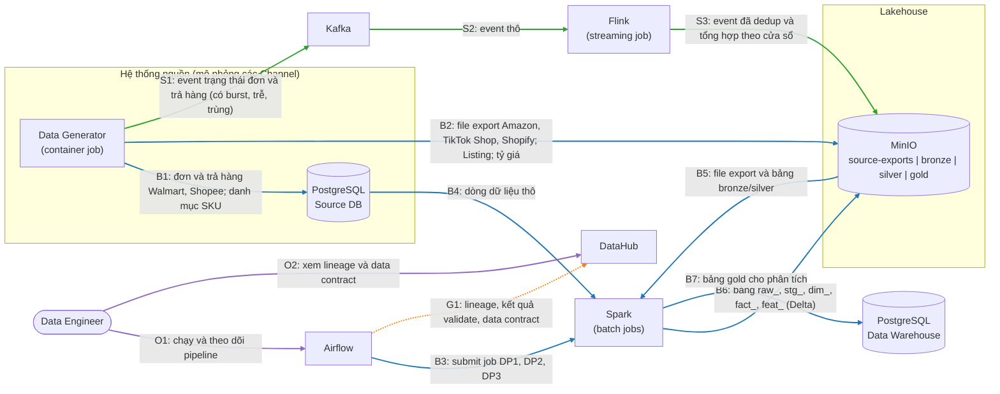

# FSDS: Nền tảng dữ liệu đa kênh cho Seller thương mại điện tử

Data platform gom dữ liệu bán hàng của một Seller trên 5 nền tảng thương mại điện tử (Amazon, TikTok Shop, Shopify, Walmart, Shopee) vào một lakehouse, phục vụ bài toán dự đoán khả năng trả hàng. Toàn bộ dữ liệu được sinh giả lập.

> **Trạng thái**: đang triển khai Data Generator (tiến độ xem [docs/generator-design.md](docs/generator-design.md#15-triển-khai)). Các phần khác, công nghệ và cấu hình trong tài liệu này vẫn là **dự kiến**.

## Mục lục

1. [Giới thiệu business domain](#1-giới-thiệu-business-domain)
2. [Kiến trúc tổng thể](#2-kiến-trúc-tổng-thể)
3. [Công nghệ](#3-công-nghệ)
4. [Dữ liệu và Data Generator](#4-dữ-liệu-và-data-generator)
5. [Repo Structure](#5-repo-structure)
6. [Tài liệu chi tiết](#6-tài-liệu-chi-tiết)
7. [Lộ trình](#7-lộ-trình)

## 1. Giới thiệu business domain

Dự án **không** xây một sàn thương mại điện tử. Dự án xây hệ thống dữ liệu của **một Seller** bán trên nhiều sàn cùng lúc. Mỗi sàn trả dữ liệu theo định dạng, trạng thái đơn và tiền tệ riêng, nên Seller cần một nơi thống nhất để phân tích và dự đoán.

Ví dụ: công ty ACME bán áo hoodie trên Amazon, TikTok Shop, Shopify, Walmart và Shopee. Hệ thống gom dữ liệu của cả 5 nơi về một mô hình chung.

| Thuật ngữ | Nghĩa |
|---|---|
| **Seller** | Người bán duy nhất mà hệ thống phục vụ |
| **Channel** | Nền tảng bán hàng bên ngoài (Amazon, TikTok Shop, Shopify, Walmart, Shopee) |
| **Marketplace** | Gian hàng theo quốc gia trong một Channel, ví dụ Amazon DE (không phải Channel nào cũng có) |
| **Storefront** | Chỗ cụ thể Seller bán hàng = Channel + Marketplace nếu có |
| **SKU** | Mã sản phẩm do Seller đặt, dùng chung xuyên Channel |
| **Listing** | Bản đăng bán của một SKU trên một Storefront |
| **Order / Order Line** | Đơn Channel giao cho Seller xử lý, và từng dòng sản phẩm trong đơn |

**Phạm vi**: 7 Storefront (Amazon US/UK/DE, TikTok Shop US, Shopify, Walmart US, Shopee VN). Amazon được mô hình hóa sâu nhất, bốn Channel còn lại mô hình hóa phần chung.

**Bài toán dự đoán**: một Order Line có bị Return hoặc Refund trong 30 ngày sau khi giao hay không. Các Channel giấu hoặc không cấp định danh người mua dùng chung được, nên feature được tra cứu theo `sku_id` + `storefront_id` thay vì theo khách hàng. Nhãn đến sau 30 ngày, nên việc giám sát drift phải làm khi chưa có đáp án thật.

Chi tiết xem [docs/Domain.md](docs/Domain.md).

## 2. Kiến trúc tổng thể

Sơ đồ triển khai cấp cao của module data engineering. Mỗi hộp là một **deployable unit**. Các thành phần không thể triển khai độc lập (như thư viện Delta Lake) không xuất hiện trên sơ đồ. Mũi tên đi theo chiều dữ liệu, nhãn trên mũi tên là dữ liệu truyền đi. Riêng mũi tên "gọi" không truyền dữ liệu (trigger, thao tác của người dùng) đi từ bên gọi tới bên được gọi.



**Chú giải**: xanh dương = luồng batch (B), xanh lá = luồng streaming (S), cam nét đứt = luồng governance (G), tím = luồng người dùng (O). Mỗi luồng đánh số riêng.

### Deployable units

| Unit | Vai trò |
|---|---|
| Data Generator | Sinh dữ liệu giả lập theo cấu hình, ghi vào Source DB, MinIO và Kafka |
| PostgreSQL (Source DB) | Mô phỏng hệ thống của một bộ phận khác, nơi dữ liệu nằm trước khi kéo về Bronze |
| Kafka | Bus cho luồng event trạng thái đơn và trả hàng |
| Flink | Xử lý streaming: dedup, late arrival, burst, window |
| Spark | Xử lý batch: các job cho DP1, DP2, DP3 |
| Airflow | Điều phối pipeline, giữ connection và variable dùng chung |
| MinIO | Object storage của lakehouse (Bronze, Silver, Gold) |
| PostgreSQL (Data Warehouse) | Kho dữ liệu cho phân tích, có index |
| DataHub | Metadata, lineage và data contract |

### Các pipeline

| Pipeline | Nội dung |
|---|---|
| **DP1** | Ingest dữ liệu thô từ nguồn vào Bronze, kèm bước validate |
| **DP2** | Từ Bronze sang Silver và Gold, kèm bước validate |
| **DP3** | Tính bảng feature offline (ví dụ `feat_sku_return_rate_90d`), kèm bước validate |

## 3. Công nghệ

| Vai trò | Công nghệ | Ghi chú |
|---|---|---|
| Đóng gói | Docker, Docker Compose | Tối ưu image (multi-stage build) |
| Batch | Apache Spark | Xử lý skew, high cardinality, schema evolution |
| Streaming | Apache Kafka, Apache Flink | Xử lý burst, late arrival, duplicate, window |
| Điều phối | Apache Airflow | |
| Lakehouse | MinIO + Delta Lake | Compaction, z-order, partitioning |
| Data Warehouse | PostgreSQL | Indexing |
| Governance | DataHub | Lineage, validation, data contract |

Các lựa chọn này là dự kiến và có thể thay đổi trong quá trình triển khai.

## 4. Dữ liệu và Data Generator

Generator tạo dữ liệu theo cấu hình. Ví dụ cấu hình dự kiến:

```yaml
scale:
  n_skus: 2000
  days_history: 180
  orders_per_day: 4000        # trên toàn bộ 7 Storefront
storefront_weights:
  amazon_us: 0.45
  tiktok_shop_us: 0.15
  amazon_uk: 0.12
  amazon_de: 0.10
  shopify: 0.08
  walmart_us: 0.07
  shopee_vn: 0.03
```

Quy mô kết quả: khoảng 720 nghìn Order và hơn 1 triệu Order Line. Cấu hình đầy đủ xem [docs/generator-design.md](docs/generator-design.md#10-cấu-hình).

Các vấn đề dữ liệu được mô phỏng:

| Vấn đề | Cách mô phỏng |
|---|---|
| Skew | Tỷ trọng Storefront lệch, vài SKU chiếm phần lớn doanh số, 8 danh mục với tỷ lệ trả hàng khác nhau |
| High cardinality | Khoảng 720 nghìn mã Order, hơn 1 triệu mã Order Line, mã vận đơn, mã buyer theo Channel |
| Schema evolution | Dữ liệu đơn Amazon chuyển từ Orders v0 sang Orders 2026-01-01 giữa chừng (đổi tên, đổi cấu trúc, thêm field) |
| Duplicate offline | Khoảng 2% dòng trùng do export chồng lấn ngày, có cả bản sửa lại |
| Duplicate, burst, late arrival | Đặc tính riêng của từng Channel trong luồng streaming |
| Data drift | Đợt sale lớn và livestream làm tỷ lệ trả hàng đổi mà feature vẫn trông bình thường |

Chạy môi trường nguồn giả lập (MinIO, PostgreSQL) và sinh dữ liệu vào đó:

```bash
cp .env.example .env
docker compose up -d                                   # MinIO, PostgreSQL, sinh Batch, nạp PostgreSQL
uv run python -m generator report --source ./out/small # báo cáo chất lượng dữ liệu (skew, cardinality, ...)
```

Chi tiết cách chạy và số liệu tối ưu image xem [docs/Docker.md](docs/Docker.md). Kết quả đo chất lượng của lần chạy đầy đủ xem [docs/generator-design.md](docs/generator-design.md#kết-quả-chạy).

## 5. Repo Structure

Cấu trúc dự kiến. Thư mục nào chưa tồn tại sẽ được tạo khi triển khai.

```
.
├── README.md              # Tài liệu tổng quan này
├── docs/                  # Toàn bộ tài liệu chi tiết, kèm ảnh chụp minh họa
├── generator/             # Data Generator: sinh dữ liệu batch và streaming theo cấu hình
├── configs/               # File cấu hình YAML của generator (small để thử, default đủ quy mô)
├── notebooks/             # Notebook báo cáo chất lượng dữ liệu (output xóa trước khi commit)
├── jobs/
│   ├── spark/             # Các job Spark cho DP1, DP2, DP3
│   └── flink/             # Job Flink xử lý luồng event
├── dags/                  # Airflow DAG cho DP1, DP2, DP3
├── docker/                # Dockerfile phụ (bản chưa tối ưu để so dung lượng)
├── Dockerfile             # Image tối ưu của generator (multi-stage)
├── docker-compose.yml     # MinIO, PostgreSQL và các bước sinh, nạp dữ liệu
├── .env.example           # Mẫu biến môi trường cho Compose (mật khẩu, cổng)
├── sql/                   # DDL cho bảng ở các zone và Data Warehouse
├── tests/                 # Unit test
└── pyproject.toml         # Thư viện Python của dự án (quản lý bằng uv)
```

## 6. Tài liệu chi tiết

| Tài liệu | Nội dung |
|---|---|
| [docs/Domain.md](docs/Domain.md) | Business domain, thuật ngữ, bài toán dự đoán, vấn đề dữ liệu cần mô phỏng |
| [docs/generator-design.md](docs/generator-design.md) | Thiết kế Data Generator: kiến trúc, đường thời gian Batch và Stream, vấn đề dữ liệu, nơi lưu, cấu hình, bằng chứng chất lượng |
| [docs/channel-sources.md](docs/channel-sources.md) | Nguồn tài liệu và mức tin cậy của dạng dữ liệu từng Channel |
| [docs/Docker.md](docs/Docker.md) | Docker Compose của môi trường nguồn, tối ưu dung lượng image generator |

Các tài liệu sau sẽ được bổ sung cùng phần triển khai tương ứng: tối ưu Spark và Flink, tối ưu lưu trữ, thiết kế schema, Orchestration, Governance.

## 7. Lộ trình

Module data engineering (tài liệu này) là nền cho phần mở rộng ở giai đoạn sau: Feature Store (Feast), huấn luyện và versioning mô hình, serving, drift detection, CI/CD, observability, và các thành phần RAG/Agent. Sơ đồ ở mục 2 sẽ được mở rộng khi các phần đó được thiết kế.
