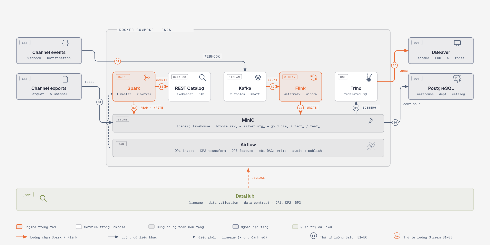
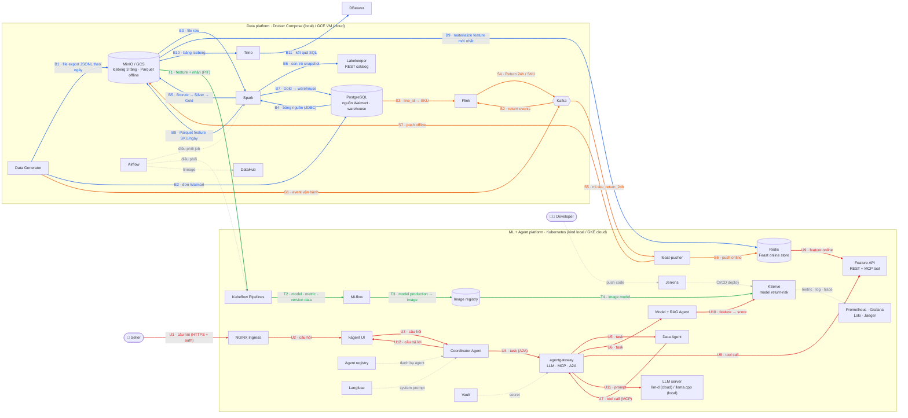

# FSDS: Nền tảng dữ liệu đa kênh cho Seller thương mại điện tử

Data platform gom dữ liệu bán hàng của một Seller trên 5 nền tảng thương mại điện tử (Amazon, TikTok Shop, Shopify, Walmart, Shopee) vào một lakehouse, phục vụ bài toán dự đoán khả năng trả hàng. Toàn bộ dữ liệu được sinh giả lập.

> **Trạng thái**: Data Generator, Bronze/Silver/Gold năm Channel, DP1/DP2, DP3 feature, các job Flink (baseline, late arrival, dedup, window) và hai ý tưởng Novel (Trino federation, Debezium CDC có kafka-ui) đã có bằng chứng chạy. Amazon SCD2 đã được kiểm tra. DataHub đã ghi lineage và 15 kết quả Validate, có ảnh UI cho DP1/DP2/DP3; xem [bằng chứng DataHub](docs/datahub.md) và [tiến độ theo rubric](docs/de-progress.md).

> **Kế hoạch mở rộng đã chốt 2026-10-17:** xem [plan tổng](docs/high-level-architecture-plan.md), [acceptance ledger](docs/de-acceptance-ledger.md) và [điều kiện triển khai](docs/implementation-readiness.md). Bằng chứng DE bên trên là các run local có phạm vi riêng; chưa chứng minh nguồn chung năm Channel, Feast/ML/agent hoặc triển khai GCP. Novel ideas cho kế hoạch mới theo Q51 trong ledger; các proof cũ được giữ làm tham chiếu.

Discovery tiếp 2026-10-18: policy chốt tới Q61, bổ sung sales sau partial cancel và nguồn Seller operational giả lập. Xem [scope/impact](docs/expanded-scope-design.md), [contract nhãn v2](docs/return-label-contract.md) và [source contract v2](docs/source-contract-order-lifecycle.md); chưa có pipeline/proof đầu cuối cho phần mở rộng.

Rà tích hợp tiếp: [sổ IR01–IR25](docs/integration-risk-register.md) ghi lỗi
resume generator đã sửa cùng regression test, CDC/feature validation được
củng cố; [bản xử lý](docs/audit-remediation-20261018.md) ghi phạm vi test.
[Publication contract](docs/run-publication-contract.md) cụ thể hóa phần
còn cần implement/POC. Chưa thao tác Cloud hoặc sinh lại nguồn lớn.

Chuẩn bị AWS mốc 1 (DE batch trên EC2 + S3): xem
[rà soát sẵn sàng ngày 2026-10-22](docs/aws-readiness-20261022.md).
Đã kiểm offline; chưa triển khai AWS. Phần MLE/EKS chưa có gói triển khai tương ứng.

## Mục lục

1. [Giới thiệu business domain](#1-giới-thiệu-business-domain)
2. [Kiến trúc tổng thể](#2-kiến-trúc-tổng-thể)
3. [Công nghệ](#3-công-nghệ)
4. [Dữ liệu và Data Generator](#4-dữ-liệu-và-data-generator)
5. [Repo Structure](#5-repo-structure)
6. [Tài liệu chi tiết](#6-tài-liệu-chi-tiết)
7. [Lộ trình](#7-lộ-trình)

## 1. Giới thiệu business domain

Dự án **không** xây một sàn thương mại điện tử. Dự án xây hệ thống dữ liệu của **một Seller** bán trên nhiều sàn cùng lúc. Mỗi sàn trả dữ liệu theo định dạng, trạng thái đơn và tiền tệ riêng, nên Seller cần một nơi thống nhất để phân tích và dự đoán.

Ví dụ: công ty ACME bán áo hoodie trên Amazon, TikTok Shop, Shopify, Walmart và Shopee. Hệ thống gom dữ liệu của cả 5 nơi về một mô hình chung.

| Thuật ngữ | Nghĩa |
|---|---|
| **Seller** | Người bán duy nhất mà hệ thống phục vụ |
| **Channel** | Nền tảng bán hàng bên ngoài (Amazon, TikTok Shop, Shopify, Walmart, Shopee) |
| **Marketplace** | Gian hàng theo quốc gia trong một Channel, ví dụ Amazon DE (không phải Channel nào cũng có) |
| **Storefront** | Chỗ cụ thể Seller bán hàng = Channel + Marketplace nếu có |
| **SKU** | Mã sản phẩm do Seller đặt, dùng chung xuyên Channel |
| **Listing** | Bản đăng bán của một SKU trên một Storefront |
| **Order / Order Line** | Đơn Channel giao cho Seller xử lý, và từng dòng sản phẩm trong đơn |

**Phạm vi**: 7 Storefront (Amazon US/UK/DE, TikTok Shop US, Shopify, Walmart US, Shopee VN). Amazon được mô hình hóa sâu nhất, bốn Channel còn lại mô hình hóa phần chung.

**Bài toán dự đoán**: một Order Line có bị Return hoặc Refund trong 30 ngày sau khi giao hay không. Các Channel giấu hoặc không cấp định danh người mua dùng chung được, nên feature được tra cứu theo `sku_id` + `storefront_id` thay vì theo khách hàng. Nhãn đến sau 30 ngày, nên việc giám sát drift phải làm khi chưa có đáp án thật.

Chi tiết xem [docs/Domain.md](docs/Domain.md).

## 2. Kiến trúc tổng thể



Sơ đồ triển khai cấp cao của module data engineering. Mỗi hộp là một **deployable
unit** — thứ chạy được thành một container riêng. Thư viện không triển khai độc lập
được (Iceberg là format bảng, không phải service) không xuất hiện trên sơ đồ.

Cách đọc sơ đồ:

- **Nhãn trên mũi tên là dữ liệu truyền đi**, không phải tên thao tác.
- **Luồng Batch đánh số `B1→B6`, luồng Stream đánh số `S1→S3`** theo đúng thứ tự
  chạy. Đọc lần lượt theo số là đi hết một vòng dữ liệu.
- **Các mũi tên nét đứt không phải luồng dữ liệu**: chúng biểu diễn điều phối
  (Airflow submit job cho Spark) và metadata/lineage (publisher gửi metadata sang DataHub).
- Khung `DOCKER COMPOSE · FSDS` bao quanh phần tự dựng bằng Compose. DBeaver và
  Channel là bên ngoài; PostgreSQL được đặt sát biên để gọn sơ đồ nhưng vẫn là
  service Compose, như `docker-compose.yml` khai báo.

**PostgreSQL vẽ một lần** vì nó kiêm ba vai: nguồn của Walmart, warehouse và
backend của REST Catalog. Walmart đi thẳng từ PostgreSQL qua JDBC vào Spark;
luồng file trên sơ đồ thể hiện nguồn được phân phối qua MinIO. Trong các run
bằng chứng hiện có, Amazon đọc mount `/data/raw`, ba Channel file khác đọc
mount `out/channels-small`; MinIO lưu các bảng Iceberg đầu ra. Phạm vi runtime
và đường dẫn được ghi trong [Airflow](docs/airflow.md).

Bản vector để phóng to hoặc đưa vào slide: [`docs/diagrams/architecture.svg`](docs/diagrams/architecture.svg).
Bản dựng gốc: [`docs/diagrams/architecture.html`](docs/diagrams/architecture.html).

### Sơ đồ toàn hệ thống (DE + MLE)

Cùng luật vẽ với sơ đồ trên, gộp cả hai module. Mỗi luồng một màu, đánh số riêng từ 1:

| Màu | Luồng | Ai dùng |
|---|---|---|
| Xanh dương `B1→B11` | Batch: nguồn → lakehouse → warehouse → feature offline → online | Developer |
| Cam `S1→S7` | Stream: event → Flink → stream feature → Feast (online + offline) | Developer |
| Xanh lá `T1→T4` | Train và deploy model: Kubeflow → MLflow → image → KServe | Developer |
| Đỏ `U1→U12` | Seller hỏi qua UI chat → Coordinator → 2 agent → feature, model, LLM | Seller (người dùng cuối) |
| Xám nét đứt | Điều phối, lineage, CI/CD, secret, prompt, giám sát — không phải luồng chính | — |

Khung trên chạy bằng Docker Compose ở local và trên VM GCE ở cloud; khung dưới là Kubernetes
(`kind` ở local, GKE ở cloud). Một số unit khung dưới (Vault, Jenkins, Langfuse, quan sát,
NGINX) là đích của rubric `mle`, chưa dựng xong; trạng thái từng phần ở các tài liệu `mle-*`.
Ảnh tĩnh: [`docs/diagrams/architecture-overall.png`](docs/diagrams/architecture-overall.png),
nguồn: [`architecture-overall.mmd`](docs/diagrams/architecture-overall.mmd), bản sửa kéo-thả:
[`architecture-overall.excalidraw`](docs/diagrams/architecture-overall.excalidraw) (mở bằng excalidraw.com → Open).



### Deployable units

| Unit | Vai trò |
|---|---|
| Data Generator | Sinh dữ liệu giả lập theo cấu hình, ghi vào MinIO, PostgreSQL và Kafka |
| MinIO | Object storage của lakehouse — bảng Iceberg ba tầng Bronze, Silver, Gold |
| REST Catalog (Lakekeeper) | Giữ con trỏ tới snapshot Iceberg hiện hành; Spark, Flink và Trino đều đi qua đây |
| Kafka | Bus cho luồng event trạng thái đơn và trả hàng |
| Spark | Xử lý batch: skew, high cardinality, schema evolution, dedup |
| Flink | Xử lý streaming: dedup, late arrival, burst, window |
| Trino | Query liên nguồn — một câu SQL đọc được cả lakehouse lẫn PostgreSQL |
| Airflow | Điều phối Ingest/Build → Validate của DP1/DP2/DP3 |
| PostgreSQL | Kiêm ba vai: data warehouse (có index), DB phòng ban khác, backend của catalog |
| DataHub | Metadata, lineage và assertion validation |
| DBeaver | Công cụ chạy trên máy, nối Trino để xem schema và ERD của cả ba tầng |

### Các pipeline

| Pipeline | Nội dung |
|---|---|
| **DP1** | Ingest dữ liệu thô từ nguồn vào Bronze, kèm bước validate |
| **DP2** | Từ Bronze sang Silver và Gold, kèm bước validate |
| **DP3** | Tính bảng feature offline (ví dụ `feat_sku_return_rate_90d`), kèm bước validate |

## 3. Công nghệ

| Vai trò | Công nghệ | Ghi chú |
|---|---|---|
| Đóng gói | Docker, Docker Compose | Tối ưu image (multi-stage build) |
| Batch | Apache Spark | Xử lý skew, high cardinality, schema evolution |
| Streaming | Apache Kafka, Apache Flink | Xử lý burst, late arrival, duplicate, window |
| Điều phối | Apache Airflow | |
| Lakehouse | MinIO + Apache Iceberg | Partitioning và compaction đã đo; xem [quyết định kiến trúc](docs/architecture-decisions.md) |
| Catalog | Lakekeeper (Iceberg REST) | Catalog cho cả Spark, Flink và Trino |
| Query liên nguồn | Trino | Một cửa sổ SQL thấy cả lakehouse lẫn PostgreSQL |
| Data Warehouse | PostgreSQL | Indexing |
| Governance | DataHub | Lineage và assertion validation |

Các thành phần trong bảng đã được triển khai ở phạm vi bằng chứng mô tả trong
[tiến độ DE](docs/de-progress.md); một số giới hạn về cỡ dữ liệu và cấu hình
vận hành vẫn được ghi ở đó.

## 4. Dữ liệu và Data Generator

Generator tạo dữ liệu theo cấu hình. Ví dụ cấu hình mặc định:

```yaml
scale:
  n_skus: 2000
  days_history: 180
  orders_per_day: 4000        # trên toàn bộ 7 Storefront
storefront_weights:
  amazon_us: 0.45
  tiktok_shop_us: 0.15
  amazon_uk: 0.12
  amazon_de: 0.10
  shopify: 0.08
  walmart_us: 0.07
  shopee_vn: 0.03
```

Quy mô kết quả: khoảng 720 nghìn Order và hơn 1 triệu Order Line. Cấu hình đầy đủ xem [docs/generator-design.md](docs/generator-design.md#10-cấu-hình).

Các vấn đề dữ liệu được mô phỏng:

| Vấn đề | Cách mô phỏng |
|---|---|
| Skew | Tỷ trọng Storefront lệch, vài SKU chiếm phần lớn doanh số, 8 danh mục với tỷ lệ trả hàng khác nhau |
| High cardinality | Khoảng 720 nghìn mã Order, hơn 1 triệu mã Order Line, mã vận đơn, mã buyer theo Channel |
| Schema evolution | Dữ liệu đơn Amazon chuyển từ Orders v0 sang Orders 2026-01-01 giữa chừng (đổi tên, đổi cấu trúc, thêm field) |
| Duplicate offline | Khoảng 2% dòng trùng do export chồng lấn ngày, có cả bản sửa lại |
| Duplicate, burst, late arrival | Đặc tính riêng của từng Channel trong luồng streaming |
| Data drift | Đợt sale lớn và livestream làm tỷ lệ trả hàng đổi mà feature vẫn trông bình thường |

Chạy môi trường nguồn giả lập (MinIO, PostgreSQL) và sinh dữ liệu vào đó:

```bash
cp .env.example .env
docker compose up -d                                   # MinIO, PostgreSQL, sinh Batch, nạp PostgreSQL
uv run python -m generator report --source ./out/small # báo cáo chất lượng dữ liệu (skew, cardinality, ...)
```

Image của generator được tối ưu từ **2,35 GB xuống 677 MB** (giảm 71%) nhờ multi-stage build, base image `python:3.12-slim` và không giữ cache cài đặt. Chi tiết cách chạy và cách đo xem [docs/Docker.md](docs/Docker.md). Kết quả đo chất lượng của lần chạy đầy đủ xem [docs/generator-design.md](docs/generator-design.md#kết-quả-chạy).

## 5. Repo Structure

Các thư mục mã nguồn, cấu hình và tài liệu công khai (không liệt kê dữ liệu
sinh ra, cache hay ghi chú cá nhân bị Git bỏ qua):

```text
.
├── .github/               # Cấu hình CI của repository
│   └── workflows/         # Workflow kiểm tra tự động
├── configs/               # Profile generator và chính sách bảo trì Iceberg
├── contracts/             # Registry hợp đồng dữ liệu và luật schema evolution
│   └── schemas/           # Schema seller-source-v2 và sim-native-v2
├── dags/                  # Airflow DP1/DP2/DP3, pipeline v2, CDC và bảo trì
├── docker/                # Dockerfile Airflow/Flink, image so sánh và override DataHub
├── docs/                  # Tài liệu thiết kế, vận hành, kiểm chứng và rubric
│   ├── diagrams/          # Sơ đồ kiến trúc và schema (HTML/SVG/PNG/Markdown)
│   ├── evidence/          # Receipt, log, metric và bằng chứng Spark UI
│   └── images/            # Ảnh minh họa và ảnh chụp bằng chứng theo thành phần
├── flink_jobs/            # SQL streaming baseline, late arrival, dedup và window
│   ├── order_snapshots/   # SQL streaming snapshots
│   └── order_lifecycle/   # Template streaming lifecycle và kết quả đối chiếu
├── generator/             # Sinh nguồn batch/stream giả lập và fixture nguồn v2
│   ├── channels/          # Renderer định dạng riêng của từng Channel
│   ├── core/              # Mô hình nghiệp vụ, định danh và logic sinh dữ liệu chung
│   └── delivery/          # Xuất dữ liệu và mô phỏng đặc tính phân phối
├── infra/                 # Cấu hình hạ tầng triển khai
│   └── gcp/               # Terraform và Ansible cho môi trường GCP
├── scripts/               # Script hỗ trợ theo công việc
│   ├── setup/             # Bootstrap và cấu hình
│   ├── run/               # Chạy pipeline và publish metadata
│   └── evidence/          # Thu bằng chứng và đo đạc
├── spark_jobs/            # Entrypoint theo tầng: bronze/silver/gold/cdc/warehouse/maintenance/measure
│   └── lib/               # Helper dùng chung, gồm data_contracts/ cho cổng contract
├── sql/                   # DDL và SQL phục vụ lakehouse/warehouse
│   └── warehouse_lifecycle/      # Bảng và index PostgreSQL cho Gold v2
├── tests/
│   ├── unit/              # Unit test offline (pytest mặc định)
│   ├── spark/             # Suite cần Spark, planner chạy riêng
│   └── harness/           # Docker runner stream/CDC/đầu-cuối
├── trino/                 # Cấu hình truy vấn liên nguồn
│   └── catalog/           # Connector Iceberg REST và PostgreSQL
├── README.md              # Tổng quan, cấu trúc và chỉ mục tài liệu
├── GLOSSARY.md            # Thuật ngữ dùng chung của dự án
├── Dockerfile             # Image generator tối ưu bằng multi-stage build
├── docker-compose.yml     # Môi trường nguồn, xử lý và governance local
├── docker-compose.gcp.yml # Override Compose cho runtime GCP
├── .env.example           # Mẫu biến môi trường Compose
├── .pre-commit-config.yaml # Kiểm tra trước commit
├── pyproject.toml         # Dependency Python và cấu hình pytest
├── uv.lock                # Khóa phiên bản dependency bằng uv
└── requirements.lock      # Dependency đã khóa cho image/runtime
```

Helper dùng import đầy đủ, ví dụ `from spark_jobs.lib.return_label import label_line`.
Driver và worker dùng `PYTHONPATH=/opt` khi mount package tại `/opt/spark_jobs`;
harness dùng `PYTHONPATH=/workspace`. Job có Python RDD gửi zip toàn package tới worker.
Wheel generator giữ riêng `generator`, không thêm PySpark vào unit dependencies.

## 6. Tài liệu chi tiết

| Tài liệu | Nội dung |
|---|---|
| [Plan tổng](docs/high-level-architecture-plan.md) | Phạm vi hiện hành Q1–Q51, phase P1–P4 và ràng buộc Cloud |
| [Discovery mở rộng](docs/plan-expansion-discovery.md) | 15 nhánh khảo sát, research gốc và Q52–Q55 đã chốt |
| [Thiết kế scope bổ sung](docs/expanded-scope-design.md) | Impact Q52–Q59, quantity trace, S19–S30 và policy đã chốt |
| [Contract nhãn v2](docs/return-label-contract.md) | Event/known-time, allocation windows, maturity/correction, L01–L17 và migration |
| [Điều kiện triển khai](docs/implementation-readiness.md) | Contract, gate G0–G4, scenario và tiêu chí evidence trước full-scale |
| [Acceptance ledger](docs/de-acceptance-ledger.md) | Rubric DE/MLE hiện hành, mapping phase/proof và quy cách nghiệm thu |
| [ADR index](docs/adr/README.md) | Quyết định và quan hệ thay thế, dẫn chiếu theo tên file đầy đủ |
| [docs/architecture-decisions.md](docs/architecture-decisions.md) | Kiến trúc DE đã triển khai, vai trò Iceberg/REST catalog và warehouse |
| [docs/terminology.md](docs/terminology.md) | Thuật ngữ nghiệp vụ và định nghĩa Bronze/Silver/Gold |
| [docs/code-style.md](docs/code-style.md) | Quy ước viết code và chú thích; ruff format/lint |
| [docs/Domain.md](docs/Domain.md) | Business domain, thuật ngữ, bài toán dự đoán, vấn đề dữ liệu cần mô phỏng |
| [docs/generator-design.md](docs/generator-design.md) | Thiết kế Data Generator: kiến trúc, đường thời gian Batch và Stream, vấn đề dữ liệu, nơi lưu, cấu hình, bằng chứng chất lượng |
| [docs/channel-sources.md](docs/channel-sources.md) | Nguồn tài liệu và mức tin cậy của dạng dữ liệu từng Channel |
| [docs/Docker.md](docs/Docker.md) | Docker Compose của môi trường nguồn, tối ưu dung lượng image generator |
| [docs/spark.md](docs/spark.md) | Tối ưu Spark Bronze: baseline, chuỗi tối ưu, ảnh Spark UI và tích hợp Airflow |
| [docs/silver.md](docs/silver.md) | Tầng Silver: hai bảng `stg_*` theo kênh, độ hạt Order Line, khoá dedup, kiểu dữ liệu, số đo lần chạy thật, và quyết định chuyển tiếp sang Gold |
| [docs/silver-five-channels.md](docs/silver-five-channels.md) | Silver cho đủ năm Channel: mapping, số đo và kiểm tra dữ liệu |
| [docs/airflow.md](docs/airflow.md) | DP1/DP2/DP3 trên Airflow, kiểm cấu hình runtime và ảnh Graph/Grid |
| [docs/flink.md](docs/flink.md) | Baseline, watermark, keyed state/dedup và window với kết quả đã đo |
| [docs/trino.md](docs/trino.md) | Trino federation giữa Iceberg và PostgreSQL |
| [docs/gold.md](docs/gold.md) | Gold fact năm Channel, Amazon SCD2, feature offline và bảng nhãn Walmart |
| [docs/gold-design.md](docs/gold-design.md) | Quyết định thiết kế Gold và SCD2 đã chốt |
| [docs/schema.md](docs/schema.md) | Sơ đồ bảng Bronze/Silver/Gold và quan hệ fact–dim đã kiểm qua Trino |
| [docs/storage.md](docs/storage.md) | Compaction Iceberg và index PostgreSQL với phép đo trước/sau |
| [Nguồn chung v2](docs/source-contract-order-lifecycle.md) | Contract nguồn native/operational, identity, coverage và horizon |
| [Fixture nguồn v2](docs/source-order-lifecycle-fixtures.md) | Profile và cách kiểm fixture nguồn chung |
| [Quy mô nguồn v2](docs/source-order-lifecycle-scale.md) | Sinh nguồn theo profile scale và kiểm manifest |
| [Spark v2](docs/spark-order-lifecycle.md) | Baseline và phép đo xử lý skew trên workload lifecycle |
| [Silver v2](docs/silver-order-lifecycle.md) | Lifecycle, allocation, đối soát và coverage receipt |
| [Gold v2](docs/gold-order-lifecycle.md) | Fact, dimension, feature và validation v2 |
| [Warehouse v2](docs/warehouse-order-lifecycle.md) | Export PostgreSQL, index và đo EXPLAIN |
| [Streaming v2](docs/stream-order-lifecycle.md) | Template Flink và đối chiếu kết quả với nguồn v2 |
| [CDC v2](docs/cdc-order-lifecycle.md) | Bootstrap, boundary, mutation và kiểm CDC Walmart v2 |
| [Airflow v2](docs/airflow-order-lifecycle.md) | Điều phối pipeline và receipt theo run |
| [DataHub v2](docs/datahub-order-lifecycle.md) | Publish lineage và assertion của pipeline v2 |
| [Kiểm đầu-cuối local v2](docs/e2e-order-lifecycle-local.md) | Runner nguồn → lakehouse → PostgreSQL và giới hạn bằng chứng |
| [DE lane 2026-10-18](docs/plan-de-lane-20261018.md) | Phạm vi bàn giao nguồn v2, artifact và kết quả kiểm local |
| [DE scope mở rộng (v2)](docs/de-order-lifecycle-status.md) | Bảng một trang: từng gói v2 (nguồn, Silver, Gold, warehouse, stream, CDC, DAG), tài liệu, kết quả local và GCP |
| [Triển khai GCP](docs/gcp-checklist.md) | Các bước người học tự chạy trên GCP; chi tiết ở [gcp-deploy](docs/gcp-deploy.md) và [gcp-runtime](docs/gcp-runtime.md) |
| [Sẵn sàng DE lên GCP](docs/de-gcp-readiness-20261020.md) | Checklist trước triển khai, đối chiếu 38 tiêu chí DE và thứ tự nghiệm thu batch, scale, streaming |
| [Ma trận rubric MLE](docs/mle-rubric-matrix.md) | Từng dòng rubric `mle` với artifact, bằng chứng, phần còn chờ GCP/learner |
| [MLE: kho feature Feast](docs/mle-feature-store.md) | Feature SKU theo ngày: Parquet offline → Redis online trong cụm kind, DAG materialize tăng dần |
| [MLE: stream feature](docs/mle-stream-feature.md) | Flink đếm Return 24h theo SKU → Kafka → Feast push vào Redis và Parquet offline |
| [MLE: Web API](docs/mle-web-api.md) | FastAPI + pydantic đọc feature online của SKU từ Feast, healthcheck cho k8s |
| [MLE: agent platform](docs/mle-agents.md) | LLM llama.cpp (thay llm-d ở local), agentgateway (LLM/MCP/A2A), kagent và Data Agent |
| [MLE: RAG](docs/mle-rag.md) | Chunk tài liệu chính sách → embedding → Feast (pgvector), truy vấn tài liệu cho agent |
| [MLE: train model](docs/mle-training.md) | Kubeflow 5 bước (Feast offline → LightGBM → MLflow), gate production theo baseline |
| [MLE: serve model](docs/mle-serving.md) | KServe RawDeployment, model nằm trong image, tự đọc feature online, abstain khi thiếu lịch sử |
| [MLE Novel ML-N2: drift](docs/mle-drift.md) | Evidently phát hiện đợt Sale làm lệch cơ cấu SKU; lô ổn định không cảnh báo |
| [MLE Novel ML-N1: agent eval](docs/mle-agent-eval.md) | Chấm câu trả lời agent bằng số thật từ Feature API, cổng chặn CI; A 100% vs B 91,7% |
| [MLE: Vault](docs/mle-vault.md) | Secret tập trung ở HashiCorp Vault, token CI chỉ-đọc, script đọc secret từ Vault |
| [MLE: CI/CD Jenkins](docs/mle-cicd.md) | Jenkins cấu hình bằng code, 4 pipeline, secret lấy từ Vault |
| [MLE: gateway](docs/mle-gateway.md) | NGINX Ingress: HTTPS cho Web API (sslip.io + cert-manager), basic auth + rate limit cho UI agent |
| [MLE: A/B test](docs/mle-ab-test.md) | agentgateway chia 50/50 giữa hai bản LLM và hai bản Data Agent, theo dõi trên Grafana |
| [MLE: Terraform GKE](infra/gcp/terraform-gke/README.md) | Cụm GKE zonal 0..2 × e2-standard-4 + Artifact Registry, state tách khỏi VM DE (đã validate, chưa apply) |
| [DE-N1: data contracts](docs/novel-de-n1-data-contracts.md) | Registry schema, luật tiến hóa và cổng cách ly đầu Silver v2 |
| [DE-N2: Iceberg tự bảo trì](docs/novel-de-n2-iceberg-maintenance.md) | Chính sách compact/z-order/expire/orphan dry-run, giữ tag `gen-*`, retry lỗi tạm |
| [docs/novel-ideas.md](docs/novel-ideas.md) | Kế hoạch đo và kết quả hai ý tưởng Novel |
| [docs/cdc.md](docs/cdc.md) | Debezium CDC cho nguồn Walmart và cách đo thay đổi từ PostgreSQL đến Kafka |
| [docs/datahub.md](docs/datahub.md) | Lineage và assertion validation trên UI DataHub cho DP1/DP2/DP3 |
| [docs/de-progress.md](docs/de-progress.md) | Trạng thái artifact/bằng chứng đối chiếu rubric DE |
| [docs/de-rubric-matrix.md](docs/de-rubric-matrix.md) | Đối chiếu 38 dòng rubric với artifact và proof |
| [docs/de-audit-20261015.md](docs/de-audit-20261015.md) | Ba phát hiện rà soát và kết quả đóng bằng chứng |
| [docs/data-quality-report-batch.md](docs/data-quality-report-batch.md) | Báo cáo chất lượng dữ liệu của generator phần Batch, đối chiếu từng dòng rubric với số đo và ảnh chụp |
| [docs/data-quality-report-stream.md](docs/data-quality-report-stream.md) | Báo cáo phần Stream: trễ, lệch thứ tự, trùng, burst livestream, và số tin trong Kafka |

Phạm vi và các bằng chứng còn lại được theo dõi trong [tiến độ DE](docs/de-progress.md).

## 7. Lộ trình

Lộ trình hiện hành nằm trong [plan tổng](docs/high-level-architecture-plan.md):
P1 nguồn chung/lakehouse/warehouse, P2 Feast + ML, P3 UI + agent, P4 hoàn thiện
Cloud/CI/CD/Ops. POC Cloud và phụ thuộc kỹ thuật bắt đầu từ phase cần dùng;
mọi thao tác GCP do người dùng chủ động thực hiện. Sơ đồ mục 2 mô tả nền DE
hiện có; sơ đồ toàn hệ thống sẽ cập nhật theo các deployable units thực tế.

Hiệu năng Silver lifecycle: [phân tích và lệnh kiểm](docs/silver-order-lifecycle-performance.md).
