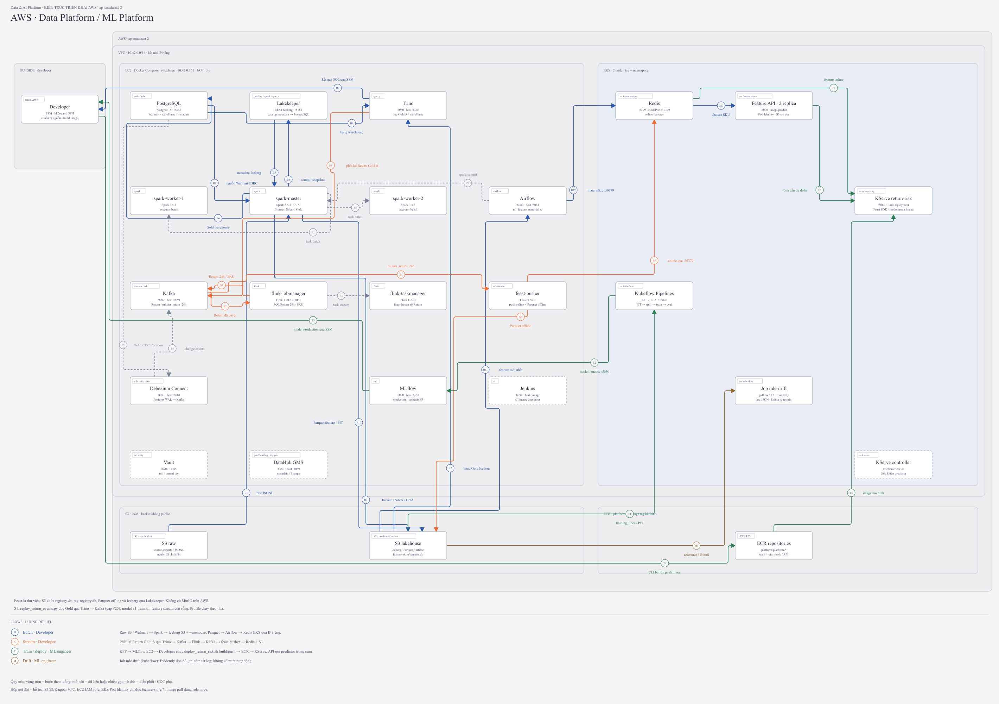
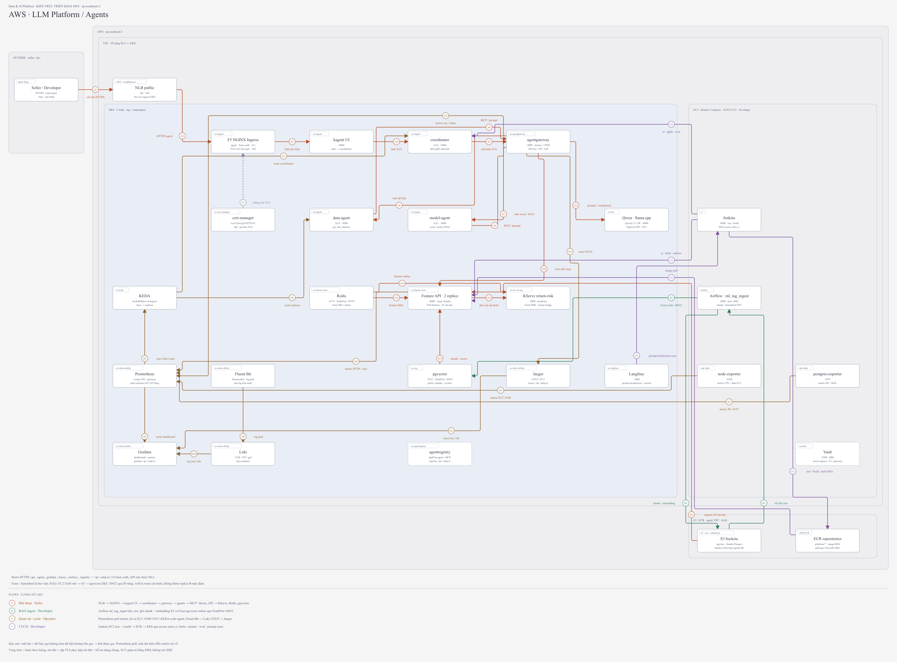

# Multichannel Data & AI Platform

Nền tảng dữ liệu và AI cho một Seller bán hàng trên Amazon, TikTok Shop, Shopify, Walmart và Shopee. Hệ thống chuẩn hóa dữ liệu đa kênh, dự đoán rủi ro Return hoặc Refund của từng dòng đơn hàng, và cung cấp agent trả lời câu hỏi bằng dữ liệu. Toàn bộ dữ liệu được sinh giả lập.

## Mục lục

1. [Business domain](#business-domain)
2. [Tổng quan hệ thống](#tổng-quan-hệ-thống)
3. [Sơ đồ triển khai](#sơ-đồ-triển-khai)
4. [Cấu trúc repo](#cấu-trúc-repo)
5. [Bắt đầu](#bắt-đầu)
6. [Tài liệu theo rubric](#tài-liệu-theo-rubric)
7. [Tài liệu khác](#tài-liệu-khác)

## Business domain

Một Seller bán trên bảy Storefront: Amazon US/UK/DE, TikTok Shop US, Shopify, Walmart US và Shopee VN. Mỗi kênh xuất dữ liệu theo schema riêng; hệ thống gom về một lakehouse Bronze / Silver / Gold rồi dựng feature cho bài toán:

> Dòng đơn hàng này có bị Return hoặc Refund trong 30 ngày sau giao hàng không?

Feature được tra cứu theo `sku_id` + `storefront_id`. Chi tiết: [business domain](docs/Domain.md), [thuật ngữ](docs/terminology.md), [contract nhãn](docs/return-label-contract.md).

## Tổng quan hệ thống

| Phần | Chức năng | Công nghệ chính | Hướng dẫn |
|---|---|---|---|
| **Data Platform** | Nguồn → Bronze / Silver / Gold → warehouse; batch, streaming, điều phối và quản trị | Spark, Kafka, Flink, Debezium, Iceberg, Lakekeeper, PostgreSQL, Trino, Airflow, DataHub | [Data Platform](docs/data-platform.md) |
| **ML Platform** | Feature store, training, model registry, serving và giám sát drift | Feast, Redis, LightGBM, Kubeflow Pipelines, MLflow, KServe, Evidently | [ML Platform](docs/ml-platform.md) |
| **LLM Platform** | LLM inference, RAG, agent, gateway và đánh giá câu trả lời | llama.cpp, pgvector, agentgateway, kagent, Langfuse, KEDA | [LLM Platform](docs/llm-platform.md) |

Trên AWS: Data Platform chạy trên một EC2 (Docker Compose) với dữ liệu ở S3; ML Platform và LLM Platform chạy trên EKS. Hạ tầng dựng bằng Terraform, cấu hình EC2 bằng Ansible.

## Sơ đồ triển khai

Hệ thống nộp bài chạy trên AWS (ap-southeast-2): EC2 chạy Docker Compose, EKS chạy ML/LLM, S3 + ECR ngoài VPC.
Mỗi hộp là một deployable unit; mũi tên theo dữ liệu, vòng tròn là bước đánh số theo từng luồng (chú thích FLOWS cuối hình).

Data Platform và ML Platform trên AWS (B batch, S stream phát lại, T train/deploy, M drift):



LLM Platform và Agent trên AWS (A hội thoại, K RAG ingest, O quan sát + scale, C CI/CD):



Bản tương tác: [AWS Data / ML](docs/diagrams/aws-architecture-layer12.html) · [AWS LLM / Agents](docs/diagrams/aws-architecture-layer3.html) · [hạ tầng AWS](docs/diagrams/aws-infra.html).
Bản chạy local (Docker Compose + kind) để phát triển: [Data / ML Platform](docs/diagrams/data-ml-platform.png) · [LLM Platform](docs/diagrams/llm-platform.png).
Sinh lại hình: `python3 scripts/diagrams/build.py`.

## Cấu trúc repo

```txt
├── generator/        # Sinh dữ liệu giả lập năm kênh (skew, schema evolution, duplicate, late arrival)
├── configs/          # Profile dữ liệu của generator (small → 100 GB)
├── contracts/        # Hợp đồng dữ liệu và schema từng kênh
├── spark_jobs/       # Spark batch: Bronze, Silver, Gold, CDC, bảo trì Iceberg
├── flink_jobs/       # Flink streaming: late arrival, dedup, window, feature 24h
├── sql/, trino/      # SQL warehouse và Trino liên nguồn
├── dags/             # Pipeline Airflow DP1–DP4, materialize feature, RAG
├── feature_repo/     # Feast: feature view, TTL, push stream vào offline/online store
├── ml/               # Training (Kubeflow), đánh giá, drift (Evidently)
├── serving/          # Feature API (FastAPI) + MCP tool, model KServe
├── rag/              # Chunking, embedding và truy xuất tài liệu
├── docker/           # Dockerfile các image (multistage)
├── infra/            # Hạ tầng
│   ├── aws/          #   Terraform (EC2, S3, ECR, EKS) và Ansible role cho EC2
│   ├── k8s/          #   Manifest Kubernetes: agent, ingress, observability, RAG, CI
│   └── helm/         #   Helm chart Feature API
├── ci/               # Jenkinsfile và cấu hình Jenkins
├── scripts/          # setup/ dựng dịch vụ · run/ chạy pipeline · evidence/ thu bằng chứng
├── tests/            # Unit, Spark, harness kiểm thử
└── docs/             # Tài liệu; evidence/ và images/ giữ bằng chứng chạy thật
```

## Bắt đầu

Yêu cầu: Python 3.12+, `uv`, Docker Engine và Docker Compose v2. Chạy các lệnh từ thư mục gốc repo.

```bash
# Kiểm tra code
uv sync --frozen
uv run pytest -q
uv run ruff check .

# Dựng nguồn dữ liệu local (MinIO, PostgreSQL, sinh dữ liệu theo configs/small.yaml)
cp .env.example .env          # sửa mật khẩu và cổng trước khi chạy
docker compose up -d --build
docker compose wait generator-load
```

Các platform khác bật theo hướng dẫn riêng: [Docker Compose](docs/Docker.md), [triển khai AWS](docs/aws-deploy.md), [cloud setup](docs/cloud-setup.md).

## Tài liệu theo rubric

Mỗi dòng dẫn tới tài liệu chứa giải thích, code liên quan và ảnh chụp bằng chứng.

### Data Platform (sheet `de`)

| Mục rubric | Tài liệu |
|---|---|
| Docker & Docker Compose, tối ưu Dockerfile | [Docker](docs/Docker.md) |
| Data Generator (offline + online data problems) | [Thiết kế generator](docs/generator-design.md), chất lượng [batch](docs/data-quality-report-batch.md) / [stream](docs/data-quality-report-stream.md) |
| Spark job (baseline, skew, schema evolution, duplicate) | [Spark](docs/spark.md), [Silver](docs/silver.md), [năm Channel](docs/silver-five-channels.md) |
| Flink job (late arrival, duplicate, window) | [Flink](docs/flink.md) |
| Data Storage (lakehouse, warehouse indexing) | [Storage](docs/storage.md), [Iceberg maintenance](docs/iceberg-maintenance.md) |
| Orchestration DP1 / DP2 / DP3 | [Airflow](docs/airflow.md) |
| Data Governance (lineage, validation) | [DataHub](docs/datahub.md) |
| Schema design (zone, SCD2, `feat_`, dim–fact, naming) | [Schema](docs/schema.md), [thiết kế Gold](docs/gold-design.md), [Gold](docs/gold.md) |
| Novel idea 1 — Trino liên nguồn | [Trino](docs/trino.md) |
| Novel idea 2 — CDC Debezium | [CDC](docs/cdc.md) |
| Bằng chứng | [Evidence Data Platform](docs/data-platform-evidence.md) |

### ML Platform / LLM Platform (sheet `mle`)

| Mục rubric | Tài liệu |
|---|---|
| LLM inference, custom model, benchmark, global model config | [LLM và agent](docs/llm-platform-agents.md) |
| Agent registry, agent, coordinator, Sandbox, Warm Up | [LLM và agent](docs/llm-platform-agents.md) |
| MCP Gateway, A2A Gateway | [Gateway](docs/llm-platform-gateway.md) |
| RAG pipeline + governance | [RAG](docs/llm-platform-rag.md) |
| Feature store (materialize, push stream feature) | [Feature store](docs/ml-platform-feature-store.md), [stream feature](docs/ml-platform-stream-feature.md) |
| Training pipeline, MLflow versioning | [Training](docs/ml-platform-training.md) |
| ML inference service (KServe) | [Serving](docs/ml-platform-serving.md) |
| Web API + MCP tool (FastAPI, async, helm) | [Feature API](docs/ml-llm-platform-web-api.md) |
| Validation & Verification (coverage, EP/BVA, mutation, property-based, locust) | [Feature API — test](docs/ml-llm-platform-web-api.md#test) |
| CI/CD | [CI/CD](docs/ml-llm-platform-cicd.md) |
| NGINX Ingress, basic auth, rate limit, HTTPS | [Gateway](docs/llm-platform-gateway.md) |
| IaC (Terraform, Ansible) | [IaC](docs/IaC.md) |
| Observability, LLM / agent telemetry | [Observability](docs/ml-llm-platform-observability.md) |
| A/B testing | [A/B](docs/llm-platform-ab-test.md) |
| Vault | [Vault](docs/ml-llm-platform-vault.md) |
| Novel idea 1 — agent eval harness | [Agent eval](docs/llm-platform-agent-eval.md) |
| Novel idea 2 — drift theo kênh | [Drift](docs/ml-platform-drift.md) |
| Bằng chứng | [Evidence ML / LLM Platform](docs/ml-llm-platform-evidence.md), [kiểm kê rubric × cloud](docs/rubric-cloud-audit.md) |

## Tài liệu khác

[Mục lục tài liệu](docs/README.md) liệt kê mọi trang theo platform. Quy ước code: [code style](docs/code-style.md). Từ vựng: [GLOSSARY](GLOSSARY.md). Quyết định kiến trúc: [ADR](docs/adr/README.md).
