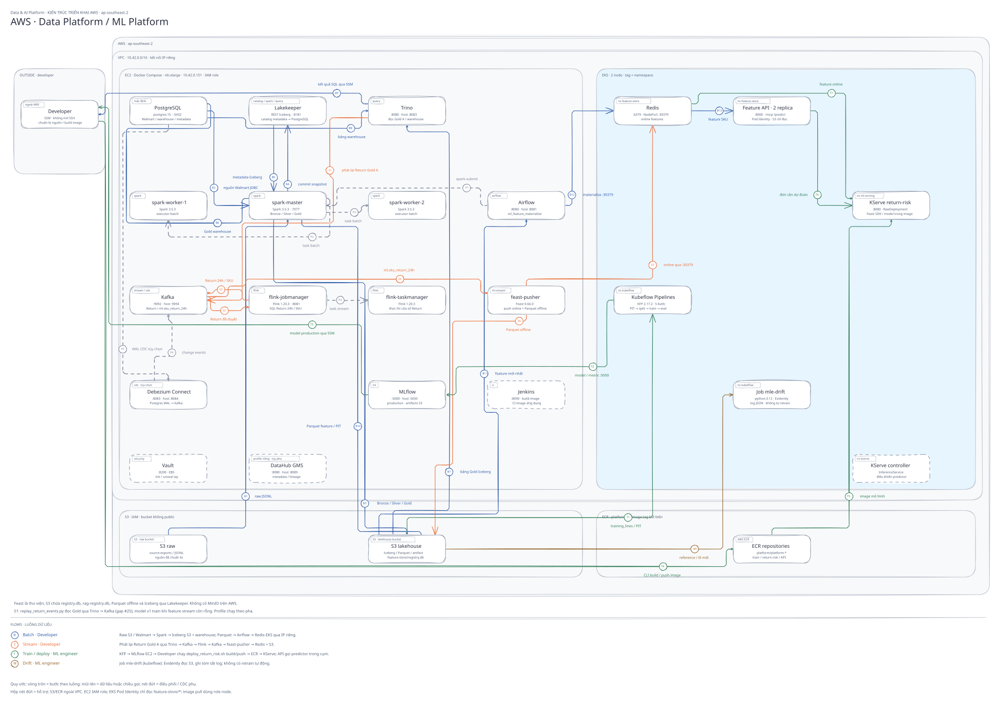
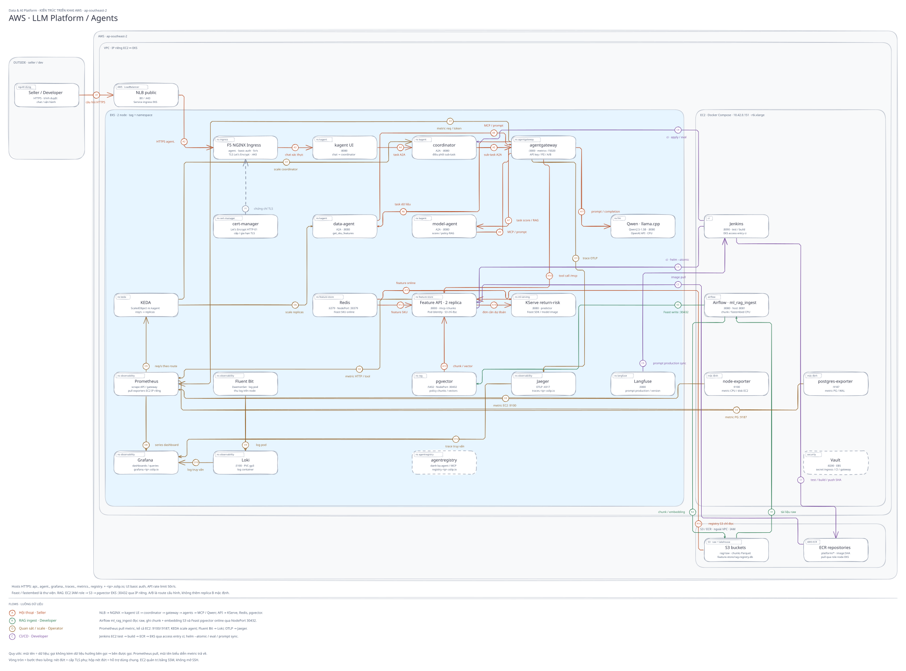

# Multichannel Data & AI Platform

Nền tảng dữ liệu và AI cho một Seller bán hàng trên Amazon, TikTok Shop, Shopify, Walmart và Shopee. Hệ thống chuẩn hóa dữ liệu đa kênh, dự đoán rủi ro Return hoặc Refund của từng dòng đơn hàng, và cung cấp agent trả lời câu hỏi bằng dữ liệu. Toàn bộ dữ liệu được sinh giả lập.

## Mục lục

- [Platform cung cấp gì?](#platform-cung-cấp-gì)
- [Bài toán nghiệp vụ](#bài-toán-nghiệp-vụ)
- [Kiến trúc](#kiến-trúc)
- [Bắt đầu](#bắt-đầu)
- [Tài liệu](#tài-liệu)
- [Cấu trúc repo](#cấu-trúc-repo)
- [Phát triển và đóng góp](#phát-triển-và-đóng-góp)
- [Kết quả kiểm chứng và giới hạn](#kết-quả-kiểm-chứng-và-giới-hạn)
- [Giới hạn đã biết](#giới-hạn-đã-biết)
- [Giấy phép](#giấy-phép)

## Platform cung cấp gì?

| Phần | Chức năng | Công nghệ chính | Hướng dẫn |
|---|---|---|---|
| **Data Platform** | Nguồn → Bronze / Silver / Gold → warehouse; batch, streaming, điều phối và quản trị | Spark, Kafka, Flink, Debezium, Iceberg, Lakekeeper, PostgreSQL, Trino, Airflow, DataHub | [Data Platform](docs/data-platform.md) |
| **ML Platform** | Feature store, training, model registry, serving và giám sát drift | Feast, Redis, LightGBM, Kubeflow Pipelines, MLflow, KServe, Evidently | [ML Platform](docs/ml-platform.md) |
| **LLM Platform** | LLM inference, RAG, agent, gateway và đánh giá câu trả lời | llama.cpp, pgvector, agentgateway, kagent, Langfuse, KEDA | [LLM Platform](docs/llm-platform.md) |

Trên AWS: Data Platform chạy trên một EC2 (Docker Compose) với dữ liệu ở S3; ML Platform và LLM Platform chạy trên EKS. Hạ tầng dựng bằng Terraform, cấu hình EC2 bằng Ansible.

## Bài toán nghiệp vụ

Một Seller bán trên bảy Storefront: Amazon US/UK/DE, TikTok Shop US, Shopify, Walmart US và Shopee VN. Mỗi kênh xuất dữ liệu theo schema riêng; hệ thống gom về một lakehouse Bronze / Silver / Gold rồi dựng feature cho bài toán:

> Dòng đơn hàng này có bị Return hoặc Refund trong 30 ngày sau giao hàng không?

Agent truy xuất feature, gọi model dự đoán và tìm chính sách trả hàng qua MCP. Chi tiết: [business domain](docs/Domain.md), [thuật ngữ](docs/terminology.md), [contract nhãn](docs/return-label-contract.md).

## Kiến trúc

Mô hình triển khai tham chiếu trên AWS (ap-southeast-2): EC2 chạy Docker Compose, EKS chạy ML/LLM, S3 + ECR ngoài VPC.
Mỗi hộp là một deployable unit; các luồng được tách thành từng hàng, có màu và mã bước trên mũi tên.
Dịch vụ xuất hiện ở nhiều hàng là cùng một dịch vụ, không phải thêm replica.

Data Platform và ML Platform trên AWS (B batch, S stream phát lại, T train/deploy, I tra feature/dự đoán, M drift):



LLM Platform và Agent trên AWS (A hội thoại, K RAG ingest, O quan sát + scale, C CI/CD):



### Chú giải mã luồng

Chữ cái xác định luồng; số phía sau là bước trong luồng đó, ví dụ `K1` là bước đầu của RAG ingest.

| Mã | Thuật ngữ | Ý nghĩa trong sơ đồ |
|---|---|---|
| **B** | Batch processing | Nạp và xử lý dữ liệu theo lô: nguồn → Bronze / Silver / Gold → truy vấn, warehouse. |
| **S** | Streaming feature | Phát lại sự kiện Return qua Kafka / Flink, đẩy feature vào online và offline store. |
| **T** | Training & model deployment | Huấn luyện bằng KFP, đăng ký model ở MLflow, build/push image và triển khai KServe. |
| **I** | Inference | Tra feature và gọi model dự đoán qua Feature API / KServe. |
| **M** | Monitoring data drift | So phân phối dữ liệu tham chiếu với lô mới, xuất kết quả drift. |
| **A** | Agent interaction | Hội thoại, điều phối Agent, gọi LLM và MCP tool qua gateway. |
| **K** | Knowledge ingestion | Nạp tri thức cho RAG: tài liệu → chunk → embedding → Feast / pgvector. |
| **C** | Continuous Integration / Continuous Delivery (CI/CD) | Kiểm thử, build/push image, đồng bộ prompt, triển khai và đánh giá Agent. |
| **O** | Observability | Thu và xem metrics, logs, traces; cung cấp metric cho KEDA autoscaling. |
| **P** | Phụ trợ / điều phối | Giao task cho Spark worker, Flink TaskManager và trao đổi metadata với catalog; dùng nét đứt. |

Bản vẽ có thể mở và chỉnh sửa bằng Excalidraw: [AWS Data / ML](docs/diagrams/aws-architecture-layer12-excalidraw.excalidraw) · [AWS LLM / Agents](docs/diagrams/aws-architecture-layer3-excalidraw.excalidraw).
Bản HTML: [AWS Data / ML](docs/diagrams/aws-architecture-layer12.html) · [AWS LLM / Agents](docs/diagrams/aws-architecture-layer3.html) · [hạ tầng AWS](docs/diagrams/aws-infra.html).
Bản chạy local (Docker Compose + kind) để phát triển: [Data / ML Platform](docs/diagrams/data-ml-platform.png) · [LLM Platform](docs/diagrams/llm-platform.png).
Sinh lại bản HTML gốc: `python3 scripts/diagrams/build.py`. Bản SVG trong README xuất từ file Excalidraw tương ứng.

## Bắt đầu

Yêu cầu: Python 3.12+, `uv`, Docker Engine và Docker Compose v2. Chạy các lệnh từ thư mục gốc repo.
Kubernetes dùng cho ML/LLM; môi trường phát triển dùng kind, triển khai AWS dùng EKS.

### Dựng nguồn dữ liệu local

```bash
cp .env.example .env          # đặt mật khẩu và cổng cho môi trường của bạn
uv sync --frozen
docker compose up -d --build
docker compose wait generator-load
```

Bước này dựng nguồn dữ liệu giả lập với MinIO và PostgreSQL. Các dịch vụ xử lý, ML và Agent được bật theo
profile và hướng dẫn riêng; xem [Docker Compose](docs/Docker.md).

### Chọn phần cần triển khai

| Mục tiêu | Hướng dẫn |
|---|---|
| Xử lý batch/stream, lakehouse và warehouse | [Data Platform](docs/data-platform.md) |
| Feature store, training và model serving | [ML Platform](docs/ml-platform.md) |
| LLM inference, RAG và Agent | [LLM Platform](docs/llm-platform.md) |
| Hạ tầng AWS và cấu hình dịch vụ | [Cloud setup](docs/cloud-setup.md), [AWS runbook](docs/aws-deploy.md), [IaC](docs/IaC.md) |

## Tài liệu

[Mục lục tài liệu](docs/README.md) tập hợp hướng dẫn theo từng platform, code liên quan và kết quả kiểm chứng.

| Chủ đề | Tài liệu |
|---|---|
| Nguồn dữ liệu và chất lượng | [Generator](docs/generator-design.md), chất lượng [batch](docs/data-quality-report-batch.md) / [stream](docs/data-quality-report-stream.md) |
| Batch và mô hình dữ liệu | [Spark](docs/spark.md), [Silver](docs/silver.md), [Gold](docs/gold.md), [Schema](docs/schema.md) |
| Streaming và CDC | [Flink](docs/flink.md), [Debezium CDC](docs/cdc.md) |
| Storage, điều phối và governance | [Storage](docs/storage.md), [Trino](docs/trino.md), [Airflow](docs/airflow.md), [DataHub](docs/datahub.md) |
| Feature và vòng đời model | [Feature store](docs/ml-platform-feature-store.md), [stream feature](docs/ml-platform-stream-feature.md), [training](docs/ml-platform-training.md), [serving](docs/ml-platform-serving.md) |
| Agent và công cụ | [LLM/Agent](docs/llm-platform-agents.md), [RAG](docs/llm-platform-rag.md), [Web API và MCP](docs/ml-llm-platform-web-api.md) |
| Vận hành và bảo mật | [CI/CD](docs/ml-llm-platform-cicd.md), [gateway](docs/llm-platform-gateway.md), [observability](docs/ml-llm-platform-observability.md), [Vault](docs/ml-llm-platform-vault.md) |
| Đánh giá | [Agent eval](docs/llm-platform-agent-eval.md), [drift](docs/ml-platform-drift.md), [A/B testing](docs/llm-platform-ab-test.md) |
| Thiết kế | [Thuật ngữ](GLOSSARY.md), [ADR](docs/adr/README.md), [quy ước code](docs/code-style.md) |

## Cấu trúc repo

```txt
├── generator/        # Sinh dữ liệu giả lập năm kênh (skew, schema evolution, duplicate, late arrival)
├── configs/          # Profile dữ liệu của generator (small → 100 GB)
├── contracts/        # Hợp đồng dữ liệu và schema từng kênh
├── spark_jobs/       # Spark batch: Bronze, Silver, Gold, CDC, bảo trì Iceberg
├── flink_jobs/       # Flink streaming: late arrival, dedup, window, feature 24h
├── sql/, trino/      # SQL warehouse và Trino liên nguồn
├── dags/             # Pipeline Airflow DP1–DP4, materialize feature, RAG
├── feature_repo/     # Feast: feature view, TTL, push stream vào offline/online store
├── ml/               # Training (Kubeflow), đánh giá, drift (Evidently)
├── serving/          # Feature API (FastAPI) + MCP tool, model KServe
├── rag/              # Chunking, embedding và truy xuất tài liệu
├── docker/           # Dockerfile các image (multistage)
├── infra/            # Hạ tầng
│   ├── aws/          #   Terraform (EC2, S3, ECR, EKS) và Ansible role cho EC2
│   ├── k8s/          #   Manifest Kubernetes: agent, ingress, observability, RAG, CI
│   └── helm/         #   Helm chart Feature API
├── ci/               # Jenkinsfile và cấu hình Jenkins
├── scripts/          # setup/ dựng dịch vụ · run/ chạy pipeline · evidence/ thu bằng chứng
├── tests/            # Unit, Spark, harness kiểm thử
└── docs/             # Tài liệu; evidence/ và images/ giữ bằng chứng chạy thật
```

## Phát triển và đóng góp

Đọc [quy ước code](docs/code-style.md), [thuật ngữ](GLOSSARY.md) và tài liệu của thành phần cần thay đổi.
Khi gửi thay đổi, mô tả vấn đề, hành vi sau sửa và cách kiểm chứng; cập nhật tài liệu liên quan nếu đổi cách dùng.

```bash
uv sync --frozen
uv run pytest -q
uv run ruff format --check .
uv run ruff check .
```

Các lệnh trên kiểm tra code Python và bộ test mặc định. Hướng dẫn kiểm thử Spark, Web API và từng dịch vụ
nằm trong tài liệu thành phần.

## Kết quả kiểm chứng và giới hạn

Dự án dùng dữ liệu giả lập; các số đo gắn với môi trường, cấu hình và phạm vi dữ liệu của từng lần chạy.
Ngày chạy, run ID và artifact được giữ trong tài liệu kiểm chứng để phân biệt kết quả local với AWS.

- [Data Platform — bằng chứng và giới hạn](docs/data-platform-evidence.md).
- [ML/LLM Platform — bằng chứng và liên kết kết quả AWS](docs/ml-llm-platform-evidence.md).
- [Trạng thái kiểm chứng theo rubric](docs/rubric-cloud-audit.md), gồm các phần còn mở và ảnh chi tiết còn thiếu.
- [Tài liệu theo rubric](docs/rubric-guide.md) dành cho việc đối chiếu coursework.

## Giới hạn đã biết

- [Agent eval](docs/llm-platform-agent-eval.md): 12/12 trên AWS dùng SKU có `labeled_count_90d` dưới 7 chữ số; response mask `phoneNumber` che số đếm 7 chữ số, khiến lượt top seller chỉ đạt 9/12. Hướng sửa là bỏ `phoneNumber` khỏi response mask; đang chờ duyệt vì giảm một lớp guardrail.
- [Sandbox Agent](docs/rubric-cloud-audit.md): gọi tool đúng nhưng model 1,5B đọc `830847` thành `83,084`; đã chứng minh đường gọi tool, chưa bảo đảm chất lượng câu trả lời của model CPU nhỏ.
- [Coordinator CI](docs/ml-llm-platform-cicd.md): deploy xanh, eval gate timeout (>180 s/câu); một LLM chạy CPU phục vụ chung mọi Agent.
- [Ảnh chi tiết](docs/rubric-cloud-audit.md) Spark schema evolution/dedup, Flink watermark, ERD dim–fact, Helm rollback và Coordinator scaling được chụp ở local; các job đã chạy trên AWS với receipt validate, nhưng chưa có đủ ảnh chi tiết AWS cho từng hành vi trên.
- [MLflow](docs/ml-platform-training.md): có model version/tag trên AWS; chưa chụp data hash và artifacts train/test của cùng run.
- [Stream feature](docs/ml-platform-stream-feature.md): `approved_returns_24h` trên AWS được replay từ nhãn Gold; `return-risk` v1 train trước khi feature có lịch sử nên chưa dùng feature này (gap #25).
- [Partition Shopee](docs/storage.md): chia tháng được áp dụng bằng maintenance rewrite; DP1 `createOrReplace` sẽ ghi lại partition ngày, chưa phải hành vi của pipeline.

## Giấy phép

Dự án được phát hành theo [Apache License 2.0](LICENSE).
