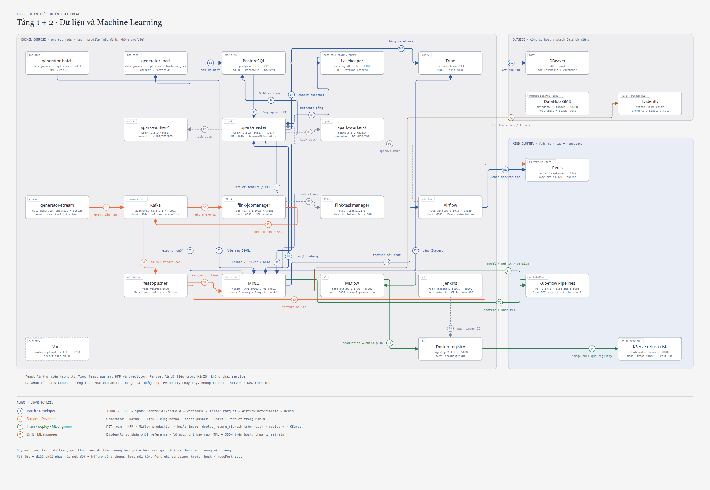
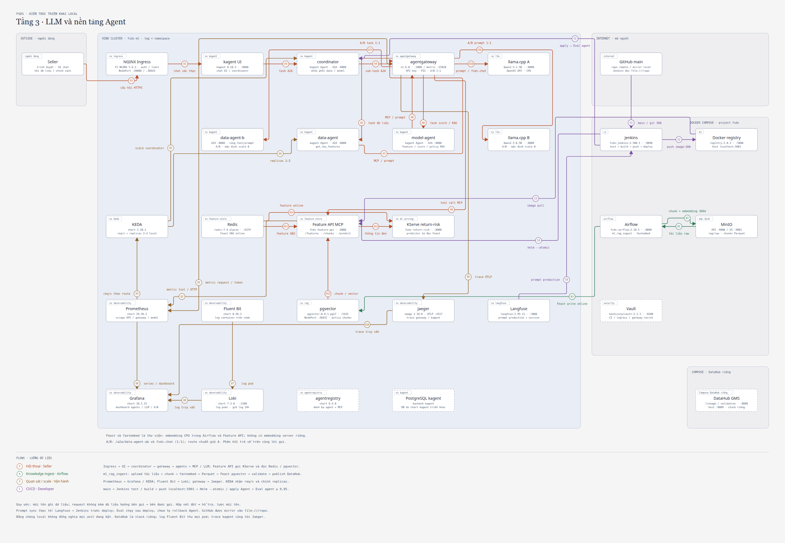

# FSDS: Nền tảng dữ liệu đa kênh cho Seller thương mại điện tử

Data platform gom dữ liệu bán hàng của một Seller trên 5 nền tảng thương mại điện tử (Amazon, TikTok Shop, Shopify, Walmart, Shopee) vào một lakehouse, dự đoán khả năng trả hàng của từng dòng đơn, rồi cho agent trả lời Seller bằng số thật. Toàn bộ dữ liệu được sinh giả lập.

> **Chấm điểm:** đối chiếu từng dòng rubric với artifact và bằng chứng ở
> [ma trận rubric DE](docs/de-rubric-matrix.md) và [ma trận rubric MLE](docs/mle-rubric-matrix.md).
> DE và MLE đã có bằng chứng chạy local (Docker Compose + `kind`). Cloud: AWS mốc 1 (EC2 + S3) theo
> [runbook](docs/aws-deploy.md) và [IaC](docs/IaC.md); EKS là bước sau.

## Mục lục

1. [Giới thiệu business domain](#1-giới-thiệu-business-domain)
2. [Kiến trúc tổng thể](#2-kiến-trúc-tổng-thể)
3. [Công nghệ](#3-công-nghệ)
4. [Dữ liệu và Data Generator](#4-dữ-liệu-và-data-generator)
5. [Repo Structure](#5-repo-structure)
6. [Tài liệu chi tiết](#6-tài-liệu-chi-tiết)
7. [Chạy và triển khai](#7-chạy-và-triển-khai)

## 1. Giới thiệu business domain

Dự án **không** xây một sàn thương mại điện tử. Dự án xây hệ thống dữ liệu của **một Seller** bán trên nhiều sàn cùng lúc. Mỗi sàn trả dữ liệu theo định dạng, trạng thái đơn và tiền tệ riêng, nên Seller cần một nơi thống nhất để phân tích và dự đoán.

Ví dụ: công ty ACME bán áo hoodie trên Amazon, TikTok Shop, Shopify, Walmart và Shopee. Hệ thống gom dữ liệu của cả 5 nơi về một mô hình chung.

| Thuật ngữ | Nghĩa |
|---|---|
| **Seller** | Người bán duy nhất mà hệ thống phục vụ |
| **Channel** | Nền tảng bán hàng bên ngoài (Amazon, TikTok Shop, Shopify, Walmart, Shopee) |
| **Marketplace** | Gian hàng theo quốc gia trong một Channel, ví dụ Amazon DE (không phải Channel nào cũng có) |
| **Storefront** | Chỗ cụ thể Seller bán hàng = Channel + Marketplace nếu có |
| **SKU** | Mã sản phẩm do Seller đặt, dùng chung xuyên Channel |
| **Listing** | Bản đăng bán của một SKU trên một Storefront |
| **Order / Order Line** | Đơn Channel giao cho Seller xử lý, và từng dòng sản phẩm trong đơn |

**Phạm vi**: 7 Storefront (Amazon US/UK/DE, TikTok Shop US, Shopify, Walmart US, Shopee VN). Amazon được mô hình hóa sâu nhất, bốn Channel còn lại mô hình hóa phần chung.

**Bài toán dự đoán**: một Order Line có bị Return hoặc Refund trong 30 ngày sau khi giao hay không. Các Channel giấu hoặc không cấp định danh người mua dùng chung được, nên feature được tra cứu theo `sku_id` + `storefront_id` thay vì theo khách hàng. Nhãn đến sau 30 ngày, nên việc giám sát drift phải làm khi chưa có đáp án thật.

Chi tiết xem [docs/Domain.md](docs/Domain.md) và [thuật ngữ](docs/terminology.md).

## 2. Kiến trúc tổng thể

Mỗi hộp là một **deployable unit** (chạy thành container/pod riêng; thư viện như Feast SDK hay Iceberg không phải unit).
Nhãn trên mũi tên là **dữ liệu** đi từ A sang B, đánh số theo luồng, mỗi luồng một màu; nét đứt chỉ dùng cho luồng phụ.
Tag góc hộp là compose profile hoặc namespace Kubernetes.

### Tầng 1 + 2: dữ liệu và ML



Luồng **B** batch (nguồn → Bronze/Silver/Gold → warehouse → feature offline → online), **S** stream feature,
**T** train và deploy model qua registry, **M** giám sát drift. Bản phóng to: [`architecture-layer12.html`](docs/diagrams/architecture-layer12.html).

### Tầng 3: LLM và agent



Luồng **A** hội thoại của Seller qua agentgateway, **K** nạp tài liệu cho RAG, **O** quan sát và scale,
**C** CI/CD (Jenkins → registry → cụm → eval agent). Bản phóng to: [`architecture-layer3.html`](docs/diagrams/architecture-layer3.html).

### Triển khai AWS

[Hạ tầng](docs/diagrams/aws-infra.html) (VPC, EC2 không mở cổng, SSM, IAM role, S3) ·
[DE trên EC2](docs/diagrams/aws-de.html) · [MLE trên EKS (sau mốc 1)](docs/diagrams/aws-ml.html).

### Pipeline dữ liệu

| Pipeline | Nội dung |
|---|---|
| **DP1** | Ingest dữ liệu thô từ nguồn vào Bronze, kèm bước validate |
| **DP2** | Từ Bronze sang Silver và Gold, kèm bước validate |
| **DP3** | Tính bảng feature offline, kèm bước validate; materialize sang Feast online |
| **`dp_order_lifecycle`** | Pipeline v2 năm Channel: contract → Bronze → Silver → Gold → validate → warehouse, có receipt theo run |

## 3. Công nghệ

| Vai trò | Công nghệ |
|---|---|
| Đóng gói | Docker (multi-stage), Docker Compose, registry image local |
| Batch / Streaming | Apache Spark · Apache Kafka, Apache Flink, Debezium CDC |
| Lakehouse / Catalog | Apache Iceberg trên MinIO (local) hoặc S3 (AWS) · Lakekeeper (Iceberg REST) |
| Warehouse / Query | PostgreSQL (index) · Trino (federation Iceberg + PostgreSQL) |
| Điều phối / Governance | Apache Airflow · DataHub (lineage, assertion) |
| Feature store | Feast: Parquet offline, Redis online, pgvector cho RAG |
| ML | Kubeflow Pipelines, LightGBM, MLflow, KServe, Evidently |
| LLM / Agent | llama.cpp, agentgateway (LLM/MCP/A2A), kagent, agentregistry, KEDA, Langfuse |
| Vận hành | NGINX Ingress + cert-manager, Vault, Prometheus, Grafana, Loki, Jaeger, Jenkins |
| Hạ tầng | `kind` (local), Terraform + Ansible cho AWS EC2/S3 |

Lý do chọn: [quyết định kiến trúc](docs/architecture-decisions.md) và [ADR](docs/adr/README.md).

## 4. Dữ liệu và Data Generator

Generator tạo dữ liệu theo cấu hình (`configs/*.yaml`) và **cố tình làm bẩn** để job xử lý có cái chứng minh:

| Vấn đề | Cách mô phỏng |
|---|---|
| Skew | Tỷ trọng Storefront lệch, vài SKU chiếm phần lớn doanh số, 8 danh mục với tỷ lệ trả hàng khác nhau |
| High cardinality | Hàng trăm nghìn mã Order, hơn 1 triệu mã Order Line, mã vận đơn, mã buyer theo Channel |
| Schema evolution | Đơn Amazon chuyển từ Orders v0 sang Orders 2026-01-01 giữa chừng (đổi tên, đổi cấu trúc, thêm field) |
| Duplicate offline | Khoảng 2% dòng trùng do export chồng lấn ngày, có cả bản sửa lại |
| Duplicate, burst, late arrival | Đặc tính riêng của từng Channel trong luồng streaming |
| Data drift | Đợt sale lớn và livestream làm tỷ lệ trả hàng đổi mà feature vẫn trông bình thường |

Thiết kế và cấu hình: [generator-design](docs/generator-design.md). Báo cáo chất lượng:
[batch](docs/data-quality-report-batch.md), [stream](docs/data-quality-report-stream.md).
Nguồn v2: [contract](docs/source-contract-order-lifecycle.md), [fixture](docs/source-order-lifecycle-fixtures.md),
[scale](docs/source-order-lifecycle-scale.md).

## 5. Repo Structure

```text
.
├── .github/workflows/     # CI: lint + unit test
├── ci/jenkins/            # 4 pipeline Jenkins: RAG, Feature API + agent, coordinator, stream feature
├── configs/               # Profile generator và chính sách bảo trì Iceberg
├── contracts/             # Registry hợp đồng dữ liệu và luật schema evolution
├── dags/                  # Airflow: DP1/DP2/DP3, pipeline v2, CDC, bảo trì, materialize, RAG ingest
├── docker/                # Dockerfile Airflow/Flink/serving/train/MLflow/Jenkins, override DataHub
├── docs/                  # Tài liệu theo thành phần, ma trận rubric
│   ├── adr/               # Quyết định kiến trúc
│   ├── diagrams/          # Sơ đồ kiến trúc, AWS và schema
│   ├── evidence/          # Receipt, log, metric
│   └── images/            # Ảnh chụp bằng chứng theo thành phần
├── feature_repo/          # Định nghĩa Feast và pusher stream feature
├── flink_jobs/            # SQL streaming: baseline, late arrival, dedup, window, stream feature
├── generator/             # Sinh nguồn batch/stream giả lập
├── infra/
│   ├── aws/               # Terraform + Ansible cho EC2 + S3
│   ├── helm/              # Chart Feature API (MCP tool)
│   ├── jenkins/           # Jenkins configuration-as-code
│   └── k8s/               # Manifest kind: feature store, ML, agent, ingress, quan sát, RAG
├── ml/                    # Train, serve, drift, eval agent
├── rag/                   # Chunk tài liệu, embedding, pipeline RAG
├── scripts/               # setup/ (dựng môi trường), run/ (chạy pipeline), evidence/ (thu bằng chứng)
├── serving/               # Feature API: FastAPI + MCP, test, locust
├── spark_jobs/            # Job Spark theo tầng + lib/ dùng chung
├── sql/                   # DDL warehouse và index
├── tests/                 # unit/ (pytest mặc định), spark/, harness/
├── trino/catalog/         # Connector Iceberg REST và PostgreSQL
├── docker-compose.yml     # Môi trường local (profile theo nhóm service)
├── docker-compose.aws.yml # Override cho EC2 + S3
├── Dockerfile             # Image generator multi-stage
└── pyproject.toml, uv.lock, requirements.lock, .env.example, GLOSSARY.md
```

Quy ước code: [code-style](docs/code-style.md).

## 6. Tài liệu chi tiết

**Data Engineering** (rubric DE)

| Tài liệu | Nội dung |
|---|---|
| [Docker](docs/Docker.md) | Compose, tối ưu image 2,39 GB → 698 MB |
| [Spark](docs/spark.md) · [Spark v2](docs/spark-order-lifecycle.md) | Baseline, skew, schema evolution, ảnh Spark UI |
| [Silver](docs/silver.md) · [năm Channel](docs/silver-five-channels.md) · [Silver v2](docs/silver-order-lifecycle.md) | Parse, dedup theo grain, lịch sử revision |
| [Gold](docs/gold.md) · [thiết kế](docs/gold-design.md) · [Gold v2](docs/gold-order-lifecycle.md) | Fact, SCD2, nhãn và feature point-in-time; [contract nhãn](docs/return-label-contract.md) |
| [Storage](docs/storage.md) · [Warehouse v2](docs/warehouse-order-lifecycle.md) | Compaction Iceberg, index PostgreSQL, EXPLAIN trước/sau |
| [Flink](docs/flink.md) · [Streaming v2](docs/stream-order-lifecycle.md) | Watermark, late arrival, dedup state, window |
| [Airflow](docs/airflow.md) · [Airflow v2](docs/airflow-order-lifecycle.md) | DP1/DP2/DP3, receipt theo run |
| [DataHub](docs/datahub.md) · [DataHub v2](docs/datahub-order-lifecycle.md) | Lineage và assertion |
| [Schema](docs/schema.md) · [ERD v2](docs/diagrams/schema-order-lifecycle.md) | Bảng mọi zone, quan hệ fact–dim, naming |
| [Novel ideas](docs/novel-ideas.md) · [Trino](docs/trino.md) · [CDC](docs/cdc.md) · [CDC v2](docs/cdc-order-lifecycle.md) | Novel 1 federation, Novel 2 CDC |
| [DE-N1](docs/novel-de-n1-data-contracts.md) · [DE-N2](docs/novel-de-n2-iceberg-maintenance.md) | Data contract, Iceberg tự bảo trì |
| [Trạng thái v2](docs/de-order-lifecycle-status.md) · [e2e local](docs/e2e-order-lifecycle-local.md) · [hiệu năng Silver](docs/silver-order-lifecycle-performance.md) | Bảng một trang và giới hạn bằng chứng |

**MLOps, LLM và agent** (rubric MLE)

| Tài liệu | Nội dung |
|---|---|
| [Feast](docs/mle-feature-store.md) · [stream feature](docs/mle-stream-feature.md) | Offline → online, Flink → Kafka → Feast push |
| [Train](docs/mle-training.md) · [Serve](docs/mle-serving.md) · [Drift](docs/mle-drift.md) | Kubeflow + MLflow, KServe, Evidently (Novel ML-N2) |
| [Web API](docs/mle-web-api.md) · [RAG](docs/mle-rag.md) | FastAPI + MCP, test, locust · pgvector |
| [Agent](docs/mle-agents.md) · [Eval](docs/mle-agent-eval.md) · [A/B](docs/mle-ab-test.md) | llama.cpp, agentgateway, kagent, KEDA · Novel ML-N1 · A/B 50/50 |
| [Gateway](docs/mle-gateway.md) · [Quan sát](docs/mle-observability.md) · [Vault](docs/mle-vault.md) · [CI/CD](docs/mle-cicd.md) | HTTPS + auth + rate limit, metric/log/trace, secret, Jenkins + registry |

**Triển khai cloud:** [runbook AWS](docs/aws-deploy.md) · [IaC](docs/IaC.md).

## 7. Chạy và triển khai

```bash
cp .env.example .env
docker compose up -d                 # MinIO, PostgreSQL, sinh Batch, nạp PostgreSQL
uv run pytest -q                     # unit test offline
```

Mỗi nhóm service bật theo profile Compose; cách chạy từng phần nằm trong tài liệu thành phần ở mục 6.
Nền MLE trên `kind`: `scripts/setup/up_ml_base.sh`. Lên AWS: làm theo [runbook](docs/aws-deploy.md) từ mục 1 đến 7.
