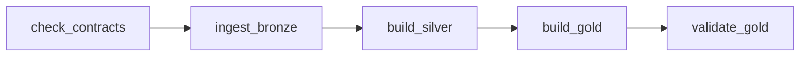

<!-- Mô tả vận hành DAG nguồn v2, receipt và các giới hạn chưa kiểm bằng Docker. -->
# Airflow — pipeline nguồn v2

> **Pipeline v2 (order lifecycle) — thiết kế và thử ở local, không phải pipeline đã nộp.** Pipeline chạy trên AWS là v1 (DP1 → DP4 + ML), xem [Data Platform evidence](data-platform-evidence.md). Các chỗ nhắc GCP dưới đây là kế hoạch cũ, chưa chạy; đích cloud hiện hành là [AWS](aws-deploy.md).

DAG [`dp_order_lifecycle`](../dags/dp_order_lifecycle.py) chạy tay từ fixture tới
Gold/nhãn/feature. DAG mặc định tạm dừng, `schedule=None`, `catchup=False`,
`max_active_runs=1`, `max_active_tasks=1`. Fixture chưa có lịch phát dữ liệu thật.



| Task | Lệnh / ứng dụng | Điều kiện lỗi |
|---|---|---|
| `check_contracts` | `python -m spark_jobs.lib.data_contracts check-registry --contracts-dir /opt/contracts` qua PythonOperator | Exit khác 0; receipt giữ stdout/stderr |
| `ingest_bronze` | `bronze/ingest_order_lifecycle.py --root … --run-id … --receipt …` | Manifest/snapshot Walmart không khớp, lỗi Spark |
| `build_silver` | `silver/build_order_lifecycle.py --run-id … --as-of … --contracts-dir /opt/contracts --receipt …` | Check reconcile khác 0; riêng số cách ly không làm lỗi |
| `build_gold` | `gold/build_order_lifecycle.py --cutoff … --run-id … --receipt …` | Silver khác snapshot cutoff, invariant sai hoặc generation nhãn đã có |
| `validate_gold` | `gold/validate_order_lifecycle.py --cutoff … --run-id … --receipt …` | Bất kỳ invariant sai; exit khác 0 làm DAG fail |

Bốn Spark task dùng `PlatformSparkSubmitOperator` (Bronze qua subclass nhỏ),
`conn_id=spark_default`, `deploy_mode=client`, packages từ Variable và driver
`platform_order_lifecycle_driver_memory` (mặc định 3g; 1g từng OOM ở Gold/warehouse local). Credential lookup ở runtime. Bronze nhận nhóm `iceberg, postgres` để
JDBC dùng `platform_postgres`; ba task còn lại dùng `iceberg`. Không thêm provider.
Contracts CLI dùng thư viện chuẩn, chạy từ `/opt`, nơi có package `spark_jobs/`.

## Params và Variables

| Airflow Param | Mặc định | Cách dùng |
|---|---|---|
| `source_root` | `null` | Dùng `platform_order_lifecycle_source_root`; nếu truyền thì là thư mục fixture có manifest nhìn thấy trong container |
| `cutoff` | `null` | Dùng `platform_order_lifecycle_cutoff`; giá trị truyền phải là timestamp ISO UTC |
| `walmart_jdbc` | `null` | Đọc bootstrap file; truyền `walmart_lifecycle.orders` để job `spark_jobs/bronze/ingest_order_lifecycle.py` đọc DB thay Walmart file |

`source_root` và `cutoff` dùng fallback Variable tại lúc render task, không gọi
metadata DB khi import DAG. Null là giá trị mặc định có chủ ý; không đặt Jinja
lồng trong Param. Silver nhận **cùng cutoff** bằng `--as-of`, vì Gold kiểm lại
published Silver so với snapshot tại cutoff trước khi ghi.

Các Variable v2 được nạp bởi [`scripts/setup/setup_airflow.sh`](../scripts/setup/setup_airflow.sh):

| Variable | Giá trị setup |
|---|---|
| `platform_order_lifecycle_receipt_dir` | `/opt/airflow/receipts/order_lifecycle` |
| `platform_order_lifecycle_source_root` | `/data/order_lifecycle` |
| `platform_order_lifecycle_cutoff` | `2026-06-01T00:00:00.000000Z` |
| `platform_order_lifecycle_driver_memory` | `3g` |
| `platform_order_lifecycle_executor_memory` | `4g` |
| `platform_order_lifecycle_executor_cores` | `2` |

Cả hai DAG `dp_order_lifecycle` và `dp_order_lifecycle_warehouse` render ba Variable tài nguyên
qua Jinja tại runtime. Subclass trong mỗi DAG mở rộng `template_fields`, kể cả
Bronze; không phụ thuộc provider có template tài nguyên hay không. Setup nạp lại
giá trị mặc định khi chạy lại; đổi Variable sau setup nếu cần. Driver nằm trong
Airflow (client mode); chỉ chạy một DAG Spark tại một thời điểm và đo RAM thật
trước khi tăng cấu hình. Xem checklist GCP.

DAG còn dùng `platform_spark_packages` đã có trong script setup. Connections, MinIO,
warehouse và REST catalog dùng cấu hình runtime chung như [Airflow v1](airflow.md).

## Chuẩn bị và trigger — người vận hành chạy

Compose mount `${PLATFORM_ORDER_LIFECYCLE_DIR:-./out/order_lifecycle_live}` chỉ đọc vào
`/data/order_lifecycle` trên Airflow, Spark master và cả hai worker. Export biến này
trên host trước khi gọi Compose nếu dùng fixture khác. Manifest phải đọc được
từ driver, JSONL phải đọc được từ executor. `/opt/contracts` đã mount.
Receipt bind `./out/receipts:/opt/airflow/receipts` để giữ trên host; UID Airflow
phải ghi được thư mục này. Runbook tạo thư mục và cấp quyền ghi cho môi trường dev.
Kiểm worker có Python tương thích driver nếu Gold chạy RDD Python; chưa kiểm
điều đó trong sandbox.

Runbook tách pha trên máy 14 GB: xem [Chạy thật DataHub v2](datahub-order-lifecycle.md#chạy-thật).
`bash scripts/run/run_order_lifecycle_live.sh --phase source`, rồi `--phase airflow` sẽ bật các
service cần thiết, đợi scheduler/worker, setup, unpause/trigger, poll tới trạng
thái cuối, copy receipt theo `run_id` rồi dừng cả dependency để nhường RAM.
Runbook đặt `platform_order_lifecycle_executor_memory=2g` sau setup cho fixture nhỏ để khớp worker
2g mặc định; dùng `PLATFORM_V2_EXECUTOR_MEMORY` và tăng worker tương ứng nếu cần.
Giá trị setup chung 4g trong bảng trên vẫn dùng cho môi trường đã cấp đủ RAM.

Nếu bật JDBC, nạp trước bằng `scripts/setup/load_order_lifecycle_walmart.py --root <fixture>`;
DAG không tự tạo dữ liệu hay nạp DB. Cần Lakekeeper, MinIO, PostgreSQL, Spark và
Airflow đã sẵn sàng. Lệnh dưới đây không bật/tắt service:

```bash
bash scripts/setup/setup_airflow.sh
# Setup nạp lại cả các giá trị v1 hiện hữu; người vận hành chọn lúc phù hợp.
docker compose --profile airflow exec -T airflow airflow dags list-import-errors --output json
docker compose --profile airflow exec -T airflow airflow dags unpause dp_order_lifecycle
docker compose --profile airflow exec -T airflow airflow dags trigger dp_order_lifecycle \
  --conf '{"source_root":"/data/order_lifecycle","cutoff":"2026-06-01T00:00:00.000000Z","walmart_jdbc":"walmart_lifecycle.orders"}'
```

Dùng `run_id` mới cho mỗi lần công bố Gold. Nhãn append theo generation và từ chối
cùng generation; clear/retry Gold sau khi đã append có thể lỗi vì generation đã có.
`max_active_runs=1` chỉ khóa DAG này; không bảo vệ trước job Spark chạy tay cùng bảng.

Import thật trong image đã được người vận hành xác nhận ngày 2026-10-19:
**10 DAG, 0 lỗi**, gồm `dp_order_lifecycle`, `dp_order_lifecycle_cdc`,
`dp_order_lifecycle_warehouse` và bảy DAG snapshots giữ tên
(ghi nhận local (receipt không đính kèm repo)). Đây là kiểm import;
chạy thật DAG trên Compose chưa thực hiện. Lệnh tái kiểm do người vận hành chạy:

```bash
docker run --rm --network none --read-only --tmpfs /tmp:rw,size=256m \
  --mount type=bind,src=$PWD/dags,dst=/opt/airflow/dags,readonly \
  --entrypoint python platform-airflow:2.10.5-spark3.5.3 -c \
  "from airflow.models import DagBag; b=DagBag('/opt/airflow/dags', include_examples=False); print(b.import_errors); assert not b.import_errors; print(sorted(b.dag_ids))"
```

## Đọc receipt

Mỗi chặng dùng thư mục `{{ var.value.platform_order_lifecycle_receipt_dir }}/{{ ts_nodash }}/`:
`check_contracts.json`, `ingest_bronze.json`, `build_silver.json`, `build_gold.json`,
`validate_gold.json`. Receipt có `run_id` Airflow gốc. Directory theo logical
time, không theo attempt; retry có thể ghi đè receipt cùng task. Tránh trigger hai
run với cùng logical timestamp nếu cần giữ thư mục tách biệt.

Contracts có exit code/stdout/stderr và `completed_at`. Bronze truyền
`--receipt <DIRECTORY>/ingest_bronze.json` cho job `spark_jobs/bronze/ingest_order_lifecycle.py`. Khi thành công, operator giữ
nguyên receipt Spark có `run_id`, `dataset_version`, `tables`, `rows`,
`completed_at` và `schema_file` trỏ tới `schemas.json` cùng thư mục. Khi Spark
lỗi, operator ghi receipt `status=failed`, bảng đích, `checks_available=false`
và thời gian hoàn tất rồi truyền tiếp lỗi; receipt lỗi không xác nhận schema
hay metrics đối soát Bronze. Manifest/boundary chi tiết vẫn nằm trong log.

Silver/Gold/Validate dùng receipt nguyên bản của job; không bổ sung check từ
suy đoán. Silver có `checks`, `info`, `quarantine.total/by_reason/by_schema_id`;
chỉ `checks != 0` gây lỗi. Gold có trạng thái `failed_before_write`, `failed`
hoặc `passed`; Validate đọc lại bảng Gold. Lỗi trước khi job kịp ghi receipt có
thể chỉ còn log Airflow; không suy từ thiếu receipt rằng task thành công.

Ví dụ người vận hành sao chép receipt sau run (volume Airflow giữ dữ liệu):

```bash
mkdir -p out/receipts-v2-run/THAY_RUN_ID
docker compose --profile airflow cp \
  airflow:/opt/airflow/receipts/order_lifecycle/THAY_TS_NODASH/. out/receipts-v2-run/THAY_RUN_ID/
```

Chuyển metadata bằng [publisher v2](datahub-order-lifecycle.md), giữ `schemas.json` cạnh
receipt để đọc schema Bronze/Silver/Gold thực tế của run. Receipt cũ thiếu schema
vẫn được đọc và publisher ghi rõ thiếu schema field. Các bảng hiện tại
Bronze/Silver/fact/feature bị thay thế theo run; nhiều bảng chưa có transaction
công bố chung. Fixture nhỏ không chứng minh scale hoặc refresh production.

**Chưa đo — Đo trên GCP:** `bash scripts/run/run_order_lifecycle_live.sh --phase source`
rồi `bash scripts/run/run_order_lifecycle_live.sh --phase airflow` trên host đã chuẩn bị
theo [runbook](datahub-order-lifecycle.md#chạy-thật) và checklist GCP.
Người vận hành chọn bỏ bước lâu ở local; chưa có run_id, receipt chạy thật DAG,
ảnh Graph/Grid hay thời gian chạy. Kết quả e2e small local PASS 92 s tại
[e2e local](e2e-order-lifecycle-local.md) là harness, chưa chứng minh DAG chạy thành công.
