# Airflow DP1 — nguồn sang Bronze, rồi Validate

## Xác minh Connection/Variable và Spark runtime ngày 2026-10-15

DAG `platform_runtime_config_check`, run `de_runtime_20261015`, hoàn tất **2/2
task success** từ 14:41:51 đến 14:42:02 UTC sau khi nạp lại cấu hình bằng
`scripts/setup/setup_airflow.sh`. `airflow dags list-import-errors --output json`
trả `[]`. [Manifest runtime](evidence/airflow-runtime-20261015.json) lưu trạng
thái, thời gian từng task và hai dòng log xác nhận; không chứa credential.

| Task | Kết quả kiểm chứng |
|---|---|
| `verify_connections_and_variables` | Lookup ba Connection `platform_minio`, `platform_postgres`, `platform_kafka` và bốn Variable; resolve đủ 12 biến môi trường. Mật khẩu MinIO/PostgreSQL được mã hóa trong metadata DB; Kafka demo không có mật khẩu. |
| `verify_spark_runtime` | `PlatformSparkSubmitOperator` lấy cấu hình ở runtime rồi submit tới `spark://spark-master:7077`; Spark thực thi `range(3)` và trả tổng bằng 3. `table_writes=0`. |

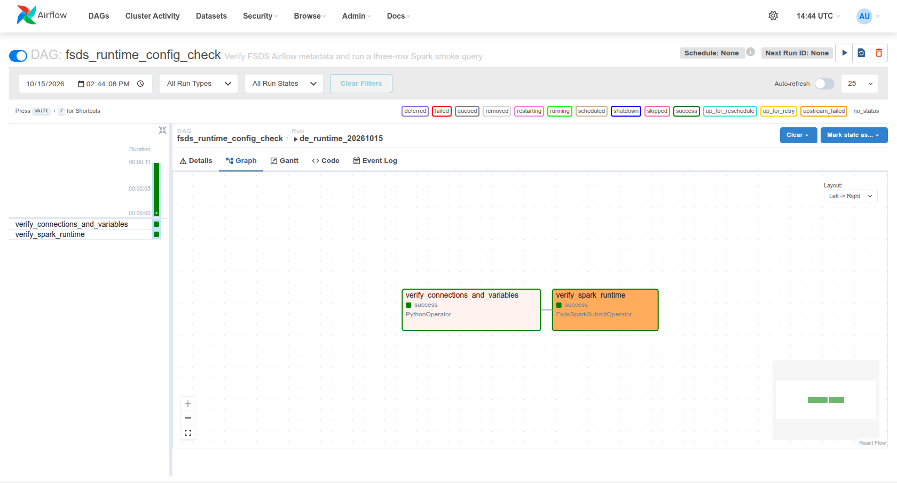

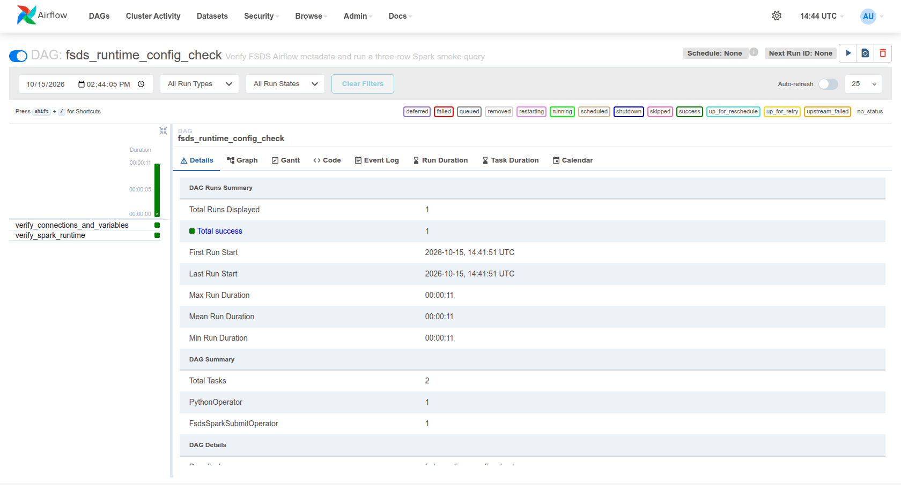

Kiểm tra này xác nhận đường lookup và thực thi operator mới; không chạy lại
DP1/DP2/DP3 hay kiểm kết nối dữ liệu thực tế tới MinIO/Kafka. Spark dùng một
worker, không có Python UDF và không đọc/ghi bảng.

Để tái tạo, bật đúng PostgreSQL/Airflow/Spark master và một worker, nạp cấu
hình rồi trigger DAG; không cần generator hay DataHub:

```bash
env -u POSTGRES_PASSWORD docker compose --profile airflow up -d postgres airflow
env -u POSTGRES_PASSWORD docker compose --profile spark up -d spark-master spark-worker-1
env -u POSTGRES_PASSWORD bash scripts/setup/setup_airflow.sh
env -u POSTGRES_PASSWORD docker compose --profile airflow exec -T airflow airflow dags list-import-errors --output json
env -u POSTGRES_PASSWORD docker compose --profile airflow exec -T airflow airflow dags trigger platform_runtime_config_check
```

`scripts/evidence/capture_airflow_runtime_evidence.py` xuất proof của run cố định
`de_runtime_20261015`; script dừng nếu run chưa thành công đủ hai task.

## Mục đích

DP1 gồm **Ingest** và **Validate**. DAG
`dags/dp1_bronze.py` có mười task, chạy tuần tự để không dồn hai Spark driver lên
laptop cùng lúc:

```text
ingest_amazon → validate_amazon → ingest_walmart → validate_walmart
→ ingest_tiktok_shop → validate_tiktok_shop → ingest_shopify → validate_shopify
→ ingest_shopee → validate_shopee
```

Các task Ingest gọi job Bronze bằng `SparkSubmitOperator`. Spark standalone
không hỗ trợ `cluster` deploy mode cho ứng dụng Python, nên driver chạy trong
container Airflow (`client` mode), executor chạy trên hai Spark worker. Airflow
dùng PySpark **3.5.3** cùng phiên bản với cụm Spark và Java **17** cho jar Iceberg.
Airflow 2.10.5 và Spark provider 5.0.1 được ghim trong `docker/Dockerfile.airflow`.
Đây là cấu hình dev trên Compose; ML Platform / LLM Platform sau này mới chuyển sang Kubernetes.

## Validate kiểm gì

`spark_jobs/bronze/validate_order_snapshots.py` kiểm riêng từng nguồn:

| Điều kiện | Amazon | Walmart |
|---|---|---|
| Bảng và cột Bronze tồn tại | `payload`, `source_file`, `export_date`, `ingested_at`, `run_id` | `purchase_order_id`, `raw_payload`, `source_table`, `fetched_at`, `ingested_at`, `run_id` |
| Số dòng | bằng JSONL của đúng cửa sổ ngày đã nạp | bằng `walmart.orders` ở PostgreSQL |
| Payload | JSON có `AmazonOrderId` **hoặc** `orderId` | JSON có `purchaseOrderId` khớp cột nguồn |
| Provenance | file, ngày, thời điểm nạp và `run_id` hợp lệ | bảng nguồn, thời điểm kéo/nạp và `run_id` hợp lệ |

TikTok Shop, Shopify và Shopee dùng `spark_jobs/bronze/validate_file_order_snapshots.py` để
so số response JSONL của đúng Channel với Bronze, kiểm ID nguồn, file, ngày và
`run_id`. Lần chạy nhỏ có lần lượt **1.810**, **910** và **354** response; cả ba
Validate đều thành công.

Một điều kiện sai làm task Validate thất bại. Bronze **giữ nguyên** bản trùng và hai
dạng schema Amazon; hai đặc tính đó không bị coi là lỗi. `run_id` nối các dòng Bronze
với lần chạy Airflow. Job Amazon đọc lại file nguồn khi Validate để so số dòng; với
toàn bộ 180 ngày, đó là một lượt đọc thêm khoảng 80 GiB, nên chi phí cần được đo khi
chuyển từ bảng thử sang bảng thật.

## Khởi động và chạy

Chỉ bật service cần dùng; `docker compose --profile airflow up -d` không nêu tên
service sẽ kéo cả generator Batch trong Compose và có thể sinh lại dữ liệu 100 GB.

```bash
env -u POSTGRES_PASSWORD docker compose up -d minio minio-init postgres
env -u POSTGRES_PASSWORD docker compose --profile spark up -d spark-master spark-worker-1 spark-worker-2
env -u POSTGRES_PASSWORD docker compose --profile airflow build airflow
env -u POSTGRES_PASSWORD docker compose --profile airflow up -d airflow
env -u POSTGRES_PASSWORD bash scripts/setup/setup_airflow.sh
env -u POSTGRES_PASSWORD bash scripts/setup/setup_dp1_file_channels.sh
env -u POSTGRES_PASSWORD docker compose --profile airflow exec airflow airflow dags list-import-errors
env -u POSTGRES_PASSWORD docker compose --profile airflow exec airflow airflow dags trigger dp1_bronze
```

`POSTGRES_PASSWORD` có thể đã được khai báo trong shell (ví dụ trong môi trường làm việc
khác); `env -u` bảo đảm Compose lấy credential thống nhất từ file `.env` của Data & AI Platform.

Airflow UI: `http://localhost:8081` (cổng cấu hình bằng `AIRFLOW_WEB_PORT`).
`airflow standalone` ghi mật khẩu admin lần đầu vào
`/opt/airflow/standalone_admin_password.txt` trong volume `airflow-data`; xem bằng:

```bash
docker compose --profile airflow exec airflow \
  sh -c 'cat /opt/airflow/standalone_admin_password.txt'
```

Không đưa mật khẩu vào ảnh hoặc tài liệu. Chụp Graph/Grid của DAG khi cả mười task
đều xanh, kèm log các task Validate có số dòng nguồn = Bronze và số dòng lỗi = 0.
Đặt ảnh vào `docs/images/airflow/` và giải thích số đo ngay dưới ảnh.

### Bằng chứng DP1

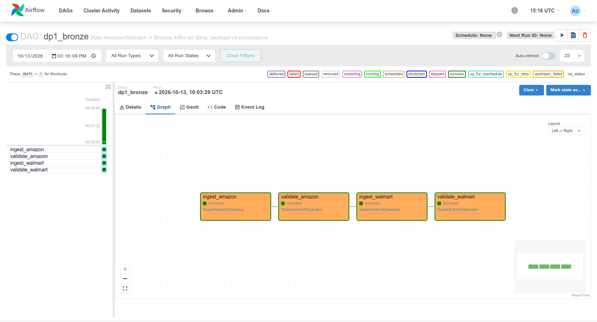

Graph của lần chạy `manual__2026-10-13T10:03:29+00:00`: Spark nạp Amazon vào Bronze,
Validate Amazon, nạp Walmart vào Bronze, rồi Validate Walmart. Cả bốn task đều
`success`. Log Validate ghi Amazon **5.827.514 = 5.827.514** dòng nguồn/đích,
Walmart **1.293.525 = 1.293.525**, và mỗi kênh **0 lỗi**.

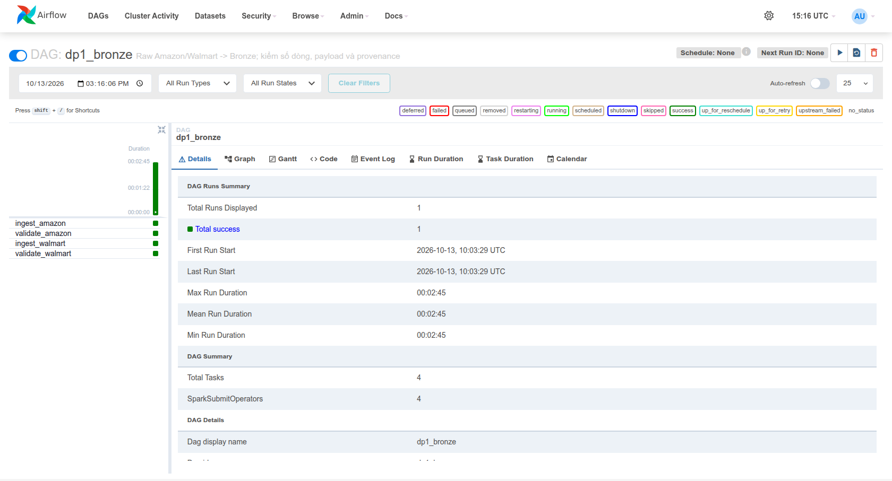

Grid cho thấy cùng một lần chạy có đủ bốn task xanh; Duration xấp xỉ 2 phút 45 giây.

## Bảng thử và bước mở rộng

`scripts/setup/setup_airflow.sh` tạo Connection `spark_default`, các Connection dùng
chung `platform_postgres`/`platform_minio`/`platform_kafka`, và các Variable `platform_*`.
`PlatformSparkSubmitOperator` đọc các nhóm cần thiết từ metadata DB tại runtime;
credential không được render vào template fields hay đưa vào application args.
MinIO credential đi qua biến môi trường AWS của driver/worker, không nằm trong
SparkConf; worker Compose nhận cùng cặp key từ `.env` để executor truy cập S3.
Mặc định Amazon nạp 10 ngày liền nhau từ 2026-04-05, Walmart đọc bảng PostgreSQL
hiện có. Hai bảng đích là `raw_amazon_orders_dp1` và
`raw_walmart_orders_dp1`, nên DAG không thay hai bảng Bronze đang làm bằng chứng.
Chạy lại setup sẽ đặt lại Connection và các Variable này về giá trị thử nghiệm.
Sau khi thử thành công, đổi Variables trong Airflow để chạy phạm vi thật. Đổi
`platform_dp1_amazon_window_days` thành `0` để chọn cả 180 ngày; chỉ đổi tên bảng đích
sang tên thật khi chủ dự án quyết định thay bảng đó.

Ba Channel mới đọc nguồn nhỏ từ `out/channels-small/source-exports`, được mount vào
Airflow và các Spark container. Tạo nguồn bằng lệnh trong
`docs/silver-five-channels.md`, rồi tạo lại bốn container sau khi thêm mount:

```bash
env -u POSTGRES_PASSWORD docker compose --profile spark --profile airflow up -d --no-deps airflow spark-master spark-worker-1 spark-worker-2
```

Bộ nguồn này dùng để chứng minh đường đi dữ liệu;
Amazon/Walmart tiếp tục dùng nguồn lớn cũ. DP2 chỉ hoàn chỉnh khi có Gold; DP3
cần bảng feature offline.

## Chặng Silver của DP2

`dags/dp2_silver.py` dùng hai bảng Bronze `_dp1` làm nguồn, chạy tuần tự:

```text
ingest_amazon_silver → validate_amazon_silver → ingest_walmart_silver → validate_walmart_silver
```

Hai job Ingest parse Order thành Order Line, quy schema và trạng thái, rồi dedup. Job
`spark_jobs/silver/validate_order_snapshots.py` kiểm bảng/cột, số Order Line không ít hơn số Order
nguồn, các khoá không trùng, cột thiết yếu không null và `run_id` đúng lần chạy.
Hai bảng đích thử là `lakehouse.silver.stg_amazon_order_lines_dp2` và
`lakehouse.silver.stg_walmart_order_lines_dp2`; chúng không thay bảng Silver khác.

Sau khi DP1 thành công, nạp Variables riêng và chạy DAG:

```bash
env -u POSTGRES_PASSWORD bash scripts/setup/setup_dp2_silver.sh
env -u POSTGRES_PASSWORD docker compose --profile airflow exec airflow airflow dags trigger dp2_silver
```

Ghi chú lịch sử: đoạn run bên dưới là **chặng Silver** của lần chạy ngày 2026-10-13;
DP2 hiện đã có Gold, SCD2 và Validate trong lần chạy 2026-10-14 được ghi ở phần sau.
Điều kiện `Order Line ≥ Order` chỉ hợp lệ với dữ liệu generator hiện tại,
nơi mỗi Order có ít nhất một dòng hàng; nó không chứng minh phép chuyển đổi từng dòng đúng.

Lần chạy `manual__2026-10-13T14:49:53+00:00` đã có cả bốn task `success`:

| Kênh | Order Bronze | Order Line Silver | Dòng không hợp lệ | Khoá trùng |
|---|---:|---:|---:|---:|
| Amazon | 5.827.514 | 8.314.312 | 0 | 0 |
| Walmart | 1.293.525 | 1.875.607 | 0 | 0 |

Các số lấy từ log của hai task Validate. Đây là lần chạy trên cửa sổ Amazon 10 ngày
và bảng Walmart hiện có, chưa phải toàn bộ Amazon 180 ngày.

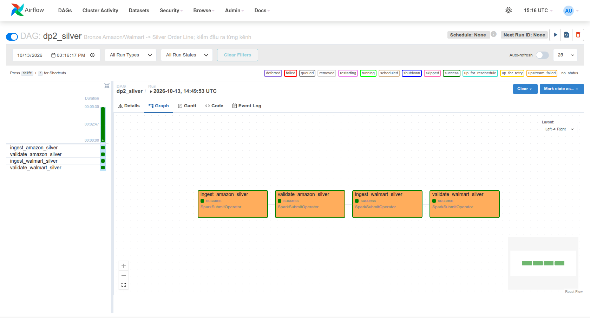

Graph của lần chạy `manual__2026-10-13T14:49:53+00:00`: hai job Silver ghi theo
thứ tự, mỗi job có Validate ngay sau. Amazon tạo 8.314.312 Order Line từ 5.827.514
Order; Walmart tạo 1.875.607 từ 1.293.525. Cả hai Validate ghi **0 dòng lỗi**
và **không có khoá trùng**.

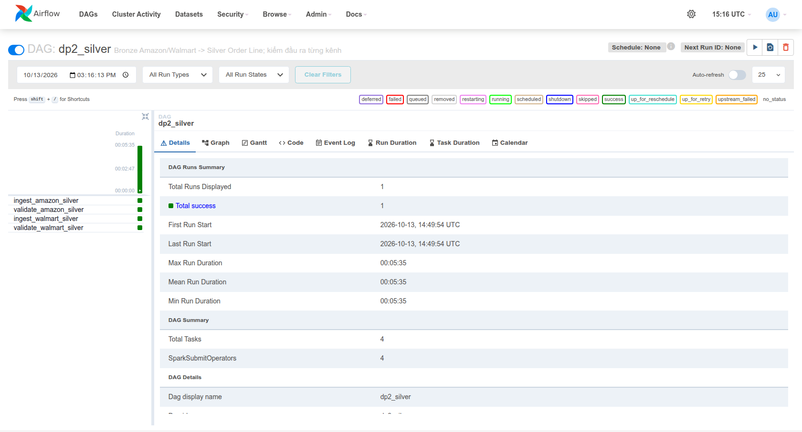

Grid xác nhận bốn task của cùng một lần chạy đều xanh; Duration xấp xỉ 5 phút 35 giây.

Ảnh được chụp từ UI đang chạy bằng `python scripts/evidence/capture_airflow_evidence.py`.
Script dùng Chrome headless và tài khoản standalone trong volume Airflow; mật khẩu
không xuất hiện trong lệnh hoặc ảnh.

## Lần chạy đủ năm Channel

DP1 `manual__2026-10-13T15:30:09+00:00` hoàn tất **10/10 task** lúc 15:35:57
UTC, thời lượng 5 phút 47 giây. Ba nguồn mới có số response bằng số dòng Bronze:

| Channel | JSONL nguồn | Bronze | Validate |
|---|---:|---:|---|
| TikTok Shop | 1.810 | 1.810 | PASS |
| Shopify | 910 | 910 | PASS |
| Shopee | 354 | 354 | PASS |

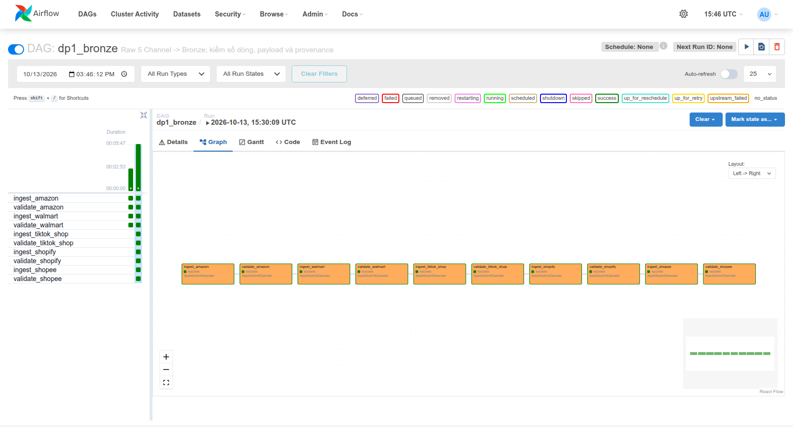

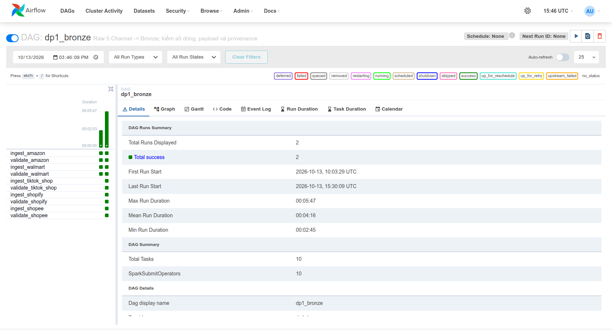

DP2 `manual__2026-10-13T15:36:21+00:00` hoàn tất **10/10 task** lúc 15:45:32
UTC, thời lượng 9 phút 10 giây. Amazon/Walmart giữ số Order Line cũ là
8.314.312 và 1.875.607. Log mới của ba Channel còn lại:

| Channel | Order duy nhất | Line trước dedup | Line sau dedup | Bản trùng bỏ | Dòng lỗi / khóa trùng |
|---|---:|---:|---:|---:|---:|
| TikTok Shop | 1.780 | 2.654 | 2.609 | 45 | 0 / 0 |
| Shopify | 891 | 1.350 | 1.316 | 34 | 0 / 0 |
| Shopee | 347 | 524 | 514 | 10 | 0 / 0 |

Mỗi Validate đối chiếu số Order riêng biệt giữa Bronze và Silver, kiểm tiền,
trường bắt buộc, `run_id` và khóa Order Line. Cả ba ghi `Silver validate: PASS`.

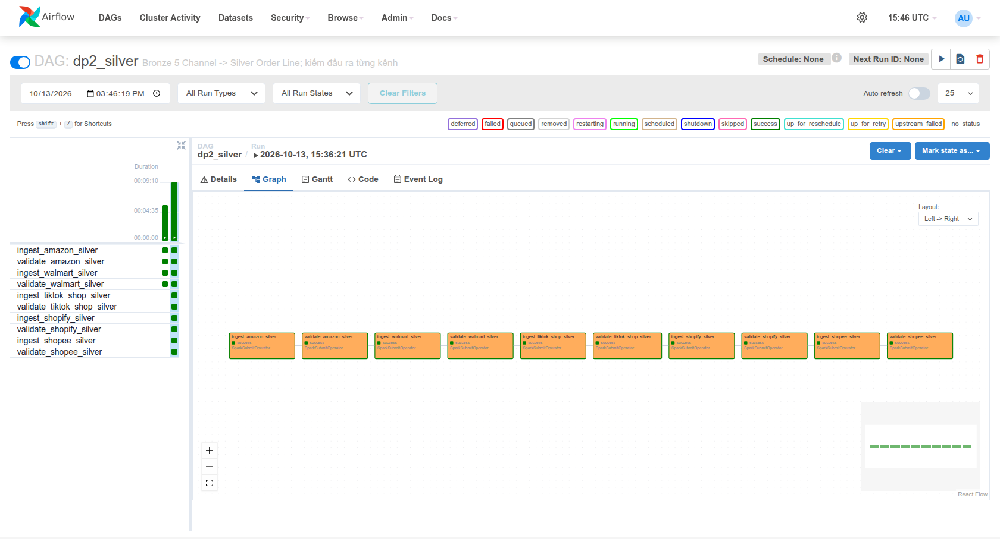

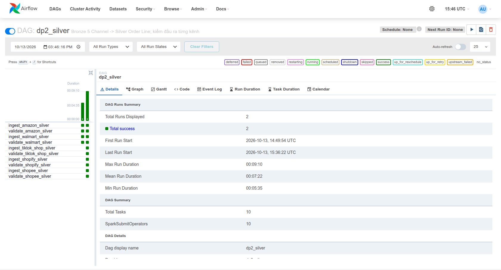

Ảnh mới được chụp bằng
`.venv/bin/python scripts/evidence/capture_airflow_evidence.py --suffix=-five-channels`;
ảnh của lần chạy bốn task trước vẫn được giữ riêng để so tiến độ. DP2 mới chứng
minh chặng Silver tại thời điểm đó; phần Gold của run sau được ghi bên dưới.

## DP2 hoàn chỉnh đến Gold

Run `manual__2026-10-14T03:53:52+00:00` hoàn tất **12/12 task** lúc 04:10:23
UTC. Mười task Silver/Validate của năm Channel đều `success`, sau đó
`build_gold_order_lines` và `validate_gold_order_lines` cũng `success`. Gold có
**10.194.358** Order Line, đúng tổng năm bảng Silver; Validate ghi **0 dòng
không hợp lệ và 0 khóa trùng**. Số dòng theo Channel và schema xem
[`gold.md`](gold.md).

Lần đầu Walmart lỗi `Java heap space` khi executor mặc định chỉ có 1 GiB.
Worker đã có 2 GiB nhưng không tự tăng heap của executor. Task Walmart được
chạy lại **trong cùng run**, với heap 1.536 MiB, 1 core và adaptive partition
64 MiB. Log xác nhận executor nhận 1.536 MiB và Walmart ghi xong 1.875.607
Order Line trong 86,6 giây. Hai task Amazon thành công từ trước được giữ nguyên.

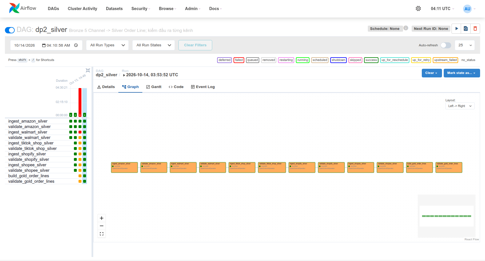

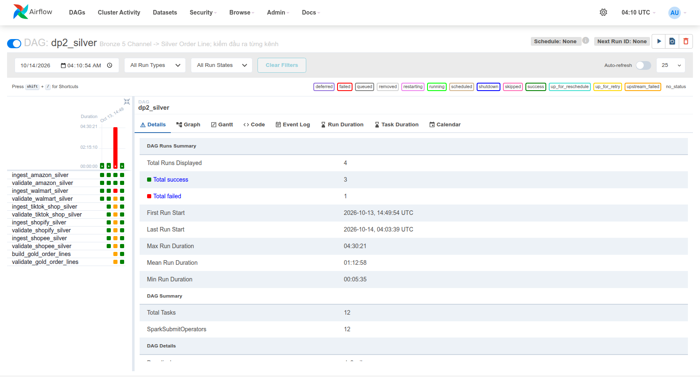

## DP2 sau khi thêm SCD2 Amazon

Cùng run `manual__2026-10-14T03:53:52+00:00` được chạy tiếp sau khi thêm
`build_amazon_order_dim → validate_amazon_order_dim` giữa Gold Build và Gold
Validate. Kết quả cuối là **14/14 task success** lúc 04:50:03 UTC. Dimension
chứa 5.779.561 phiên bản; Validate ghi `invalid=0`, `duplicate=0`,
`multiple_current=0`, `bad_fact=0`, `missing_version=0`. Fact Amazon có khóa
phiên bản tương ứng; Gold Validate vẫn `invalid=0`, khóa trùng `0`.

Lần SCD2 đầu dừng khi phát hiện cùng trạng thái Amazon có chữ nguồn khác nhau
giữa schema v0 và 2026. Job hiện so trạng thái chuẩn khi kiểm xung đột và giữ
chữ nguồn của export mới nhất. Task SCD2 được chạy lại trong cùng run; các task
Silver đã thành công không bị nạp lại.

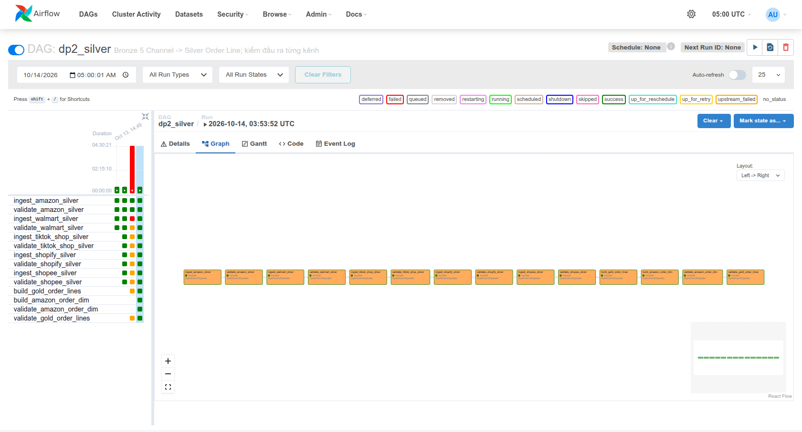

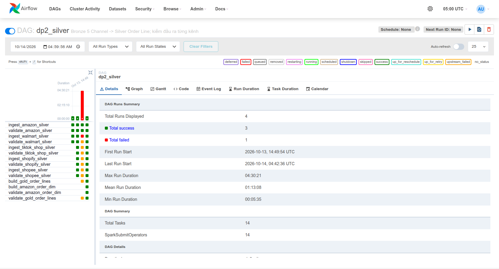

## DP3 feature offline

Run `manual__2026-10-14T04:11:15+00:00` hoàn tất **2/2 task** lúc 04:13:31
UTC. `build_return_features` tạo 10.194.358 dòng từ Gold;
`validate_return_features` xác nhận bằng số dòng Gold, 0 dòng không hợp lệ,
0 khóa trùng và `PASS`. Feature chỉ dùng thông tin biết lúc đặt Order, với
`event_timestamp` là thời điểm Order được tạo.


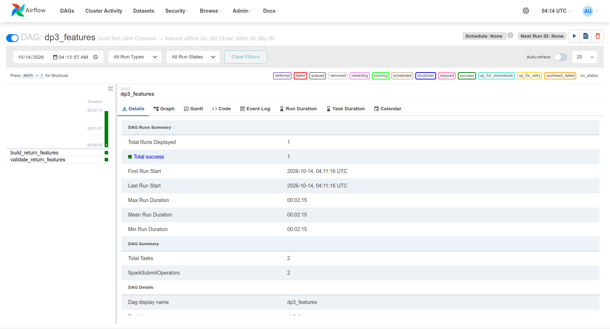

Sau khi Gold có khóa phiên bản Amazon, cùng run được chạy lại và hoàn tất
**2/2 task** lúc 05:02:40 UTC. Validate lần hai vẫn ghi `feature invalid=0`,
`duplicate_order_line_key=0`; khóa phiên bản và trạng thái không đi vào
feature của thời điểm đặt Order.

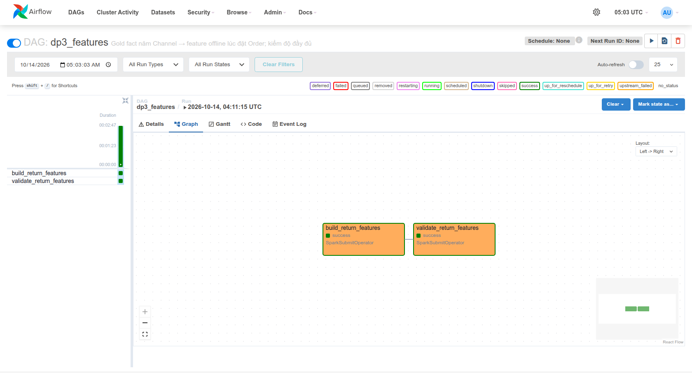

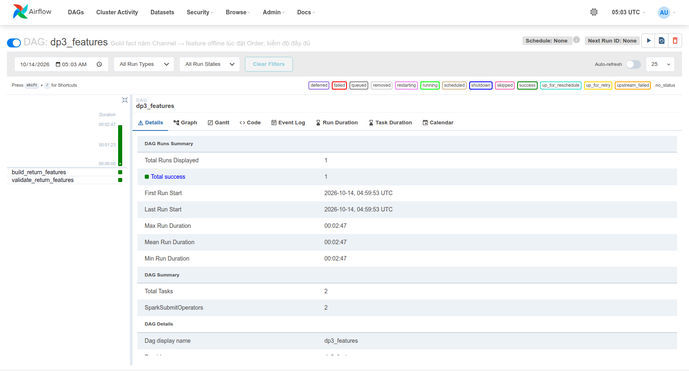

## DP3 bridge nhãn Walmart

Run `manual__2026-10-14T04:15:18+00:00` của `dp3_walmart_labels` hoàn tất
task Build/Validate lúc 04:24:21 UTC. Bảng nhãn riêng có **1.319.345** dòng,
**0 khóa trùng và 0 dòng không hợp lệ**. Lần đầu task lỗi vì Python UDF chạy
giữa driver 3.11 và worker 3.10; sau khi chuẩn bị khóa bằng Python host thành
Parquet, task được chạy lại trong cùng run và `success`. Quy tắc khóa và độ
phủ xem [`gold.md`](gold.md).

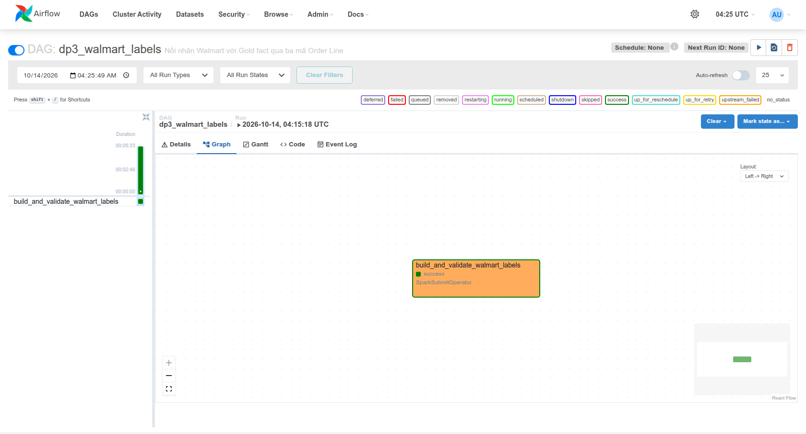

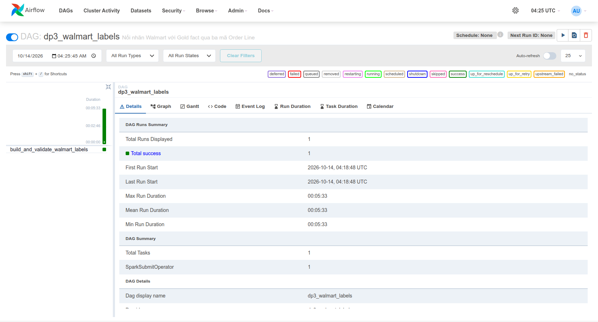

## Nguồn bổ sung CDC của DP1

`dp1_cdc` là DAG riêng cho thay đổi của bảng nguồn Walmart. Hai task
`ingest_walmart_cdc → validate_walmart_cdc` đọc Kafka theo offset rồi ghi Iceberg
Bronze; không thay thế đường nạp Batch của năm Channel. Hai lần chạy thành công
đã đưa sáu sự kiện vào `lakehouse.bronze.raw_walmart_cdc`, log Validate ghi
**Kafka 6 = Bronze 6, offset duy nhất 6, thiếu 0, lỗi 0**. Ảnh Graph/Grid và số
đo commit → Bronze ở [`cdc.md`](cdc.md).

## Trên AWS (2026-10-27 đến 2026-10-28)

Airflow và Spark chạy bằng Compose trên EC2 Sydney, đọc raw S3 và PostgreSQL EC2.
[Receipt AWS](evidence/aws/data-platform-aws-20261027.json) và
[manifest validation](evidence/aws/datahub-validation-aws-20261029.json) giữ run_id và số đo.

### DP1: nguồn → Bronze

Run `manual__2026-10-27T14:58:12+00:00`, 10/10 task success.
Trong [DAG dp1_bronze](../dags/dp1_bronze.py), `ingest_amazon` đọc JSONL S3;
`ingest_walmart` đọc JDBC; `ingest_tiktok_shop`, `ingest_shopify`, `ingest_shopee` đọc export S3 của từng kênh.
Mỗi `validate_<channel>` chạy sau ingest tương ứng, so số dòng nguồn/Bronze và kiểm payload, provenance.
Amazon có 108.248.563 dòng ở cả hai phía, lỗi 0. Các task Spark chạy lần lượt để giới hạn RAM.

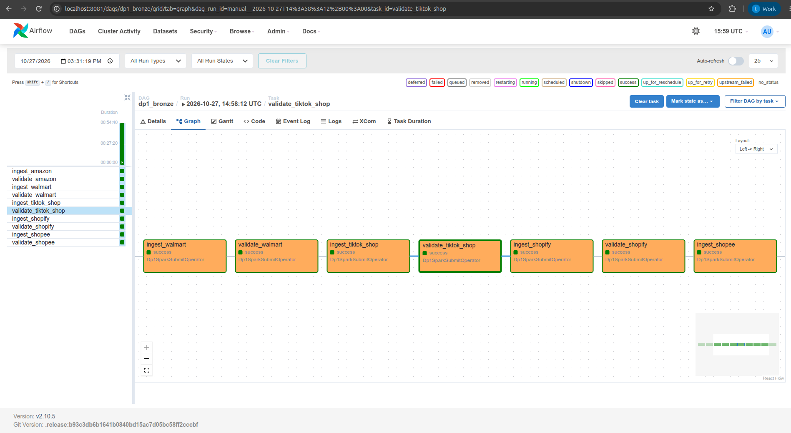

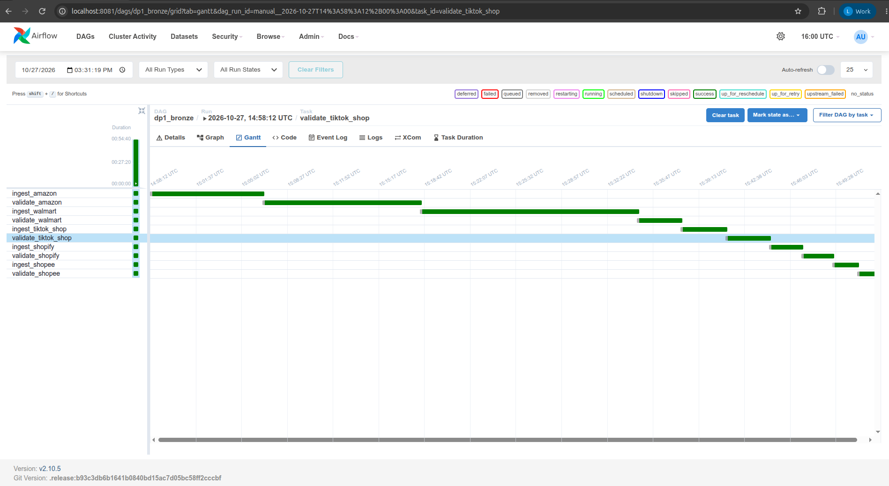

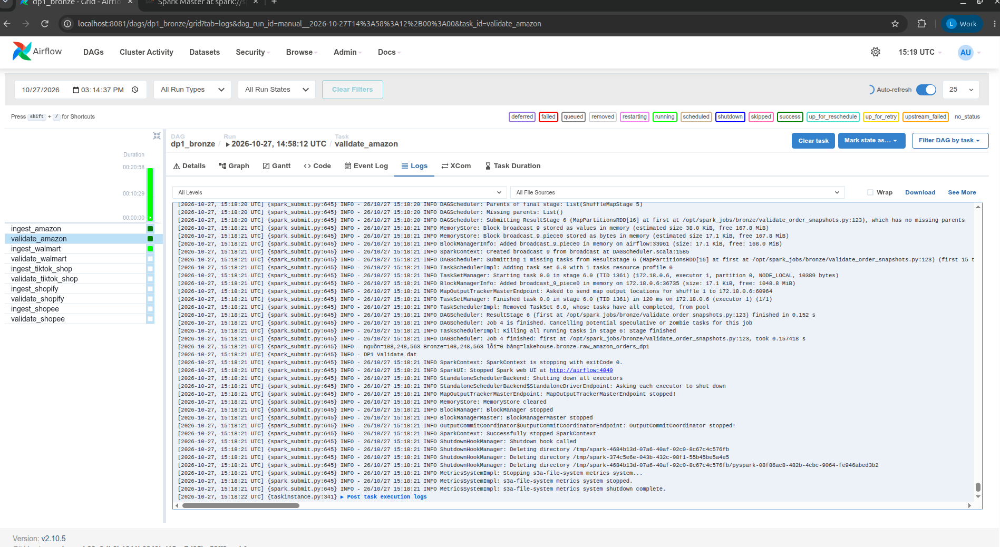

### DP2: Bronze → Silver → Gold và SCD2

Run `manual__2026-10-27T16:05:58+00:00`, 14/14 task success sau khi chạy lại validator Walmart.
[DAG dp2_silver](../dags/dp2_silver.py) có các component sau:

| Component | Vai trò |
|---|---|
| `ingest_amazon_silver` | [Parse schema Amazon cũ/mới, explode Order Line và giữ revision mới nhất](../spark_jobs/silver/build_amazon_order_snapshots.py) |
| `ingest_walmart_silver` | [Chuẩn hóa dòng JDBC Walmart, dedup theo khóa nguồn](../spark_jobs/silver/build_walmart_order_snapshots.py) |
| `ingest_tiktok_shop_silver`, `ingest_shopify_silver`, `ingest_shopee_silver` | [Chuẩn hóa và dedup export của từng Channel](../spark_jobs/silver/build_file_order_snapshots.py) |
| `validate_amazon_silver`, `validate_walmart_silver` | [Kiểm số Order Line so nguồn, cột bắt buộc, khóa và run_id](../spark_jobs/silver/validate_order_snapshots.py) |
| `validate_tiktok_shop_silver`, `validate_shopify_silver`, `validate_shopee_silver` | [Kiểm Silver của từng kênh nhỏ](../spark_jobs/silver/validate_file_order_snapshots.py) |
| `build_gold_order_lines` | [Hợp năm Silver thành fact chung](../spark_jobs/gold/build_order_snapshot_lines.py) |
| `build_amazon_order_dim` | [Tạo các phiên bản SCD2 từ snapshot Amazon Bronze](../spark_jobs/gold/build_amazon_order_status_scd2.py) |
| `validate_amazon_order_dim` | [Kiểm một bản hiện hành, khoảng hiệu lực và khóa fact → dim](../spark_jobs/gold/validate_amazon_order_status_scd2.py) |
| `validate_gold_order_lines` | [So Gold với Silver từng kênh, kiểm lỗi và khóa trùng](../spark_jobs/gold/validate_order_snapshot_lines.py) |

Gold = Silver 227.200.303 Order Line, lỗi và trùng khóa 0. Amazon SCD2 có 106.109.637 bản hiện hành,
1.062.966 bản lịch sử; các kiểm tra đều 0 lỗi. Gantt còn dấu đỏ của `validate_walmart_silver`:
receipt ghi ổ gốc đầy, dọn ổ rồi Clear và chạy lại PASS. `01:58:43` là duration trên Summary;
không dùng số đó làm thời gian đầu-cuối từ run_id đến validate cuối sau các lần Clear.

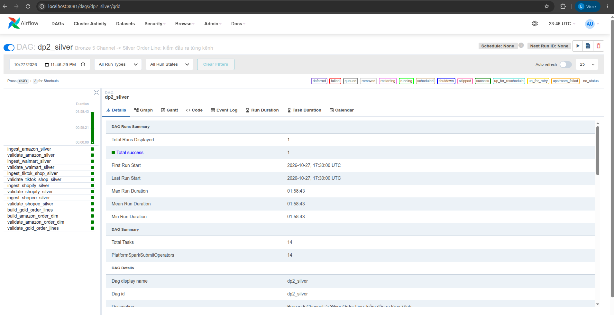

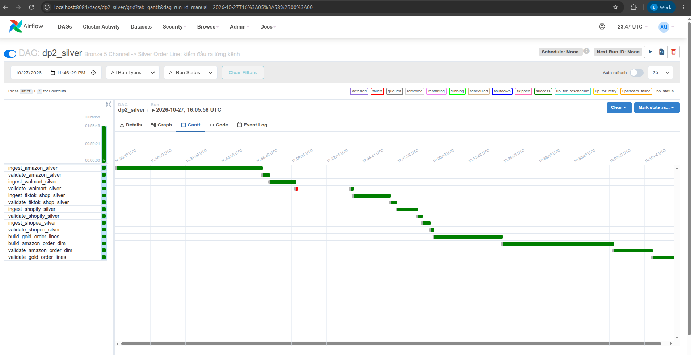

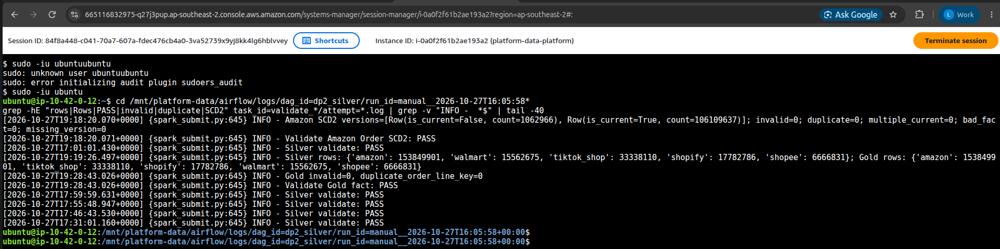

### DP3: Gold → feature offline

Run `manual__2026-10-28T00:05:21.167441+00:00`, 2/2 task success.
[DAG dp3_features](../dags/dp3_features.py): `build_return_features` gọi
[job build](../spark_jobs/gold/build_order_snapshot_return_features.py), chỉ lấy thuộc tính biết lúc đặt Order;
`validate_return_features` gọi [validator](../spark_jobs/gold/validate_order_snapshot_return_features.py),
so tập khóa với Gold, kiểm thiếu/thừa, trùng khóa và `event_timestamp = created_at`.
Feature = Gold 227.200.303 dòng; mọi số lỗi nói trên bằng 0. Gantt cho thấy validate mất 01:03:55,
lâu hơn build vì đối chiếu từng dòng; đây chưa phải chứng minh PIT join đầy đủ.

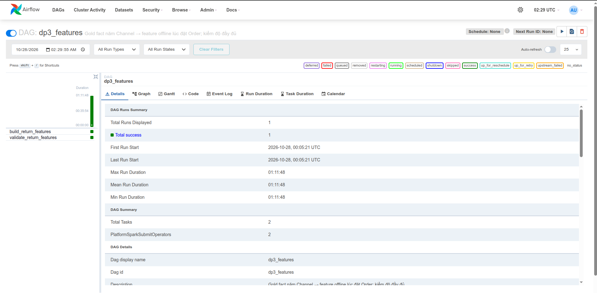

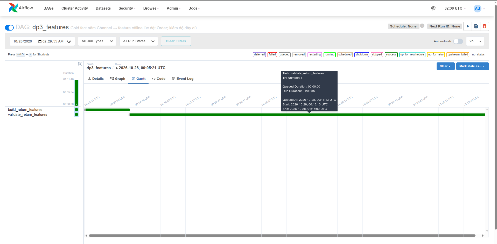

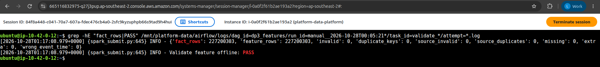
