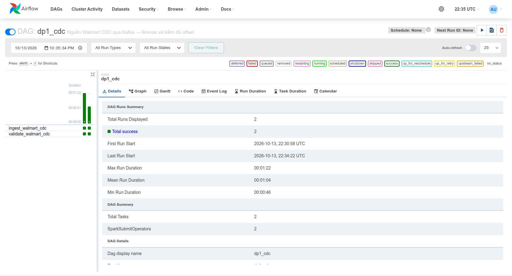
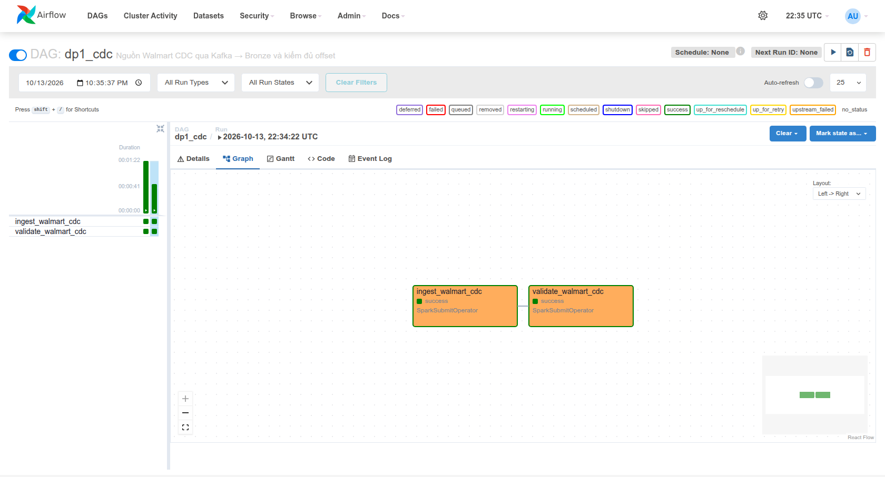
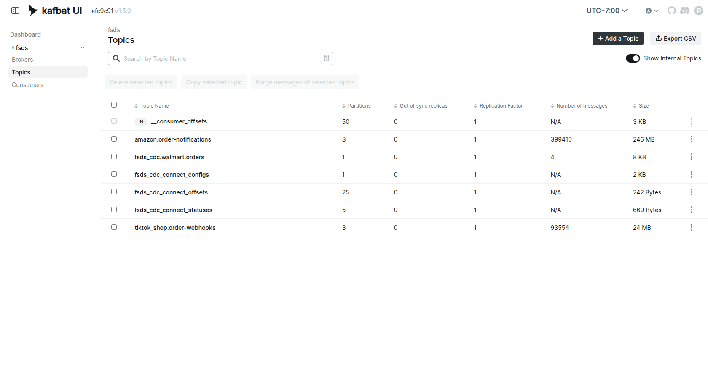
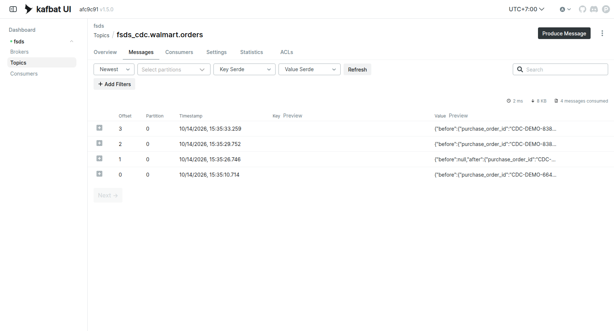

# Debezium CDC cho nguồn Walmart

Nguồn `walmart.orders` mô phỏng cơ sở dữ liệu của một phòng ban khác. DP1 hiện
đọc bảng này theo lô. Debezium đọc WAL của PostgreSQL, ghi từng thay đổi đã
commit vào Kafka topic `platform_cdc.walmart.orders` để chặng CDC Bronze xử lý.

## Cấu hình

- PostgreSQL chạy `wal_level=logical`; bảng `walmart.orders` dùng
  `REPLICA IDENTITY FULL` vì không có khóa chính, để sự kiện cập nhật/xóa chứa
  dữ liệu cũ.
- Publication chỉ bao gồm `walmart.orders`; connector dùng slot
  `platform_walmart_orders` và `pgoutput`.
- Connector dùng `snapshot.mode=no_data`: dữ liệu lịch sử đã đi qua DP1 Batch,
  còn nhánh này chỉ nhận thay đổi phát sinh sau khi đăng ký. Nếu chạy CDC từ
  đầu trên nguồn mới, phải chọn snapshot khác hoặc nạp lịch sử riêng.
- Topic có một partition để giữ thứ tự thay đổi của bản ghi minh họa; bảng
  nguồn không có khóa chính nên khóa Kafka mặc định có thể rỗng.
- Kafka Connect giữ cấu hình và offset trong ba topic nội bộ riêng. Cổng REST
  từ máy host mặc định là 8084.

Thiết kế theo [hướng dẫn PostgreSQL connector](https://debezium.io/documentation/reference/3.4/connectors/postgresql.html)
và [Kafka Connect trong Docker](https://debezium.io/documentation/reference/3.4/tutorial.html).

## Chạy

```bash
env -u POSTGRES_PASSWORD docker compose --profile cdc up -d debezium-connect kafka-ui
.venv/bin/python scripts/setup/setup_order_snapshots_debezium.py --env-file .env
.venv/bin/python scripts/evidence/measure_order_snapshots_cdc.py --env-file .env
```

`scripts/setup/setup_order_snapshots_debezium.py` kiểm tra WAL, tạo publication/topic rồi đăng ký connector.
`scripts/evidence/measure_order_snapshots_cdc.py` sao chép tạm một đơn nguồn với mã riêng, commit ba thay đổi
**thêm → cập nhật → xóa**, đợi từng sự kiện xuất hiện trong Kafka và ghi thời
gian commit → Kafka vào `out/cdc/probe-*.json`. Sau khi xóa, bảng nguồn trở về
số dòng ban đầu.

Sau khi topic có sự kiện, `dags/dp1_cdc.py` chạy
`spark_jobs/cdc/ingest_walmart_order_changes.py` và `spark_jobs/cdc/validate_walmart_order_changes.py`. Job đầu đọc
Kafka theo phạm vi offset đóng băng một lần cho `run_id`, lưu JSON dưới
`/opt/airflow/platform-control/cdc` trong volume driver Airflow. Hai task dùng
cùng boundary, partition set và start-inclusive/end-exclusive offsets;
retry không chốt lại latest. V2 ghi `(source_epoch, topic, partition, offset)`,
epoch gồm cluster ID/topic UUID, và dùng `read_committed`. Validator đọc
đúng range, kiểm thiếu/thừa/trùng, payload, loại thay đổi, mã đơn và LSN.

Cập nhật 2026-10-18: mặc định setup chọn bảng **`raw_walmart_cdc_v2`** mới;
bảng legacy thiếu epoch bị từ chối, không tự migrate hoặc ghi đè proof cũ.
Cả hai CLI cần `--run-id` và `--boundary-dir`. Phải giữ/mount cùng POSIX
control directory cho các driver; mất boundary thì validator fail.
Manifest có checksum/atomic first-writer và không chứa credentials.
Retention/truncation hoặc đổi source incarnation sẽ fail trước replay.

Helper đã có unit regression, và ngày 2026-10-18 đã chạy được **một lượt
Kafka–Spark–Iceberg v2 thành công** (mục [Kết quả CDC v2](#kết-quả-cdc-v2-ngày-2026-10-18)).
Lượt đó chỉ là đường đi bình thường. Retry giữa hai task, topic bị
recreate/reset, retention cắt offset và producer ghi thêm trong lúc đọc
**chưa được thử**. Kiểm UUID trước/sau không phải broker lock: cấm admin
recreate/reset topic đồng thời task đang đọc/ghi. Hiện nhánh local PLAINTEXT,
chưa là adapter Kafka bảo mật cho Cloud. Các kết quả từ mục "Kết quả chạy ngày
2026-10-14" trở xuống là proof **legacy** của bảng `raw_walmart_cdc`.

## Kết quả CDC v2 ngày 2026-10-18

Chạy lại bằng code hiện tại (job `spark_jobs/cdc/ingest_walmart_order_changes.py`, `spark_jobs/cdc/validate_walmart_order_changes.py`, DAG `dp1_cdc`, setup chọn
`raw_walmart_cdc_v2`). Kafka được tạo mới vì container cũ đã bị xóa khi dọn
đĩa, nên Debezium đăng ký lại connector (`snapshot.mode=no_data`) rồi
`scripts/evidence/measure_order_snapshots_cdc.py` tạo ba thay đổi `CDC-DEMO-24f0630c0caa`
([probe](evidence/cdc-probe-CDC-DEMO-24f0630c0caa.json)).

| Offset | Thay đổi | Đơn |
|---:|---|---|
| 0 | Xóa | `CDC-DEMO-8383d4cfe5a7` (probe ngày 2026-10-14) |
| 1 | Thêm | `CDC-DEMO-24f0630c0caa` |
| 2 | Cập nhật | `CDC-DEMO-24f0630c0caa` |
| 3 | Xóa | `CDC-DEMO-24f0630c0caa` |

Offset 0 là sự kiện xóa của probe cũ. Kafka cũ đã mất, nhưng replication slot
`platform_walmart_orders` trong PostgreSQL vẫn giữ thay đổi chưa được xác nhận,
nên Debezium phát lại nó. Không có sự kiện nào bị mất khi mất broker.

Run `manual__2026-10-18T05:14:10+00:00` thành công cả hai task (khoảng 1,5
phút). Log Validate:

```text
Kafka=4, Bronze=4, offsets duy nhất=4, thiếu=0, thừa=0, sai payload=0, lỗi=0
Validate CDC Bronze: PASS
```

Ingest và Validate dùng chung một boundary JSON trong
`/opt/airflow/platform-control/cdc` (volume `platform_airflow-data`); Validate chỉ đọc
dòng Bronze có đúng `source_epoch` (cluster ID/topic UUID) và nằm trong khoảng
offset đã đóng băng. Manifest kiểm ở
[`datahub-validation-v2.json`](evidence/datahub-validation-v2.json), lineage và
Quality trên DataHub ở [DataHub](datahub.md#bằng-chứng-chạy-lại-ngày-2026-10-18).

```bash
env -u POSTGRES_PASSWORD docker compose --profile spark up -d spark-master spark-worker-1 spark-worker-2
env -u POSTGRES_PASSWORD docker compose --profile airflow up -d airflow
env -u POSTGRES_PASSWORD bash scripts/setup/setup_dp1_cdc.sh
env -u POSTGRES_PASSWORD docker compose --profile airflow exec -T airflow airflow dags trigger dp1_cdc
```

Bằng chứng **commit → Bronze** cần thời điểm hoàn tất task ingest cho cùng lần
probe; không suy diễn thời gian đó từ phép đo commit → Kafka.

## Kết quả chạy ngày 2026-10-14

Connector `platform-walmart-orders` và task 0 ở trạng thái `RUNNING` trên Debezium
3.4.3.Final. Lần probe `CDC-DEMO-783bee6f9cad` tạo đúng ba sự kiện:

| Thay đổi | Offset Kafka | Commit → Kafka |
|---|---:|---:|
| Thêm | 0 | 583,2 ms |
| Cập nhật | 1 | 451,6 ms |
| Xóa | 2 | 608,7 ms |

File gốc `out/cdc/probe-CDC-DEMO-783bee6f9cad.json` ghi thời điểm commit, offset,
LSN và trạng thái `before`/`after` của từng sự kiện. Probe báo không còn dòng mẫu
trong PostgreSQL sau lần xóa.

Lần Airflow đầu (`manual__2026-10-13T22:30:58+00:00`) có cả Ingest và Validate
thành công. Log Validate: **Kafka 3 = Bronze 3**, offset duy nhất 3, thiếu 0, lỗi 0.

Để đo khi các service đã sẵn sàng, probe thứ hai
`CDC-DEMO-6647c5e27b8c` tạo thêm ba thay đổi ở offset 3–5. Airflow run
`manual__2026-10-13T22:34:22+00:00` nạp thêm dữ liệu vào
`lakehouse.bronze.raw_walmart_cdc`; log Validate ghi **Kafka 6 = Bronze 6**,
offset duy nhất 6, thiếu 0, lỗi 0. Cả hai run được chụp trong UI:





Task Ingest của run thứ hai kết thúc lúc **22:34:47,559 UTC**. Lấy thời điểm đó
trừ thời điểm từng `COMMIT` trả về trong file probe cho giới hạn trên của độ trễ
**commit → Bronze**:

| Thay đổi | Offset | Commit → Kafka | Commit → Bronze, giới hạn trên |
|---|---:|---:|---:|
| Thêm | 3 | 623,3 ms | 44,380 giây |
| Cập nhật | 4 | 466,6 ms | 35,178 giây |
| Xóa | 5 | 554,3 ms | 31,261 giây |

Giới hạn trên dùng thời điểm task báo thành công; snapshot Iceberg có thể được
commit sớm hơn. Phép đo có cả thời gian **kích hoạt DAG bằng tay** (6–19 giây sau
các commit) và khởi động Spark. Đây là cấu hình Batch trên máy phát triển, không phải
độ trễ riêng của Debezium hoặc một dịch vụ CDC chạy liên tục.

Sau khi probe kết thúc, `SELECT count(*) FROM walmart.orders` trả **1.293.525**.
Một lượt Batch đọc toàn bộ bảng để phát hiện ba thay đổi sẽ phải xét lượng dòng
này; CDC phát đúng ba thông điệp mới. Lịch Batch một lần/ngày là chính sách của
bài toán, nên độ chờ 0–24 giờ do lịch chạy, không phải giới hạn tốc độ của SQL.

## Xác nhận trên kafka-ui (chạy lại 2026-10-14)

Service `kafka-ui` (image `kafbat/kafka-ui:v1.5.0`, profile `cdc`, cổng 8085)
cho xem trực tiếp topic mà Debezium ghi vào, thay vì chỉ đọc số offset bằng CLI:

```bash
env -u POSTGRES_PASSWORD docker compose --profile cdc up -d postgres debezium-connect kafka-ui
.venv/bin/python scripts/setup/setup_order_snapshots_debezium.py --env-file .env
.venv/bin/python scripts/evidence/measure_order_snapshots_cdc.py --env-file .env
```

Danh sách topic cho thấy `platform_cdc.walmart.orders` có 1 partition và **4 message**
(3 KB), bên cạnh hai topic Stream của generator:



Tab Messages của topic cho thấy đúng bốn sự kiện ở offset 0–3, mỗi preview là một
JSON Debezium có `before`/`after` và `purchase_order_id`:



Probe mới `CDC-DEMO-8383d4cfe5a7` tạo ba thay đổi ở offset 1–3:

| Thay đổi | Offset | Commit → Kafka | Ghi chú |
|---|---:|---:|---|
| Thêm | 1 | 14.529,9 ms | lượt đầu sau khi connector khởi động, còn warm-up |
| Cập nhật | 2 | 300,1 ms | |
| Xóa | 3 | 492,0 ms | |

Offset 0 là sự kiện **xóa** của probe cũ `CDC-DEMO-6647c5e27b8c`, được phát lại:
slot logic `platform_walmart_orders` nằm trong PostgreSQL nên khi Debezium khởi động
lại, nó đọc tiếp phần WAL chưa xác nhận. Đây là hành vi đúng của CDC giữ slot, và
cũng là lý do probe luôn ghi offset thật thay vì giả định bắt đầu từ 0.

Trạng thái connector và task 0 đều `RUNNING` trên Debezium 3.4.3.Final, lưu ở
[`docs/evidence/debezium-connector-status.json`](evidence/debezium-connector-status.json).
