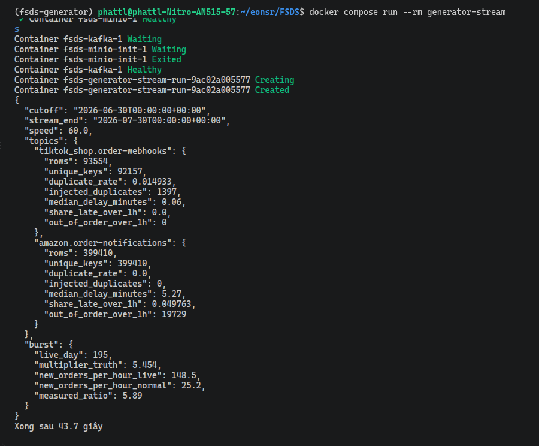
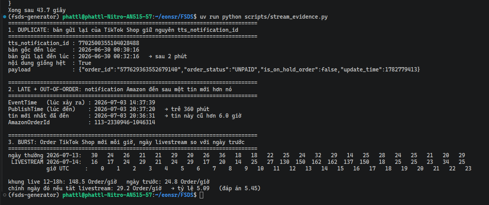
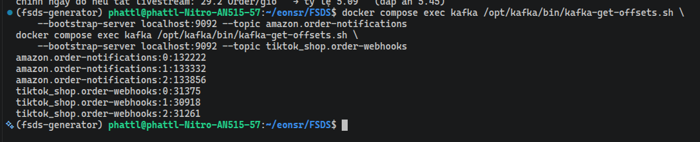
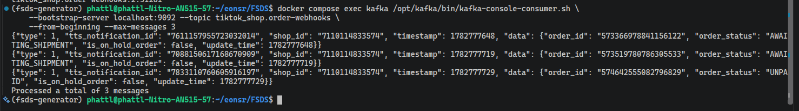

# Báo cáo chất lượng dữ liệu của Data Generator (Stream)

Báo cáo này đối chiếu các dòng rubric về streaming với số đo thật. Phần Batch nằm ở [data-quality-report-batch.md](data-quality-report-batch.md). Thiết kế và bản đồ code xem [generator-design.md, mục Stream](generator-design.md#stream).

## Phạm vi

Batch đạt ngưỡng 100 GB bằng `configs/scale-100gb.yaml`, nhưng Stream không phát ở quy mô đó: 851.506 Order/ngày nhân 30 ngày Stream sẽ là hàng chục triệu notification, vượt mục đích kiểm streaming. Stream trong báo cáo này dùng `configs/default.yaml` (4.000 Order/ngày) — cùng mục `streaming_problems` và `drift.tiktok_live` với bản 100 GB, nên mọi tỷ lệ (trễ, trùng, burst) giống nhau; chỉ số tuyệt đối nhỏ hơn. Ngưỡng 100 GB chỉ áp cho Batch Amazon + Walmart ở `/data/raw`.

## Lần chạy

- Cấu hình: `configs/default.yaml` (seed 42, `cutoff` 2026-06-30, 30 ngày Stream tới 2026-07-30, livestream TikTok ngày mô phỏng 195).
- Nơi nhận: Kafka một node trong Docker Compose, hai topic `amazon.order-notifications` và `tiktok_shop.order-webhooks`. Cách dựng xem [Docker.md](Docker.md).
- `STREAM_SPEED=60`, tức phát nhanh gấp 60 lần nhịp cấu hình. Một lần phát hết 43,7 giây. Ở nhịp thật (`STREAM_SPEED=1`) sẽ là khoảng 40 phút.
- Lệnh chạy:

```bash
docker compose up -d kafka
docker compose run --rm generator-stream        # phát và in số đo
uv run python scripts/stream_evidence.py        # in ví dụ cụ thể của từng vấn đề
```

Hai nguồn số trong báo cáo này:

- **Số tổng** do generator đếm trong lúc phát và ghi vào `stream_manifest.json` trên MinIO. Số tin trong Kafka được đếm lại bằng `kafka-get-offsets.sh` để xác nhận không mất và không thừa tin.
- **Ví dụ cụ thể** do `scripts/stream_evidence.py` phát lại Stream trong bộ nhớ (không cần Kafka) và chỉ ra một trường hợp thật cho mỗi vấn đề. Đây là phần đối xứng của lệnh `python -m generator report` bên Batch.

## Tóm tắt theo rubric

| Dòng rubric | Kết quả | Số đo chính |
|---|---|---|
| Simulate late arrival | Đạt | Amazon trễ trung vị 5,27 phút, 4,98% trễ hơn 1 giờ (mục tiêu 5 phút và 5%) |
| Simulate out-of-order | Đạt | 19.729 tin Amazon đến sau một tin có `EventTime` muộn hơn quá 1 giờ, bằng 98,8% số tin trễ nặng |
| Simulate duplicate | Đạt | TikTok Shop trùng 1,49% (mục tiêu 1,5%), bản trùng giữ nguyên `tts_notification_id` |
| Simulate burst | Đạt | Giờ cao điểm livestream gấp 5,89 lần giờ thường (mục tiêu 5 đến 8 lần, đáp án của lần chạy là 5,45) |
| Using generator configuration | Đạt | Mọi tham số nằm trong mục `streaming_problems` và `drift.tiktok_live` của `configs/*.yaml` |
| Publish to a streaming platform | Đạt | 492.964 tin vào hai topic Kafka, số tin trong Kafka khớp số generator đếm |

## Số đo của lần chạy

```json
{
  "cutoff": "2026-06-30T00:00:00+00:00",
  "stream_end": "2026-07-30T00:00:00+00:00",
  "speed": 60.0,
  "topics": {
    "tiktok_shop.order-webhooks": {
      "rows": 93554,
      "unique_keys": 92157,
      "duplicate_rate": 0.014933,
      "injected_duplicates": 1397,
      "median_delay_minutes": 0.06,
      "share_late_over_1h": 0.0,
      "out_of_order_over_1h": 0
    },
    "amazon.order-notifications": {
      "rows": 399410,
      "unique_keys": 399410,
      "duplicate_rate": 0.0,
      "injected_duplicates": 0,
      "median_delay_minutes": 5.27,
      "share_late_over_1h": 0.049763,
      "out_of_order_over_1h": 19729
    }
  },
  "burst": {
    "live_day": 195,
    "multiplier_truth": 5.454,
    "new_orders_per_hour_live": 148.5,
    "new_orders_per_hour_normal": 25.2,
    "measured_ratio": 5.89
  }
}
```



## Chi tiết từng vấn đề

### Số lượng tin nhắn

| Topic | Tin nhắn | Tỷ trọng Order của Channel | Ước tính |
|---|---|---|---|
| `amazon.order-notifications` | 399.410 | 67% (US 45%, UK 12%, DE 10%) | 30 × 4.000 × 0,67 × 5 = 402.000 |
| `tiktok_shop.order-webhooks` | 93.554 | 15% | 30 × 4.000 × 0,15 × 5 = 90.000, cộng phần livestream |

Ước tính lấy 5 lần đổi Order Status cho mỗi Order (`pending_payment`, `awaiting_shipment`, `shipped`, `delivered`, `completed`). Số đo thấp hơn ước tính một chút vì Order tạo gần `stream_end` chưa kịp đi hết vòng đời, và khoảng 3% Order bị hủy nên chỉ có ba lần đổi trạng thái.

Chỉ Amazon và TikTok Shop có mặt trong Stream ở bước này. Shopify (webhook), Walmart và Shopee (polling theo lô) làm ở bước 4.

### Duplicate

| Topic | Tin nhắn | Khóa khác nhau | Bản trùng đã chèn | Tỷ lệ trùng | Mục tiêu |
|---|---|---|---|---|---|
| `tiktok_shop.order-webhooks` | 93.554 | 92.157 | 1.397 | 1,49% | 1,5% |
| `amazon.order-notifications` | 399.410 | 399.410 | 0 | 0% | 0% |

Ba con số của TikTok Shop ăn khớp: 93.554 − 92.157 = 1.397, đúng bằng số bản trùng generator đã chèn. Amazon bằng 0 là đúng thiết kế, vì chỉ webhook của TikTok Shop và Shopify mới gửi trùng (xem [generator-design.md, mục 5](generator-design.md#streaming)).

Bản trùng giữ **nguyên** `tts_notification_id` và nguyên nội dung, chỉ khác thời điểm đến (sau 2 hoặc 30 phút, theo lịch thử lại của TikTok Shop). Vì vậy Flink dedup được bằng đúng khóa đó.

Tỷ lệ trùng đo bằng `1 - count(distinct tts_notification_id) / count(*)`. Để ra đúng `r` sau khi chèn, xác suất gửi lại mỗi tin phải là `p = r / (1 - r)`, vì bản gửi lại cũng làm tổng số tin tăng lên. Với `r` = 1,5% thì `p` khoảng 1,52%.

Một cặp thật, lấy từ `scripts/stream_evidence.py`:

```text
tts_notification_id : 7702500355104028488
bản gốc đến lúc     : 2026-06-30 00:30:16
bản gửi lại đến lúc : 2026-06-30 00:32:16   → sau 2 phút
nội dung giống hệt  : True
payload             : {"order_id":"577629363552679140","order_status":"UNPAID","is_on_hold_order":false,"update_time":1782779413}
```

### Late arrival và out-of-order

| Chỉ số | Amazon | TikTok Shop | Mục tiêu (Amazon) |
|---|---|---|---|
| Độ trễ trung vị | 5,27 phút | 0,06 phút | 5 phút |
| Tỷ lệ trễ hơn 1 giờ | 4,98% | 0% | 5% |
| Tin lệch thứ tự quá 1 giờ | 19.729 | 0 | có |

Notification Amazon mang hai mốc thời gian: `EventTime` là lúc Order đổi trạng thái, `NotificationMetadata.PublishTime` là lúc tin đến. Khoảng cách giữa hai mốc chính là độ trễ, và Flink đo độ trễ theo `EventTime` nên tốc độ phát không ảnh hưởng tới số này.

Độ trễ trung vị đo được 5,27 phút, cao hơn mục tiêu 5 phút một chút, vì 5% tin trễ nặng (1 đến 6 giờ) kéo trung vị lên.

Cột lệch thứ tự đếm: tin đến nơi mà `EventTime` của nó đã cũ hơn quá 1 giờ so với `EventTime` lớn nhất đã đến trước đó. Kiểm tra chéo: 5% của 399.410 là 19.970 tin trễ nặng, trong đó 19.729 tin rơi vào cảnh lệch thứ tự, tức **98,8%**. Gần như mọi tin trễ nặng đều đến sau các tin mới hơn nó, đúng như thiết kế.

TikTok Shop bằng 0 ở cả hai cột là đúng: webhook TikTok chỉ trễ vài giây, còn bản gửi lại chậm nhất cũng chỉ 30 phút, chưa tới ngưỡng 1 giờ.

Tin trễ nặng nhất của lần chạy, lấy từ `scripts/stream_evidence.py`:

```text
EventTime   (lúc xảy ra) : 2026-07-03 14:37:39
PublishTime (lúc đến)    : 2026-07-03 20:37:20   → trễ 360 phút
tin mới nhất đã đến      : 2026-07-03 20:36:31   → tin này cũ hơn 6.0 giờ
AmazonOrderId            : 113-2330946-1046314
```

Tin này xảy ra lúc 14:37 nhưng mãi 20:37 mới tới, trong khi tin của các Order khác xảy ra tận 20:36 đã tới trước. Flink phải giữ cửa sổ đủ rộng, hoặc chấp nhận bỏ tin, mới xử lý đúng trường hợp này.

### Burst của livestream TikTok

| Chỉ số | Giá trị |
|---|---|
| Ngày mô phỏng có livestream | 195 (12:00 đến 18:00 UTC) |
| Hệ số nhân, đáp án của lần chạy | 5,454 |
| Order TikTok mới mỗi giờ trong buổi live | 148,5 |
| Order TikTok mới mỗi giờ, trung bình 29 ngày Stream còn lại | 25,2 |
| Tỷ lệ đo được | 5,89 |

Burst được tạo ở **lõi mô phỏng**, không ở lớp giao hàng: trong 6 giờ live, lõi sinh thêm Order TikTok Shop sao cho tốc độ tổng gấp `live_multiplier` lần bình thường. Cách làm giống Sale Event kiểu Prime Day của Batch, tức đổi tham số của lõi theo lịch chứ không sửa dữ liệu sau khi sinh. Hệ số được rút một lần cho mỗi lần chạy trong khoảng cấu hình `[5, 8]` và ghi vào manifest làm đáp án.

Order thêm dùng bộ sinh số ngẫu nhiên riêng (`rng_for(seed, "tiktok_live_orders", day)`), nên bật hay tắt livestream không làm đổi các Order khác của ngày đó.

**Ghi chú về `measured_ratio`.** Số 5,89 cao hơn đáp án 5,45, và đây không phải lỗi. Mẫu số của phép chia là **trung bình của 29 ngày Stream còn lại** (25,2 Order mỗi giờ), trong khi riêng khung giờ đó của ngày 195 vốn đã đông hơn trung bình:

| Cách so | Order mỗi giờ | Tỷ lệ |
|---|---|---|
| Trung bình 29 ngày Stream còn lại | 25,2 | 5,89 |
| Chính ngày 195, nếu tắt livestream | 29,2 | 5,09 |
| Đáp án generator rút ra | | 5,45 |

Số Order mỗi ngày rút theo phân phối Poisson nên dao động: các ngày Stream nằm trong khoảng 21,8 đến 28,3 Order mỗi giờ ở khung 12:00 đến 18:00, và ngày 195 rơi vào đầu cao. Đếm riêng phần Order do livestream tạo thêm được 716 Order, so với kỳ vọng 668 (sai số Poisson khoảng ±26).

Cả hai cách so đều nằm trong khoảng mục tiêu 5 đến 8 lần. Khi đọc `measured_ratio`, cần nhớ nó so với mặt bằng chung của các ngày khác, nên chịu ảnh hưởng của việc ngày livestream vốn đông hay vắng.

Hai dòng cuối của `scripts/stream_evidence.py` in cả ba con số này, nên kiểm chứng lại được mà không cần Kafka.

Order TikTok Shop mới mỗi giờ, ngày livestream đặt cạnh ngày ngay trước đó, lấy từ `scripts/stream_evidence.py`:

```text
ngày thường 2026-07-13:   30   24   26   21   21   29   20   26   36   18   18   22   25   24   32   29   14   25   28   24   25   21   20   29
 LIVESTREAM 2026-07-14:   16   17   24   29   21   24   29   17   20   14   25   27  130  150  162  162  137  150   18   25   25   23   34   25
               giờ UTC:    0    1    2    3    4    5    6    7    8    9   10   11   12   13   14   15   16   17   18   19   20   21   22   23
```

Sáu giờ 12:00 đến 18:00 bật hẳn lên (130 đến 162 Order mỗi giờ), các giờ còn lại của ngày đó vẫn bằng ngày thường. Burst bắt đầu và kết thúc đúng khung giờ cấu hình, không lan sang phần còn lại của ngày.



### Nhịp phát

Burst phải kéo dài đủ lâu theo đồng hồ thật thì mới quan sát được trên Flink UI (throughput, backpressure). Nếu phát đều 60 giây thật cho mỗi ngày mô phỏng thì buổi live 6 giờ chỉ kéo dài khoảng 15 giây.

| Loại ngày | Giây thật mỗi ngày mô phỏng | Buổi live kéo dài |
|---|---|---|
| Ngày thường | 60 | |
| Ngày có livestream (195) | 600 | khoảng 150 giây |

Tổng một lần phát đủ 30 ngày: 29 × 60 + 600 = 2.340 giây, khoảng 40 phút. Tham số `--speed` chia nhỏ thời gian chờ để chạy thử nhanh: lần chạy trong báo cáo này dùng `--speed 60` nên hết 43,7 giây. Late arrival không bị ảnh hưởng bởi tốc độ phát, vì Flink đo theo `EventTime` trong payload.

### Nơi nhận

Khóa Kafka của mỗi tin là mã đơn gốc (`AmazonOrderId`, `data.order_id`), nên mọi tin của cùng một Order vào cùng một partition và giữ nguyên thứ tự với nhau. Lệch thứ tự chỉ xảy ra **giữa các Order khác nhau**, đúng như mong muốn.

```bash
docker compose exec kafka /opt/kafka/bin/kafka-get-offsets.sh \
    --bootstrap-server localhost:9092 --topic amazon.order-notifications
docker compose exec kafka /opt/kafka/bin/kafka-get-offsets.sh \
    --bootstrap-server localhost:9092 --topic tiktok_shop.order-webhooks
```

| Topic | Partition 0 | Partition 1 | Partition 2 | Tổng | Generator đếm |
|---|---|---|---|---|---|
| `amazon.order-notifications` | 132.222 | 133.332 | 133.856 | 399.410 | 399.410 |
| `tiktok_shop.order-webhooks` | 31.375 | 30.918 | 31.261 | 93.554 | 93.554 |

Hai cột cuối bằng nhau, nghĩa là không mất và không thừa tin nào trên đường vào Kafka.

Kafka giữ lại tin của mọi lần chạy trước. Muốn số tổng khớp đúng `rows` thì xóa dữ liệu Kafka trước khi phát lại:

```bash
docker compose stop kafka && docker compose rm -f kafka && docker volume rm fsds_kafka-data
docker compose up -d kafka
```



Đọc thử vài tin để xác nhận đúng dạng gốc của Channel:

```bash
docker compose exec kafka /opt/kafka/bin/kafka-console-consumer.sh \
    --bootstrap-server localhost:9092 --topic tiktok_shop.order-webhooks \
    --from-beginning --max-messages 3
```

```json
{"type": 1, "tts_notification_id": "7611157955723032014", "shop_id": "7110114833574",
 "timestamp": 1782777648,
 "data": {"order_id": "573366978841156122", "order_status": "AWAITING_SHIPMENT",
          "is_on_hold_order": false, "update_time": 1782777648}}
```



## Ba Channel nguồn nhỏ

Nguồn nhỏ `out/channels-small` sinh đủ năm Channel cho **Batch** (xem báo cáo Batch). Stream chưa phát ba Channel mới vì chỉ Amazon và TikTok Shop có renderer sự kiện (notification/webhook); Shopify, Walmart và Shopee đến theo lô polling nên thuộc bước sau. Hai topic hiện có đã phủ hai dạng streaming chính cần kiểm: late arrival/out-of-order của Amazon và duplicate/burst của TikTok Shop.

## Giả định và việc còn mở

- **Dạng notification của Amazon là giả định, mức Thấp.** Tài liệu chính thức của SP-API Notifications chưa đọc được, nên tên field do dự án tự đặt theo `ORDER_CHANGE`. Ghi chú này cũng nằm ở đầu `generator/channels/amazon.py` và trong [channel-sources.md](channel-sources.md). Dạng webhook của TikTok Shop thì lấy từ tài liệu chính thức, mức Cao.
- Notification Amazon trong Stream luôn dùng giá trị trạng thái kiểu Orders v0 (`Shipped`), không đổi theo ngày chuyển schema như bên Batch.
- Livestream mới gây burst, chưa gây concept drift (tỷ lệ trả quần áo tăng gần gấp đôi). Phần đó làm ở bước 4.
- Shopify (webhook, trùng 1,5%), Walmart và Shopee (polling, đến theo lô 5 đến 15 phút) chưa có trong Stream.
