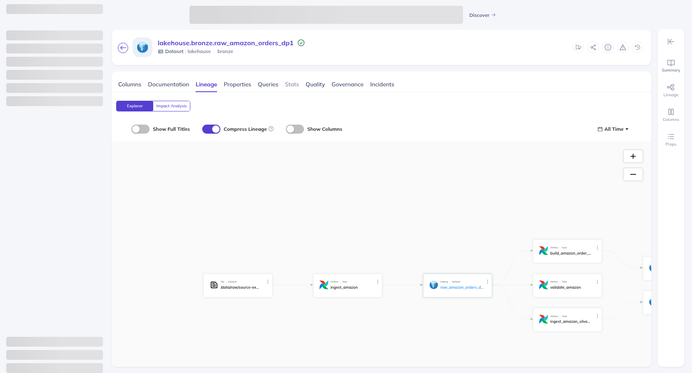
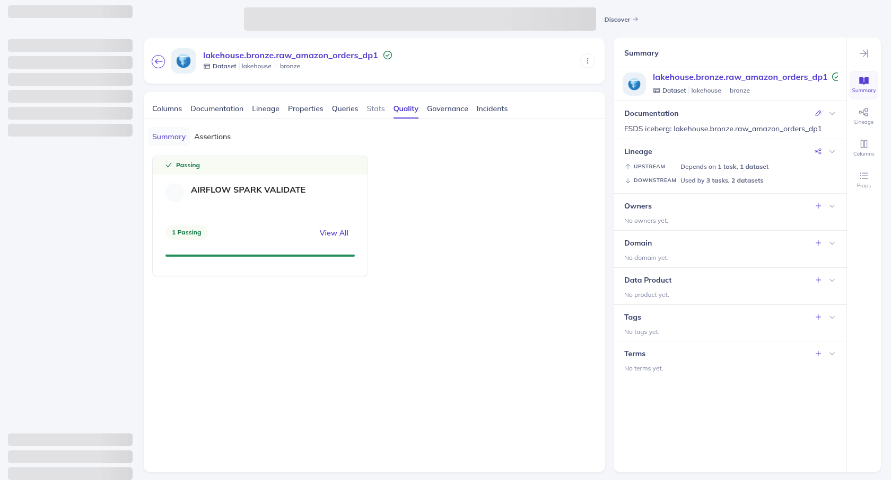
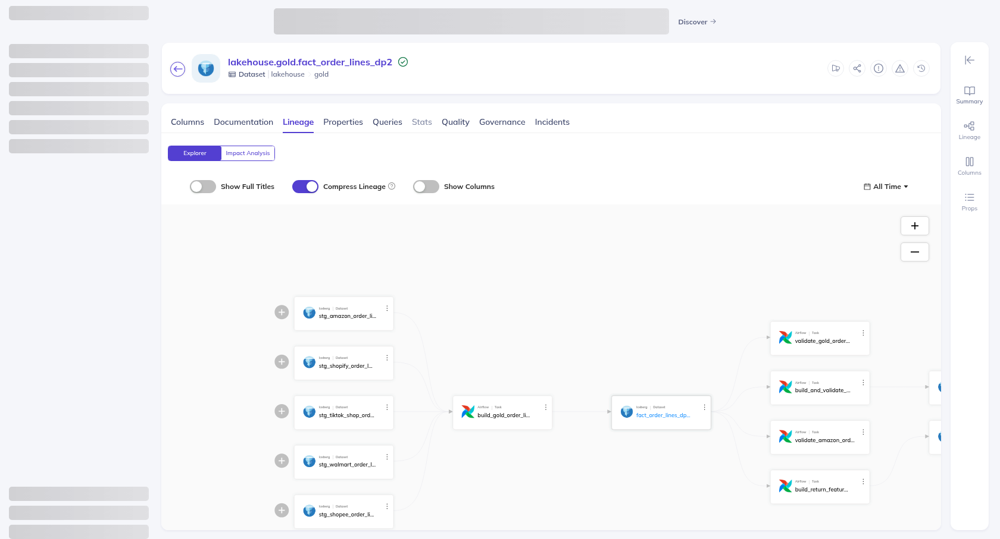
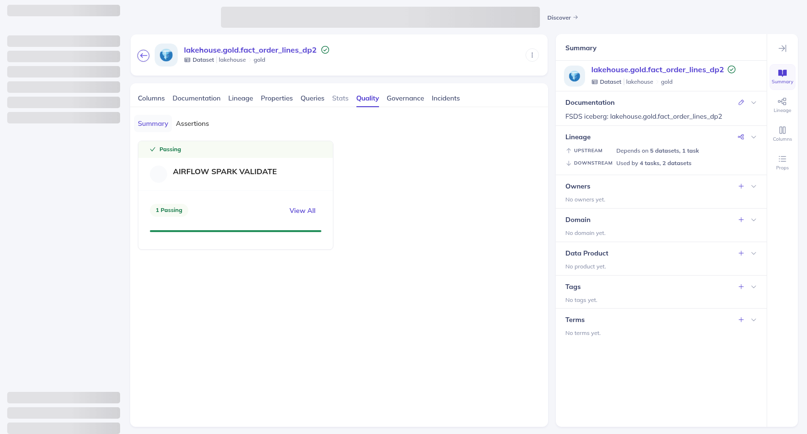
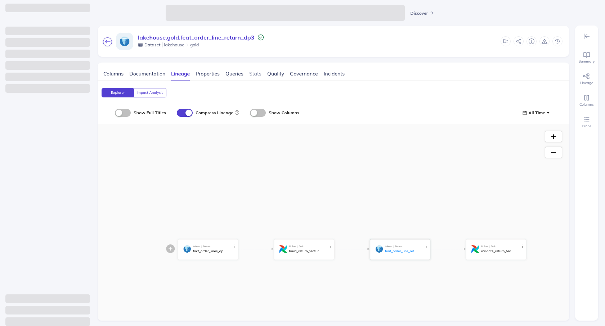
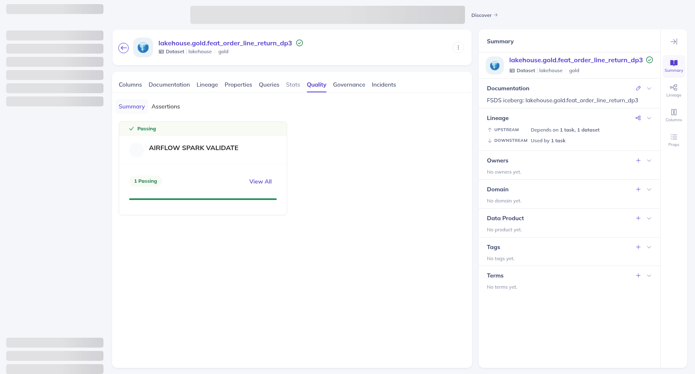
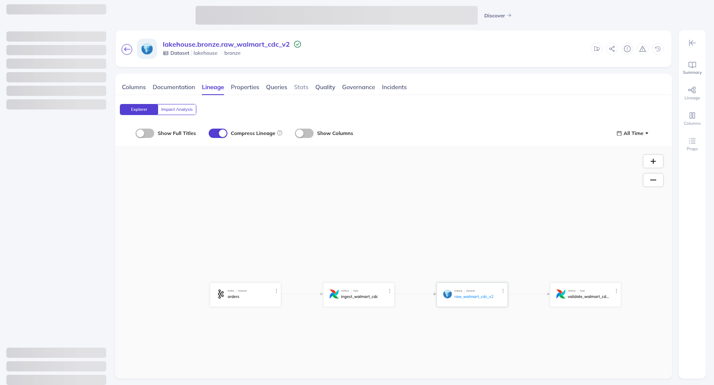
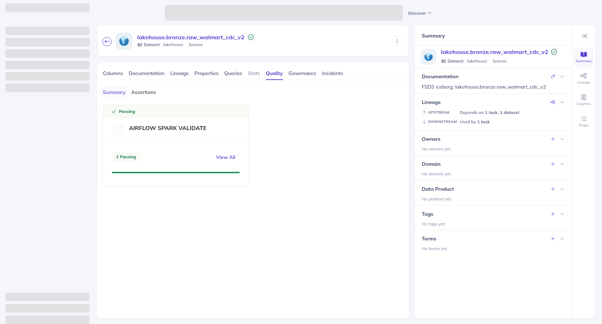
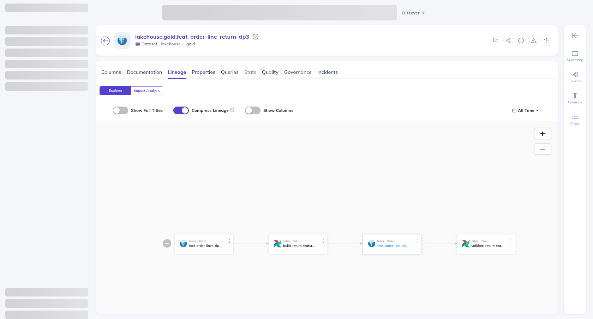
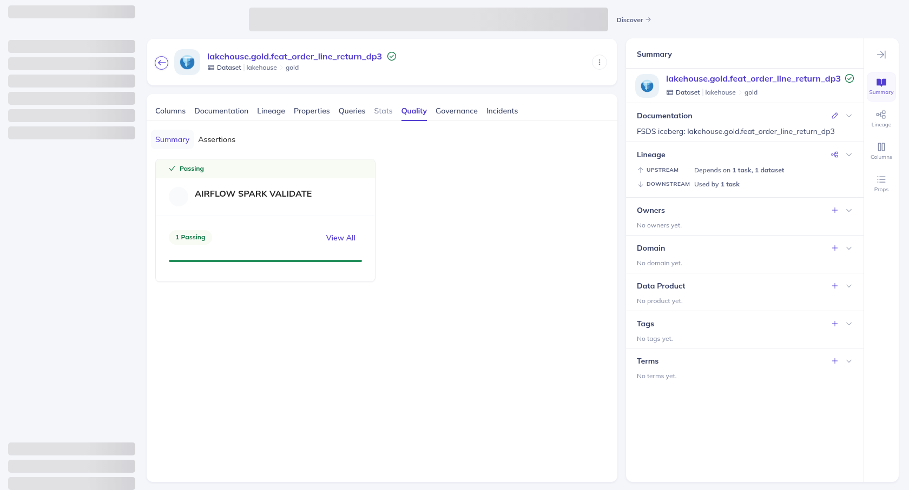

# DataHub — lineage và data validation của DP1/DP2/DP3

## Phạm vi bằng chứng

DataHub GMS `v1.7.0.1` đã nhận **21 dataset** (22 sau khi thêm bảng CDC v2 ngày 2026-10-18), **29 Airflow job** và **15 assertion**
từ `scripts/run/publish_order_snapshots_datahub.py`. Sáu dataset nguồn gồm JSONL Amazon,
ba nguồn JSONL Channel nhỏ, bảng PostgreSQL `walmart.orders` và topic Kafka CDC;
15 dataset đích là các bảng Iceberg Bronze/Silver/Gold. Metadata nối nguồn →
Bronze → Silver → Gold → feature bằng input/output của job Airflow và cạnh
dataset lineage. Nhánh CDC nối topic Kafka với bảng Bronze riêng.

Các assertion đọc kết quả **đã chạy** từ log Airflow trong volume `fsds_airflow-data`;
không chạy lại Spark khi publish. `scripts/evidence/build_order_snapshots_datahub_validation.py`
chỉ nhận attempt có dòng `Marking task as SUCCESS`, trích số đo và thời điểm,
đối chiếu điều kiện PASS rồi ghi
[`evidence/datahub-validation.json`](evidence/datahub-validation.json). Mỗi assertion
trên DataHub giữ `run_id` và metrics gốc trong kết quả SUCCESS. Đây là bản ghi
bằng chứng của các run đã hoàn tất, chưa phải lịch giám sát validation tự động.

| Pipeline | Dataset trên ảnh | Upstream thể hiện trên Lineage | Validate SUCCESS |
|---|---|---|---|
| DP1 | `lakehouse.bronze.raw_amazon_orders_dp1` | JSONL Amazon → `ingest_amazon` → Bronze | Nguồn = Bronze **5.827.514**, lỗi **0**, run `manual__2026-10-13T15:30:09+00:00` |
| DP2 | `lakehouse.gold.fact_order_lines_dp2` | Năm bảng Silver → `build_gold_order_lines` → Gold | Silver = Gold **10.194.358**, lỗi **0**, khóa trùng **0**, run `manual__2026-10-14T03:53:52+00:00` |
| DP3 | `lakehouse.gold.feat_order_line_return_dp3` | Gold fact → `build_return_features` → feature | Gold = feature **10.194.358**, lỗi **0**, khóa trùng **0**, run `manual__2026-10-14T04:11:15+00:00` |

Ảnh được chụp từ tab `Lineage` và `Quality` của UI thật. Tab Quality hiển thị
`AIRFLOW SPARK VALIDATE` và `1 Passing` cho từng dataset đại diện.

### DP1





### DP2





### DP3





## Bằng chứng chạy lại ngày 2026-10-18

Ngày 2026-10-18 code CDC (bảng mới `raw_walmart_cdc_v2`, boundary theo run,
source epoch) và validator feature (so tập khóa, event time) đã đổi. Hai
check này được chạy lại bằng code hiện tại; mười ba check còn lại giữ run cũ vì
code của chúng không đổi.

| Check | Run mới | Kết quả |
|---|---|---|
| DP1 CDC `lakehouse.bronze.raw_walmart_cdc_v2` | `manual__2026-10-18T05:14:10+00:00` | Kafka = Bronze = offset duy nhất **4**; thiếu, thừa, sai payload, lỗi đều **0** ([chi tiết](cdc.md#kết-quả-cdc-v2-ngày-2026-10-18)) |
| DP3 `lakehouse.gold.feat_order_line_return_dp3` | `manual__2026-10-18T05:24:29+00:00` | Gold = feature **10.194.358**; thiếu, thừa, sai event time, khóa trùng, lỗi đều **0** |

Lần DP3 đầu tiên trong ngày (`manual__2026-10-18T05:16:26+00:00`) **thất bại**
vì executor hết heap khi chỉ bật một Spark worker. Lệnh `createOrReplace` bị
hủy nên bảng feature cũ vẫn nguyên. Bật đủ hai worker như cấu hình gốc thì run
thứ hai thành công. Bản chạy lại vẫn là DP3 cũ trên Gold cũ, chưa phải
feature/nhãn theo nguồn v2.

Manifest mới là [`datahub-validation-v2.json`](evidence/datahub-validation-v2.json),
tạo bằng `--run` và `--cdc-table`; mỗi check ghi `log_format` (`v1`, `cdc-v2`,
`feature-v2`). Manifest cũ [`datahub-validation.json`](evidence/datahub-validation.json)
giữ nguyên. Check trên bảng v2 có assertion URN riêng (hậu tố `-v2`), nên kết
quả của bảng CDC v1 vẫn là lịch sử riêng; bảng v1 được ghi là legacy trong
mô tả dataset.

Ảnh Quality chỉ hiện `1 Passing`, không hiện `run_id`. Vì vậy kết quả assertion
được đọc thẳng từ GraphQL của DataHub và lưu ở
[`datahub-assertions-v2-20261018.json`](evidence/datahub-assertions-v2-20261018.json):
check DP3 có hai lần SUCCESS, lần mới nhất là run 2026-10-18; check CDC v2 có
run 2026-10-18; check CDC v1 vẫn là run 2026-10-13.









Tái tạo bộ v2 (sau khi các run trên đã có trong volume Airflow):

```bash
docker run --rm -v fsds_airflow-data:/logs:ro -v "$PWD":/work -w /work \
  python:3.12-slim python scripts/evidence/build_order_snapshots_datahub_validation.py \
  --logs-root /logs/logs --output docs/evidence/datahub-validation-v2.json \
  --run dp1_cdc=manual__2026-10-18T05:14:10+00:00 \
  --run dp3_features=manual__2026-10-18T05:24:29+00:00 \
  --cdc-table lakehouse.bronze.raw_walmart_cdc_v2
"$HOME/.local/share/uv/tools/acryl-datahub/bin/python" \
  scripts/run/publish_order_snapshots_datahub.py --server http://127.0.0.1:8089 \
  --evidence docs/evidence/datahub-validation-v2.json
.venv/bin/python scripts/evidence/capture_order_snapshots_datahub_evidence.py --profile v2
```

## Cách tái tạo trên máy đã chuẩn bị DataHub quickstart

Image `mysql:8.2` tại lần pull này có `/bin/bash` 0 byte; image frontend
`v1.7.0.1` có nhiều Play JAR 0 byte. File
[`docker/datahub-compose.override.yml`](../docker/datahub-compose.override.yml)
dùng MySQL `8.0` và frontend `v1.6.0.2` đã kiểm tra chạy được cùng GMS
`v1.7.0.1`. Đây là cấu hình phục vụ proof cục bộ, cần đồng bộ phiên bản khi triển
khai dài hạn.

```bash
DATAHUB_VERSION=v1.7.0.1 UI_INGESTION_DEFAULT_CLI_VERSION=1.7.0.14 \
DATAHUB_MAPPED_GMS_PORT=8089 DATAHUB_MAPPED_FRONTEND_PORT=9002 \
docker compose --env-file "$HOME/.datahub/quickstart/.local-secrets.env" \
  --profile quickstart -f "$HOME/.datahub/quickstart/docker-compose.yml" \
  -f docker/datahub-compose.override.yml -p datahub up -d

docker run --rm -v fsds_airflow-data:/logs:ro -v "$PWD":/work -w /work \
  python:3.12-slim python scripts/evidence/build_order_snapshots_datahub_validation.py \
  --logs-root /logs/logs

"$HOME/.local/share/uv/tools/acryl-datahub/bin/python" \
  scripts/run/publish_order_snapshots_datahub.py --server http://127.0.0.1:8089
.venv/bin/python scripts/evidence/capture_order_snapshots_datahub_evidence.py
```

Lần khởi tạo này OpenSearch tự khóa tạo index khi ổ hệ thống còn 13 GB; sau khi
giải phóng image FSDS không dùng, đã tắt `cluster.routing.allocation.disk.threshold_enabled`
cho OpenSearch DataHub **một node**, kiểm tra dung lượng bằng `df -h /` trong lúc
chạy. Nếu Compose dừng ở `403 cluster create-index blocked`, chỉ sau khi xác
nhận ổ vẫn còn đủ chỗ, gỡ khóa trong OpenSearch DataHub rồi chạy lại lệnh
`docker compose ... up -d` ở trên:

```bash
docker exec datahub-opensearch-1 curl -sS -X PUT \
  -H 'Content-Type: application/json' \
  'http://localhost:9200/_cluster/settings' \
  -d '{"persistent":{"cluster.routing.allocation.disk.threshold_enabled":false,"cluster.blocks.create_index":null}}'
```

Không áp dụng cấu hình đó cho môi trường chia sẻ hoặc production.
Không xóa Docker volume để lấy chỗ: các volume lớn khác thuộc dự án khác.

UI ở `http://localhost:9002`; GMS ở `http://localhost:8089`.
