<!-- ERD logic của 22 bảng Iceberg v2, đối chiếu job 20/21/23 và hai module lakehouse. -->
# Schema v2 — Bronze, Silver, Gold

Nguồn: [`spark_jobs/bronze/ingest_order_lifecycle.py`](../../spark_jobs/bronze/ingest_order_lifecycle.py),
[`spark_jobs/silver/build_order_lifecycle.py`](../../spark_jobs/silver/build_order_lifecycle.py),
[`spark_jobs/gold/build_order_lifecycle.py`](../../spark_jobs/gold/build_order_lifecycle.py),
[`spark_jobs/lib/order_lifecycle_lakehouse.py`](../../spark_jobs/lib/order_lifecycle_lakehouse.py),
[`spark_jobs/lib/order_lifecycle_gold.py`](../../spark_jobs/lib/order_lifecycle_gold.py).
Tên bảng trong hình bỏ tiền tố catalog `lakehouse.`. Hình chỉ liệt kê các cột
khóa/liên kết và một số cột grain, không thay thế schema field đo từ catalog.

`PK`/`FK` là khóa **logic**, Iceberg không cưỡng chế ràng buộc. Với Silver nghiệp
vụ, danh tính sự kiện nguồn đầy đủ ở Bronze là
`(dataset_version, producer, source_epoch, source_event_id)`; sau dedup, nhiều
bảng Silver chỉ giữ `dataset_version, source_event_id, entity_revision` trong
envelope. Không giả thêm `producer/source_epoch` vào các bảng Silver thiếu cột.

```mermaid
erDiagram
    bronze_lifecycle_raw_records {
        string dataset_version
        string producer
        string source_epoch
        string source_event_id
        string record_sha256
        string feed
        string contract_schema_id
        string raw_json
        string source_file
        string run_id
    }
    silver_lifecycle_stg_line_commitments {
        string line_id PK
        string dataset_version
        string channel
        string account_id
        string native_order_id FK
        string native_line_id FK
        string sale_mapping_version FK
        string source_event_id
    }
    silver_lifecycle_stg_allocations {
        string allocation_id PK
        string line_id FK
        string dataset_version
        string bound_pool_id
        string bound_location_id
        string source_event_id
    }
    silver_lifecycle_stg_deliveries {
        string delivery_event_id PK
        string allocation_id FK
        string line_id FK
        string dataset_version
        timestamp actual_delivered_at
    }
    silver_lifecycle_stg_return_events {
        string dataset_version PK
        string source_event_id PK
        string return_id
        string event_type
        string allocation_id FK
        string line_id FK
    }
    silver_lifecycle_stg_refunds {
        string dataset_version PK
        string refund_entity_id PK
        string refund_transaction_id
        int transaction_revision
        string allocation_id FK
        string line_id FK
        string unresolved_scope_ref FK
    }
    silver_lifecycle_stg_listing_versions {
        string dataset_version PK
        string source_event_id PK
        string listing_id
        string mapping_version
        int revision
        boolean is_latest
    }
    silver_lifecycle_stg_stock_operations {
        string dataset_version PK
        string operation_id PK
        string pool_id
        string location_id
        string internal_sku_id
        string line_id FK
        string allocation_id FK
    }
    silver_lifecycle_stg_stock_snapshots {
        string dataset_version PK
        string snapshot_id PK
        string pool_id
        string location_id
        string internal_sku_id
        timestamp effective_at
    }
    silver_lifecycle_stg_inbound_events {
        string dataset_version PK
        string source_event_id PK
        string inbound_line_id
        string event_type
        string pool_id
        string internal_sku_id
    }
    silver_lifecycle_stg_uncertainties {
        string uncertainty_id PK
        int revision
        string resolution_state
    }
    silver_lifecycle_stg_coverage {
        string coverage_id PK
        int revision
        string covered_feed
        string covered_producer
        string status
    }
    silver_lifecycle_stg_coverage_receipts {
        string coverage_id PK
        int coverage_revision PK
        string covered_feed
        string covered_producer
        string receipt_status
    }
    silver_lifecycle_stg_native_order_lines {
        string dataset_version PK
        string channel PK
        string native_order_id PK
        string native_line_id PK
        string seller_sku
    }
    silver_lifecycle_stg_line_lifecycle {
        string dataset_version PK
        string line_id PK
        string channel
        string native_order_id FK
        string native_line_id FK
        string sale_mapping_version FK
    }
    silver_lifecycle_quarantine_records {
        string dataset_version
        string feed
        string producer
        string contract_schema_id
        string record_sha256
        string reason
        string source_file
        string raw_json
    }
    gold_lifecycle_fact_order_lines {
        string dataset_version PK
        string line_id PK
        string seller_sku
        timestamp created_at
        string generation_id
    }
    gold_lifecycle_label_return {
        string dataset_version PK
        string line_id PK
        timestamp cutoff PK
        string generation_id PK
        string label_version
        int label
        string input_json
    }
    gold_lifecycle_feat_sku_return_rate_90d {
        string dataset_version PK
        string line_id PK
        timestamp event_timestamp
        string generation_id
    }
    gold_lifecycle_label_segments {
        string dataset_version PK
        string line_id PK
        timestamp start_exclusive PK
        timestamp end_inclusive
        int label
        date cohort_date
        timestamp decision_observed_at
        string generation_id
    }
    silver_lifecycle_stg_observed_evidence {
        string dataset_version
        string record_sha256
        string feed
        timestamp source_observed_at
        string ev_line_id
        string ev_order_id
        string corrects_source_event_id
        string raw_json
    }
    silver_lifecycle_stg_coverage_validity {
        string dataset_version PK
        string evidence_event_id PK
        string receipt_status
    }
    gold_lifecycle_label_inputs {
        string dataset_version PK
        string line_id PK
        string input_json
        timestamp created_at
    }
    silver_lifecycle_stg_line_commitments ||--o{ silver_lifecycle_stg_allocations : line_id
    silver_lifecycle_stg_allocations ||--o{ silver_lifecycle_stg_deliveries : allocation_id
    silver_lifecycle_stg_allocations |o--o{ silver_lifecycle_stg_return_events : allocation_id
    silver_lifecycle_stg_line_commitments |o--o{ silver_lifecycle_stg_refunds : line_id_nullable
    silver_lifecycle_stg_uncertainties |o--o{ silver_lifecycle_stg_refunds : unresolved_scope_ref
    silver_lifecycle_stg_listing_versions }o--o{ silver_lifecycle_stg_line_commitments : mapping_version_sale_mapping_version
    silver_lifecycle_stg_line_commitments |o--o{ silver_lifecycle_stg_stock_operations : line_id_nullable
    silver_lifecycle_stg_allocations |o--o{ silver_lifecycle_stg_stock_operations : allocation_id_nullable
    silver_lifecycle_stg_coverage ||--o{ silver_lifecycle_stg_coverage_receipts : coverage_id
    silver_lifecycle_stg_line_commitments ||--|| silver_lifecycle_stg_line_lifecycle : line_id
    silver_lifecycle_stg_native_order_lines |o--o| silver_lifecycle_stg_line_lifecycle : dataset_channel_order_line
    silver_lifecycle_stg_line_lifecycle ||--o| gold_lifecycle_fact_order_lines : dataset_line
    gold_lifecycle_fact_order_lines ||--o{ gold_lifecycle_label_return : dataset_line
    gold_lifecycle_fact_order_lines ||--|| gold_lifecycle_feat_sku_return_rate_90d : dataset_line
    gold_lifecycle_fact_order_lines ||--|| gold_lifecycle_label_inputs : dataset_line
    gold_lifecycle_fact_order_lines ||--o{ gold_lifecycle_label_segments : dataset_line
    silver_lifecycle_stg_observed_evidence }o--o{ gold_lifecycle_label_inputs : ev_line_id_or_order
    silver_lifecycle_stg_coverage_validity ||--o{ silver_lifecycle_stg_observed_evidence : evidence_event_id
```

Bronze và quarantine không đánh PK: bản lặp nguồn có thể có cùng hash/id. Việc
chuyển Bronze → Silver là parse/dedup/contract gate, không phải FK hàng một-một,
nên không vẽ cạnh FK giả. `record_sha256` và `source_file` phục vụ truy nguồn.
Gold chỉ đọc Silver: lịch sử quan sát ở `lifecycle_stg_observed_evidence`, kết quả kiểm coverage ở `lifecycle_stg_coverage_validity`.

| Bảng đầy đủ (bỏ `lakehouse.`) | Grain / khóa logic và lưu ý |
|---|---|
| `bronze.lifecycle_raw_records` | Một dòng JSONL hoặc một dòng JDBC; giữ trùng, partition theo feed, thay toàn bảng |
| `silver.lifecycle_stg_line_commitments` | Một entity line revision mới nhất; reconcile kiểm `line_id` duy nhất trong fixture |
| `silver.lifecycle_stg_allocations` | Một allocation revision mới nhất; `allocation_id` nối line |
| `silver.lifecycle_stg_deliveries` | Một entity delivery revision mới nhất; `delivery_event_id`, liên kết allocation/line |
| `silver.lifecycle_stg_return_events` | Một sự kiện trạng thái Return, không phải một Return; return_id có nhiều trạng thái; khóa sự kiện trong dataset |
| `silver.lifecycle_stg_refunds` | Một refund entity revision mới nhất; line/allocation có thể null; allocation_id chỉ lấy money row đầu theo code hiện tại |
| `silver.lifecycle_stg_listing_versions` | Một sự kiện revision Listing; giữ lịch sử, revision/latest. `mapping_version` được line tham chiếu, không suy rằng mọi revision có mapping_version duy nhất |
| `silver.lifecycle_stg_stock_operations` | Một operation revision mới nhất; pool/location/SKU, có thể tham chiếu line/allocation |
| `silver.lifecycle_stg_stock_snapshots` | Một snapshot entity revision mới nhất; đối chiếu pool/location/SKU và effective_at |
| `silver.lifecycle_stg_inbound_events` | Một sự kiện của inbound_line_id; cùng inbound có thể có nhiều event_type |
| `silver.lifecycle_stg_uncertainties` | Một uncertainty_id, revision lớn nhất; không có dataset_version ở schema Silver hiện tại |
| `silver.lifecycle_stg_coverage` | Một coverage_id, revision lớn nhất; covered_feed/producer, không có dataset_version ở bảng này |
| `silver.lifecycle_stg_coverage_receipts` | Một envelope coverage_id × coverage_revision sau kiểm tập bản ghi nhận; không chỉ revision cuối |
| `silver.lifecycle_stg_native_order_lines` | Dataset × channel × native_order_id × native_line_id; Silver chưa tự dedup mọi bản lặp native, Gold kiểm ambiguity trước ghi |
| `silver.lifecycle_stg_line_lifecycle` | Dataset × line_id; allocations/deliveries/returns/refunds gộp về line trước join |
| `silver.lifecycle_quarantine_records` | Một dòng Bronze không đạt contract; không khẳng định hash là duy nhất |
| `silver.lifecycle_stg_observed_evidence` | Một bản ghi quan sát (feed nhãn + coverage + uncertainty) đã qua cổng hợp đồng, MỌI revision, chỉ bỏ trùng y `record_sha256`; partition days(source_observed_at) |
| `silver.lifecycle_stg_coverage_validity` | Dataset × revision coverage (`coverage_id:revision`); complete/partial kiểm một lần |
| `silver.lifecycle_stg_build_info` | Một dòng mỗi lần dựng Silver: run_id, as_of; Gold kiểm as_of = cutoff |
| `gold.lifecycle_fact_order_lines` | Dataset × line_id của generation hiện tại; lifecycle join native theo dataset/channel/order/line, partition days(created_at) |
| `gold.lifecycle_label_return` | Dataset × line_id × cutoff × generation_id; append bất biến các generation |
| `gold.lifecycle_feat_sku_return_rate_90d` | Dataset × line_id đích; event_timestamp = created_at; thay theo run, partition days(created_at) |
| `gold.lifecycle_label_segments` | Dataset × line_id × đoạn cutoff `(start_exclusive, end_inclusive]` mà line ở trạng thái labeled; feature PIT tính từ bảng này |
| `gold.lifecycle_label_inputs` | Dataset × line_id, input_json chuẩn hóa và created_at; generation hiện tại |

Cạnh kho snapshot/operation là đối soát theo `(pool_id, location_id, internal_sku_id)`
và bất đẳng thức thời gian, không phải FK tới snapshot_id. Inbound cùng pool/SKU
không đủ để tạo FK tới một operation cụ thể nên giữ bảng độc lập trong ERD.
Coverage áp scope feed/producer và tập sự kiện, không có FK row-level sang mọi bảng.
Quan hệ native↔OMS có thể thiếu vì cách ly; hình biểu diễn liên kết logic, không
cam kết mọi nguồn luôn đầy đủ.

Đây là ERD của code fixture hiện tại: một số join Silver chỉ dùng `line_id` hoặc
`allocation_id` mà chưa gộp đủ nguồn/epoch/dataset; khóa logic trong hình không
chứng minh an toàn cho nhiều dataset trộn chung. Mapping version FK cũng là quan
hệ nghiệp vụ; code reconcile hiện chỉ kiểm membership. Chưa đo schema thật từ
catalog trong gói này.

Ảnh/schema runtime và số dòng thực tế:
<!-- RUN: người vận hành điền -->
