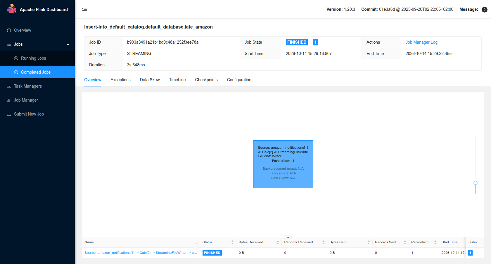
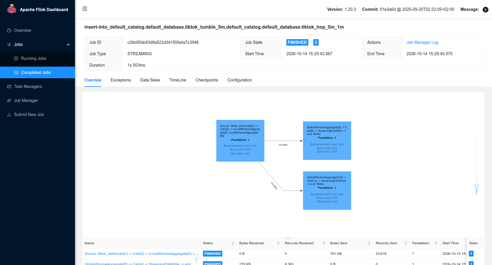
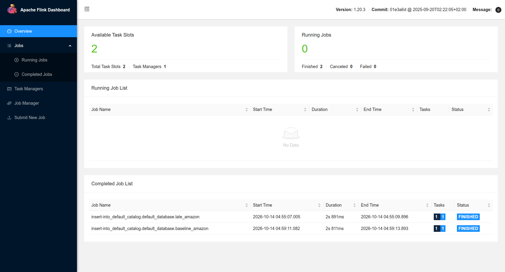
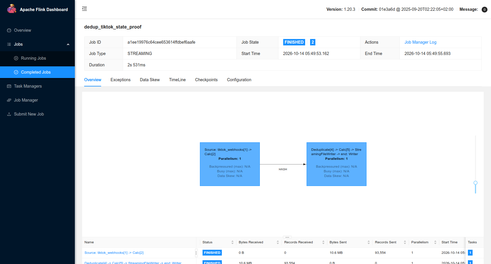

# Flink trên hai topic Kafka của generator

Các job SQL ở `flink_jobs/` đọc từ đầu topic Kafka rồi dừng tại offset cuối
được chốt khi job bắt đầu (`scan.startup.mode=earliest-offset`,
`scan.bounded.mode=latest-offset`). Nhờ vậy từng lần chạy có thể đếm đầu vào và
đầu ra. Nếu phát lại Stream vào cùng topic, một lần chạy mới sẽ đọc cả các lần
phát trước; số đếm phải đối chiếu offset thực tế trước khi kết luận.

`docker/Dockerfile.flink` dùng Flink 1.20.3 và Kafka SQL connector
3.4.0-1.20. Hai service trong Compose là JobManager (UI cổng 8082) và
TaskManager. Cấu hình theo [Flink Docker](https://nightlies.apache.org/flink/flink-docs-release-1.20/docs/deployment/resource-providers/standalone/docker/)
và [Kafka Table connector](https://nightlies.apache.org/flink/flink-docs-release-1.20/docs/connectors/table/kafka/).

| Job | Nguồn | Cơ chế | Đích file |
|---|---|---|---|
| `flink_jobs/order_snapshots/baseline.sql` | Amazon notification | đọc bounded, giữ ID và EventTime | `out/flink/baseline-amazon` |
| `flink_jobs/order_snapshots/late_arrival.sql` | Amazon notification | watermark EventTime trễ một giờ; `CURRENT_WATERMARK` tách tin muộn | `out/flink/late-amazon-1ms` |
| `flink_jobs/order_snapshots/dedup_webhooks.sql` | TikTok webhook | `ROW_NUMBER` theo notification ID, giữ bản đầu; Flink duy trì state theo khóa | `out/flink/unique-tiktok` |
| `flink_jobs/order_snapshots/windows.sql` | TikTok Order mới | tumbling 5 phút và sliding 5 phút dịch 1 phút | `out/flink/tiktok-*` |

`CURRENT_WATERMARK` trả watermark tại operator và có thể rỗng trước khi nguồn
phát watermark đầu tiên; điều kiện của job late chỉ chọn tin có watermark và
`event_ts <= watermark`. Số này có thể khác `out_of_order_over_1h=19.729` của
generator, vì phép đếm generator là một thứ tự gửi toàn cục còn Flink phát
watermark theo partition và theo chu kỳ.

## Số đo lần chạy (2026-10-13, tin muộn đo lại 2026-10-14)

| Đo | Kết quả | Đối chiếu |
|---|---:|---|
| Amazon baseline | 399.410 dòng / 3,0 giây | khớp tổng Kafka |
| Amazon late, mặc định 200 ms | 242 dòng | tiến độ watermark còn phụ thuộc lịch phát |
| Amazon late, `0ms` | 0 dòng | không dùng làm proof; chưa có watermark thỏa filter trong lần chạy bounded này |
| Amazon late, `1ms` | 9.143 dòng / 3,6 giây | 2,29% của 399.410; thấp hơn phép đếm toàn cục generator 19.729. Lần đo 2026-10-13 ra 6.310 dòng: số này phụ thuộc lịch phát watermark so với vận tốc đọc bounded, không cố định |
| TikTok dedup | 92.157 từ 93.554 | bỏ 1.397, đúng với manifest Kafka |
| Tumbling 5 phút | 7.555 cửa sổ | mỗi cửa sổ phát một lần |
| Sliding 5 phút, bước 1 phút | 37.870 cửa sổ | xấp xỉ năm lần cửa sổ do chồng lấn |

Đầu ra ở `out/flink/`. Ví dụ số cực đại trên lần chạy: tumbling **20 Order**
trong 13:55–14:00 UTC; sliding **22 Order** trong 13:59–14:04 UTC ngày
2026-07-14. Đây là lượng Order `UNPAID`, không phải tổng webhook.

Xem
[hàm CURRENT_WATERMARK](https://nightlies.apache.org/flink/flink-docs-release-1.20/docs/dev/table/functions/systemfunctions/)
và [watermark SQL](https://nightlies.apache.org/flink/flink-docs-release-1.20/docs/dev/table/sql/create/).

## Bắt tin đến muộn bằng watermark (rubric C17)

`flink_jobs/order_snapshots/late_arrival.sql` gán watermark `event_ts - INTERVAL '1' HOUR`:
Flink coi một bản tin là đến muộn khi event time của nó đã nằm trước watermark
hiện tại. Điều kiện `event_ts <= CURRENT_WATERMARK(event_ts)` giữ lại đúng những bản
tin mà watermark đã vượt qua (trễ hơn một giờ so với mốc nước), rồi ghi riêng ra
`out/flink/late-amazon-1ms`. Vì thế phép đo này không đếm mọi bản tin trễ, mà
đếm phần đã bị watermark vượt qua.

Lần chạy 2026-10-14 phát lại đúng lô 399.410 notification; job
`b903a3491a21b1bd0c48a1252f3ee78a` hoàn tất sau 3,648 giây và ghi **9.143 dòng**
(xem bảng số đo ở trên). Số này không cố định vì phụ thuộc lịch phát watermark
(`pipeline.auto-watermark-interval`) so với vận tốc đọc bounded.



## Cửa sổ tumbling và sliding (rubric C19)

`flink_jobs/order_snapshots/windows.sql` khai hai cửa sổ trên cùng luồng Order mới
(`new_orders`, lọc `order_status = 'UNPAID'`): một tumbling 5 phút và một hopping
5 phút bước 1 phút. Cả hai đọc `window_start`/`window_end` do hàm cửa sổ sinh ra
rồi `GROUP BY` theo chúng:

```sql
INSERT INTO tiktok_tumble_5m
SELECT CAST(window_start AS STRING), CAST(window_end AS STRING), COUNT(*)
FROM TABLE(TUMBLE(TABLE new_orders, DESCRIPTOR(event_ts), INTERVAL '5' MINUTE))
GROUP BY window_start, window_end;

INSERT INTO tiktok_hop_5m_1m
SELECT CAST(window_start AS STRING), CAST(window_end AS STRING), COUNT(*)
FROM TABLE(HOP(TABLE new_orders, DESCRIPTOR(event_ts),
               INTERVAL '1' MINUTE, INTERVAL '5' MINUTE))
GROUP BY window_start, window_end;
```

`TUMBLE` cắt trục thời gian thành các cửa sổ rời nhau rộng 5 phút, mỗi sự kiện
rơi đúng một cửa sổ. `HOP` tạo cửa sổ chồng lấn: bước nhảy 1 phút, rộng 5 phút,
mỗi sự kiện rơi vào năm cửa sổ, nên số cửa sổ quan sát gấp khoảng năm lần. Kết
quả khớp: **7.555** cửa sổ tumbling so với **37.870** cửa sổ hopping.

Job chạy lần này có job ID `c2bb95bb43d8a522d34155fa4a7c3946`, hoàn tất sau
1,503 giây. Đồ thị Flink cho thấy nguồn `tiktok_webhooks` tỏa ra hai nhánh
`LocalWindowAggregate`/`GlobalWindowAggregate` ghi vào hai đích riêng, đúng với
hai cửa sổ trong `EXECUTE STATEMENT SET`.



Lệnh khởi động:

```bash
env -u POSTGRES_PASSWORD docker compose --profile flink build flink-jobmanager
env -u POSTGRES_PASSWORD docker compose --profile flink --profile stream up -d kafka flink-jobmanager flink-taskmanager
```

Chạy từng script từ container JobManager, ví dụ:

```bash
env -u POSTGRES_PASSWORD docker compose --profile flink exec -T flink-jobmanager ./bin/sql-client.sh -f /opt/flink/jobs/order_snapshots/baseline.sql
```

Đầu ra từng job ghi ở `out/flink`; ảnh Flink UI baseline được lưu trong
`docs/images/flink/`.



Ảnh chụp sau lần baseline thành công mới nhất; danh sách Completed Jobs hiển thị
job `baseline_amazon` ở trạng thái `FINISHED`. File
`out/flink/baseline-amazon-proof/` chứa 399.410 dòng.

## Bằng chứng keyed state cho TikTok dedup

Ngày 2026-10-14 chạy lại cùng phép dedup với
`flink_jobs/order_snapshots/dedup_state_proof.sql`, ghi đích riêng
`out/flink/unique-tiktok-state-proof/` để giữ lần chạy cũ. Job ID
`a1ee19976c64cee653614ffdbef6aafe` hoàn tất sau 2,531 giây. Flink REST
trả execution plan có operator
`Deduplicate(keep=[FirstRow], key=[tts_notification_id], order=[PROCTIME])`
và cạnh `HASH` từ source sang operator. Như vậy hai webhook cùng ID đến cùng
keyed operator; `ROW_NUMBER` trong SQL giữ lần đầu theo processing time.

Source gửi **93.554** record vào operator; file đầu ra có **92.157** dòng,
giảm **1.397** webhook trùng. Số liệu job, plan và metrics giữ trong
[`docs/evidence/flink-dedup-state.json`](evidence/flink-dedup-state.json).



Ảnh trên cho thấy job `FINISHED`, đồ thị `Source → Deduplicate → Writer` và
93.554 record đi từ source. Ảnh và plan chứng minh phép khử trùng theo khóa đã
được Flink thực thi; vì job đọc bounded và kết thúc sau vài giây, phép đo này
không phải bằng chứng về kích thước state dài hạn hay checkpoint phục hồi.
