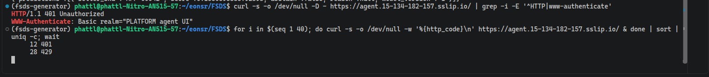
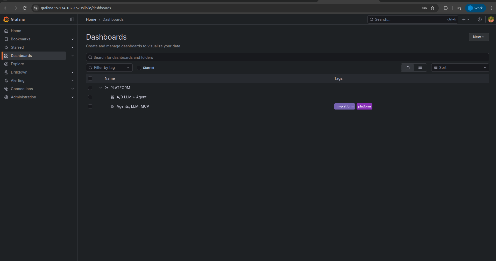
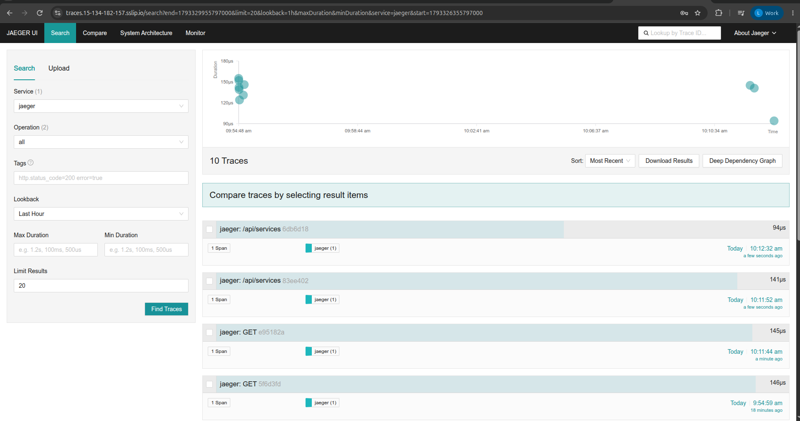
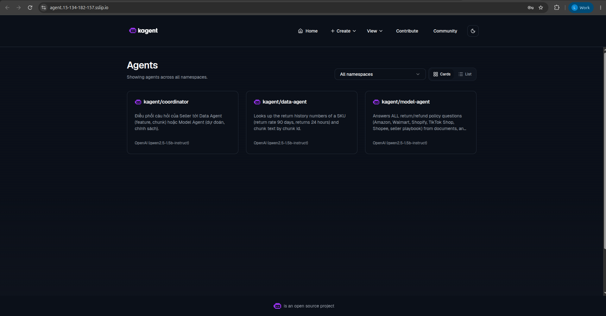
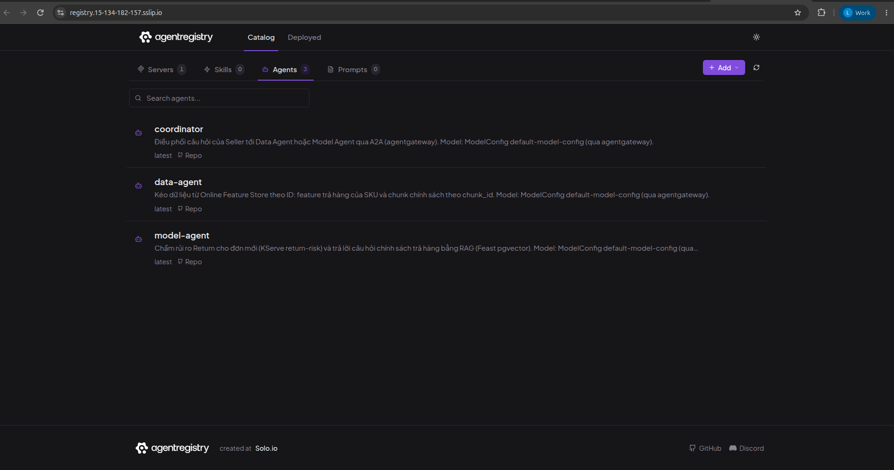

<!-- Mục đích: NGINX Ingress cho các service LLM Platform — HTTPS, basic auth, rate limit -->
# Gateway — NGINX Ingress, HTTPS, auth

service đứng sau gateway (metric, log, trace, UI test agent, UI registry),
basic auth + rate limit cho UI test agent, domain + HTTPS cho Web API kéo dữ liệu.

## Chọn controller

Dự án cộng đồng **ingress-nginx** đã ngừng bảo trì (bản chart cuối 4.15.1, 03/2026, không còn bản
vá bảo mật). Dùng **F5 NGINX Ingress Controller** (mã nguồn mở, chart `nginx-ingress` 2.7.3 /
app 5.6.3) — vẫn là "NGINX Ingress Controller" như thiết kế sử dụng, annotation dạng `nginx.org/*`.

```bash
helm --kube-context kind-platform install nginx-ingress oci://ghcr.io/nginx/charts/nginx-ingress \
  --version 2.7.3 -n ingress --create-namespace --set controller.service.type=NodePort \
  --set controller.service.httpPort.nodePort=30080 --set controller.service.httpsPort.nodePort=30443 \
  --set controller.ingressClass.name=nginx --set controller.ingressClass.setAsDefaultIngress=true
scripts/setup/setup_ingress.sh
```

| Route | Host (local) | Bảo vệ | File |
|---|---|---|---|
| Feature API (Web API kéo dữ liệu) | `api.<ip-node>.sslip.io` | HTTPS, redirect HTTP→HTTPS, 50 r/s | [`feature-api.yaml`](../infra/k8s/ingress/feature-api.yaml) |
| kagent UI (chat test agent) | `agent.<ip-node>.sslip.io` | HTTPS + **basic auth** + **5 r/s, burst 10, 429** | [`agent-ui.yaml`](../infra/k8s/ingress/agent-ui.yaml) |
| Prometheus (metric) | `metrics.<ip-node>.sslip.io` | HTTPS + basic auth `ops` | [`ops-ui.yaml`](../infra/k8s/ingress/ops-ui.yaml) |
| Grafana (metric + log qua Loki), Jaeger (trace) | `grafana.` / `traces.` | HTTPS + basic auth `ops` | cùng template |
| Agent registry UI (agentregistry 0.4.0, không có auth riêng) | `registry.` | HTTPS + basic auth `ops` | cùng template |

- **Domain**: sslip.io phân giải `api.172-25-0-2.sslip.io` → `172.25.0.2` (IP node kind) — có tên
  miền thật mà không phải mua. Trên GKE: domain riêng trỏ IP tĩnh của load balancer.
- **HTTPS**: cert-manager cấp cert từ CA nội bộ [`issuer.yaml`](../infra/k8s/ingress/issuer.yaml)
  (`platform-local-ca`; xuất ra `out/ingress/platform-local-ca.crt` để client tin). Trên GKE: ACME/Let's Encrypt.
- **Mật khẩu UI** sinh ngẫu nhiên, cất ở Vault `secret/platform/agent-ui` (UI agent) và `secret/platform/ops-ui` (UI vận hành); secret htpasswd trong k8s tạo
  từ đó (`setup_ingress.sh`), không nằm trong repo.

## Bằng chứng (2026-10-21, từ máy host)

```text
GET http://api.172-25-0-2.sslip.io:30080/            → 301 → https://…
GET https://api.172-25-0-2.sslip.io:30443/healthz    → 200, ssl_verify_result = 0 (cert hợp lệ với CA)
GET https://agent.172-25-0-2.sslip.io:30443/          → 401 không mật khẩu, 200 có mật khẩu
40 request đồng thời có mật khẩu                     → 11 × 200, 29 × 429 (rate limit)
GET https://metrics.172-25-0-2.sslip.io:30443/        → 401; có mật khẩu ops: /api/v1/query?query=up → 12 target
GET https://grafana.172-25-0-2.sslip.io:30443/        → 401 không mật khẩu, 200 có mật khẩu (log Loki xem qua Grafana Explore)
GET https://traces.172-25-0-2.sslip.io:30443/         → 401 không mật khẩu, 200 có mật khẩu (Jaeger UI)
GET https://registry.172-25-0-2.sslip.io:30443/       → 401 không mật khẩu, 200 có mật khẩu (agent registry)
```

Giới hạn local: redirect trả cổng 443 thay vì NodePort 30443; IP node đổi khi tạo lại cluster thì
chạy lại `setup_ingress.sh`.

<!-- Ảnh trình duyệt: hộp đăng nhập UI agent + ổ khoá HTTPS của API: người vận hành chụp. -->

## Let's Encrypt với DuckDNS (tùy chọn, mặc định tắt)

```bash
scripts/setup/setup_letsencrypt.sh   # chưa đặt DUCKDNS_DOMAIN: hướng dẫn rồi exit 0, giữ CA nội bộ
```

DNS-01 dùng webhook cộng đồng [ebrianne/cert-manager-webhook-duckdns](https://github.com/ebrianne/cert-manager-webhook-duckdns).
Script nhận **thư mục chart local** qua `DUCKDNS_WEBHOOK_CHART`, kiểm pin chart **1.0.0** trước cài.
**Chưa kiểm chứng: kiểm pin này thực sự tồn tại và schema `groupName`, `apiTokenSecretRef`
trùng chart nguồn trước khi bật**; chart này chưa được tải và kiểm chứng trong các kết quả đính kèm repo.
Không coi nhánh tùy chọn này là proof cert Let's Encrypt đã cấp.

người vận hành chuẩn bị chart đã kiểm, cert-manager đang chạy và Vault `secret/platform/duckdns` có trường
`token`. Token chỉ đọc qua `vault_env.sh duckdns`, nạp Secret `cert-manager/duckdns-token` qua
stdin; không ghi vào repo. Dùng tên gốc `<tên>.duckdns.org`, không thêm `api.` phía trước.

```bash
export DUCKDNS_DOMAIN=ten-cua-ban.duckdns.org
export LE_EMAIL=ban@example.com
export DUCKDNS_WEBHOOK_CHART=/duong-dan/chart-da-kiem
# VAULT_ADDR/VAULT_TOKEN lấy từ môi trường, không chép secret vào lệnh hay docs.
LE_ENV=staging scripts/setup/setup_letsencrypt.sh
kubectl --context kind-platform -n feature-store get certificate
# Khi staging đã Ready, mới yêu cầu production:
LE_ENV=production scripts/setup/setup_letsencrypt.sh
```

Staging dùng ACME staging (cert chưa được trình duyệt tin), production dùng ACME production,
account/TLS Secret khác nhau. Script tạo Ingress riêng `feature-api-duckdns` tới Feature API,
giữ nguyên route sslip.io/CA nội bộ. Cần DNS A trỏ nơi client truy cập được và đường vào
NodePort 30443 (hoặc NAT 443→30443 nếu muốn URL HTTPS không ghi cổng). DNS-01 chỉ chứng minh
quyền domain; không tự dựng NAT, không cập nhật bản ghi A của DuckDNS.

<!-- chụp: Certificate feature-api-duckdns-production-tls Ready và trình duyệt HTTPS domain DuckDNS sau khi người vận hành kiểm chart/chạy cấp cert thật. -->

## Trên EKS (2026-10-30/31)

F5 NGINX Ingress Controller (namespace `ingress`) sau một NLB AWS; cert-manager cấp cert Let's Encrypt thật (HTTP-01)
cho mỗi host `<tên>.15-134-182-157.sslip.io`. Mọi UI đều sau gateway, route tạo bởi
[`setup_ingress.sh`](../scripts/setup/setup_ingress.sh), mật khẩu sinh một lần và cất ở Vault:

| Host | Service phía sau | Setting NGINX | Auth |
|---|---|---|---|
| `api.` | Feature API (Web API) | [`feature-api.yaml`](../infra/k8s/ingress/feature-api.yaml): HTTPS, `limit-req-rate` 50r/s, burst 100 | không (API công khai, có rate limit) |
| `agent.` | kagent UI (UI test agent) | [`agent-ui.yaml`](../infra/k8s/ingress/agent-ui.yaml): HTTPS, basic auth, 5r/s burst 10, vượt ⇒ 429 | `seller` |
| `grafana.` | Grafana (metric + log Loki) | [`ops-ui.yaml`](../infra/k8s/ingress/ops-ui.yaml) | `ops` + admin Grafana |
| `traces.` | Jaeger UI | `ops-ui.yaml` | `ops` |
| `metrics.` | Prometheus UI | `ops-ui.yaml` | `ops` |
| `registry.` | agentregistry UI | `ops-ui.yaml` | `ops` |

Basic auth + rate limit của UI agent, đo từ laptop không kèm mật khẩu: một request ⇒ `401` với
`WWW-Authenticate: Basic realm="PLATFORM agent UI"`; 40 request cùng lúc ⇒ 12 × `401` (trong hạn mức, tới bước auth)
và 28 × `429` (vượt 5r/s + burst 10, NGINX chặn trước cả bước auth).



Các UI sau gateway (đã đăng nhập qua basic auth, HTTPS):









Log xem trong Grafana (Explore → Loki): [Observability](ml-llm-platform-observability.md#trên-eks-2026-10-30).
Web API HTTPS: [Swagger qua `api.`](ml-llm-platform-web-api.md#trên-eks-2026-10-30).
