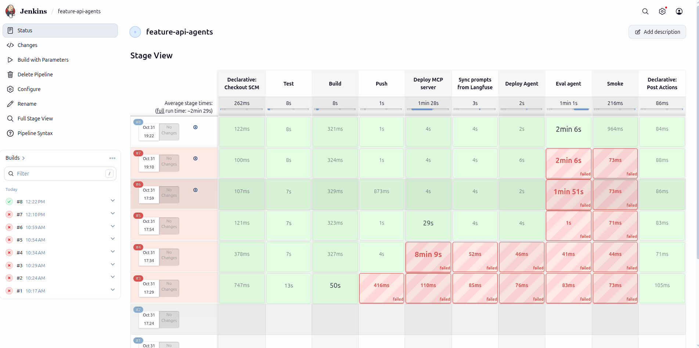
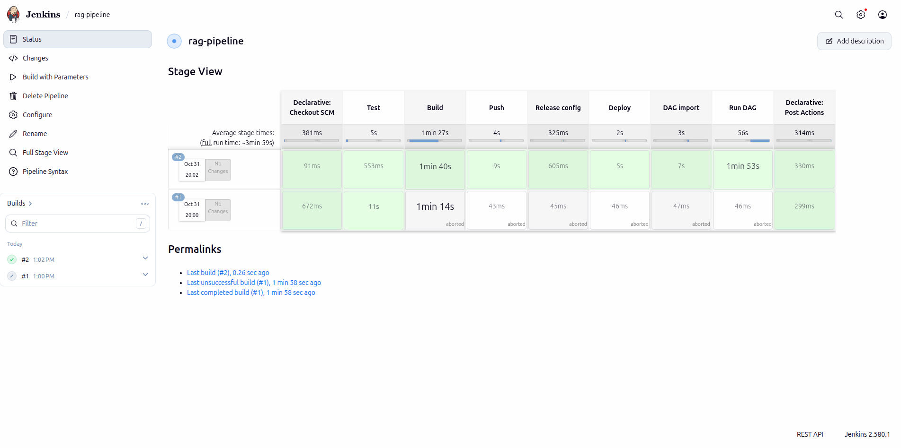
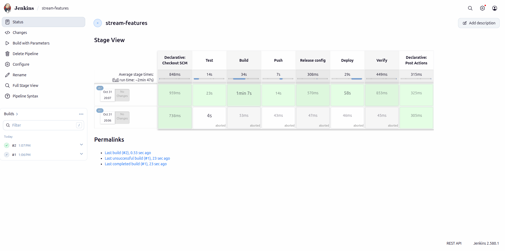

<!-- Mục đích: Jenkins CI/CD local cho phần ML Platform / LLM Platform: dựng, cấu hình, job, secret. -->
# CI/CD — Jenkins

CI/CD (test + build + auto-deploy) cho RAG pipeline, MCP server + agent,
coordinator, stream feature job. Secret phải nằm ở Jenkins/công cụ tương tự, không trong code.

## Dựng

| Thành phần | File |
|---|---|
| Image Jenkins 2.580.1 LTS + plugin cố định + docker/compose/kubectl/helm/kind/uv | [`docker/Dockerfile.jenkins`](../docker/Dockerfile.jenkins) |
| Cấu hình bằng code (JCasC): user, credential, 4 job | [`infra/jenkins/jenkins.yaml`](../infra/jenkins/jenkins.yaml) |
| Khởi động (lấy secret từ Vault) | [`scripts/setup/setup_jenkins.sh`](../scripts/setup/setup_jenkins.sh), service `jenkins` (profile `ci`) |
| Pipeline | [`ci/jenkins/`](../ci/jenkins/stream-features.Jenkinsfile): `stream-features`, `feature-api-agents`, `coordinator`, `rag-pipeline` |

```bash
scripts/setup/setup_vault.sh      # trước: Vault + token chỉ-đọc
scripts/setup/setup_jenkins.sh    # UI http://localhost:8090, user admin, mật khẩu ở Vault secret/platform/jenkins
```

## Quyết định

- **Secret**: Jenkins chỉ giữ 2 credential — `vault-ci-token` (token Vault chỉ-đọc) và
  `kind-kubeconfig`. Mật khẩu DB/MinIO lấy từ Vault lúc build (`scripts/setup/vault_env.sh`).
  Mật khẩu admin Jenkins sinh ngẫu nhiên, cất ở Vault, nạp qua biến môi trường mỗi lần khởi động.
- **Job lấy code từ git `main`** (`file:///repo`): CI chạy đúng code đã commit, không phải working
  tree. ⇒ Phải commit các file `ci/jenkins/*` trước khi build lần đầu.
- **network_mode host + JENKINS_HOME cùng đường dẫn với host**: build gọi `docker compose` qua socket
  của host; bind mount tương đối trong workspace phải tồn tại trên host ở đúng đường dẫn đó.
- Build chạy trên controller (1 executor) — đủ cho local; trên GKE tách agent.

## Bằng chứng (2026-10-21)

- Jenkins `Up`, `/login` 200; API liệt kê job `coordinator`, `feature-api-agents`, `rag-pipeline`,
  `stream-features` và credential `vault-ci-token`, `kind-kubeconfig` — đều do JCasC tạo.
- Đổi mật khẩu admin: xoá `secret/platform/jenkins` rồi chạy lại `setup_jenkins.sh` (đã làm một lần, login
  bằng mật khẩu mới OK).
- **Chưa build** (ghi nhận local 2026-10-21): các Jenkinsfile chưa được commit lên `main`. Trạng thái này đã được thay thế bởi kết quả AWS ngày 2026-10-31 ở mục dưới.

## Phát hành image qua registry local

```text
Jenkins (network host)
  Test → Build image:<SHA> → Push localhost:5001/image:<SHA>
                                      │ host port 5001
                                registry:2.8.3 + volume registry-data
                                      │ network Docker kind, registry:5000
  Deploy Helm / KServe / KFP ───→ kubelet/containerd pull image:<SHA>
  Deploy Agent → Eval agent (accuracy ≥ 0.95) → artifacts JSONL/JSON
```

Registry Docker khác với MLflow model registry và agent registry. Chỉ bind `127.0.0.1:5001`,
không public HTTP registry. Cấu hình theo [kind local registry](https://kind.sigs.k8s.io/docs/user/local-registry/):
`localhost:5001` trong image được containerd của mỗi node ánh xạ sang `http://registry:5000`.
Script kiểm `config_path` đã bật, ghi `hosts.toml` và ConfigMap `kube-public/local-registry-hosting`.
Không tạo lại cụm, không restart node. Khi thiếu `config_path`, script dừng và báo node cần được cấu hình registry.

```bash
# Cụm platform hiện có; setup không xoá dữ liệu. up_ml_base.sh cũng gọi bước này.
scripts/setup/setup_kind_registry.sh
curl -fsS http://localhost:5001/v2/_catalog

# Feature API: build → tag/push → helm upgrade --atomic, IfNotPresent.
REGISTRY=localhost:5001 scripts/setup/deploy_kind_feature_api.sh "$(git rev-parse HEAD)"
# KFP: script tự build/push train image cùng TAG trước khi compile/submit.
REGISTRY=localhost:5001 scripts/run/run_training_pipeline.sh
# KServe: lấy model production, build/push image tag version+git SHA+băm nội dung, rồi apply.
REGISTRY=localhost:5001 scripts/run/deploy_return_risk.sh
```

`REGISTRY` mặc định `localhost:5001`; chuyển ECR/Artifact Registry bằng biến này và đăng nhập
Docker cùng cấu hình credential pull của cụm đích. Script chung `scripts/run/push_images.sh`
nhận danh sách image có tag nguồn; nếu có `TAG`, retag sang SHA đó. Không phát hành `latest`.
Tên cũ `push_images_gke.sh` chỉ là wrapper tương thích `REGISTRY_URL`, cũng cần danh sách image.

Mọi Jenkinsfile build image đều có stage **Push** trước deploy. Feature API deploy với
`SKIP_BUILD_PUSH=1`, không build lại image sau Push. RAG/stream publish dưới git SHA và sinh
Compose override `out/ci-compose-images.yaml`; deploy bằng `--no-build --pull always` với
cùng SHA, gồm cả Flink taskmanager. Các stage kiểm tra sau đó dùng cùng override.
Tag SHA giả định working tree sạch; thay code chưa commit thì đặt `TAG` riêng bất biến khi chạy tay.

Stage **Eval agent** đã nối cho Feature API + coordinator, xem [cổng eval](llm-platform-agent-eval.md#dùng-trong-ci).
Dưới ngưỡng hoặc không có dữ liệu chấm ⇒ build đỏ; gate này chưa tự rollback agent đã apply.
Ghi nhận local 2026-10-22: **Chưa có bằng chứng Jenkins chạy thật** cho thay đổi registry/gate mới.
Trạng thái này đã được thay thế bởi kết quả AWS ngày 2026-10-31 dưới đây.

## Trên AWS (2026-10-31)

Jenkins chạy trên EC2 `i-0d657089ba4a4ea7e` (IP riêng `10.42.0.151`), UI chỉ nghe `127.0.0.1:8090`.
Code lấy từ git bundle; image đẩy lên ECR
`665116832975.dkr.ecr.ap-southeast-2.amazonaws.com/platform`. Các bước Kubernetes deploy vào context
`platform-apps`, hai node `r6i.xlarge`; RAG và stream feature dùng Compose trên EC2.

| Pipeline / code | Các bước và kết quả |
|---|---|
| [feature-api-agents](../ci/jenkins/feature-api-agents.Jenkinsfile) #8 | Test → Build → Push ECR → Deploy MCP server → Sync prompts từ Langfuse → Deploy Agent → Eval agent → Smoke: xanh. Gate đạt **12/12 = 1,00 ≥ 0,95**; [JSONL và giới hạn PII](llm-platform-agent-eval.md#trên-aws-2026-10-31). |
| [rag-pipeline](../ci/jenkins/rag-pipeline.Jenkinsfile) #2 | Test → Build → Push → Release config → Deploy → DAG import → Run DAG: xanh. Lineage DataHub của RAG vẫn còn mở. |
| [stream-features](../ci/jenkins/stream-features.Jenkinsfile) #2 | Test → Build → Push → Release config → Deploy → Verify: xanh. |
| [coordinator](../ci/jenkins/coordinator.Jenkinsfile) | Validate / Sync / Deploy xanh; **Eval agent thất bại** vì mỗi câu hỏi vượt timeout 180 s. Một Qwen 1,5B chạy CPU phục vụ chung các Agent; chưa tính pipeline này là hoàn tất. |







Các lỗi tìm thấy trên đường chạy:

- Role EC2 thiếu `eks:DescribeCluster` khi tạo kubeconfig Jenkins; đã bổ sung quyền.
- Checkout bundle local cần `ALLOW_LOCAL_CHECKOUT`; remote của bundle dùng đường dẫn thường.
  JCasC ăn biến trong `scriptPath` ⇒ ghép chuỗi đường dẫn Jenkinsfile.
- Key agentgateway được sao chép vào Vault qua container Jenkins; không đưa giá trị key vào tài liệu.
- Redis mất dữ liệu khi node scale về 0 ⇒ chạy `ml_feature_materialize` với `full_reload` để nạp lại trước eval.

Stage View chứng minh trạng thái các bước; kết quả chấm từng câu nằm trong JSONL của ML-N1.
Gate hiện chặn pipeline sau deploy, chưa tự rollback Agent khi eval thất bại.
