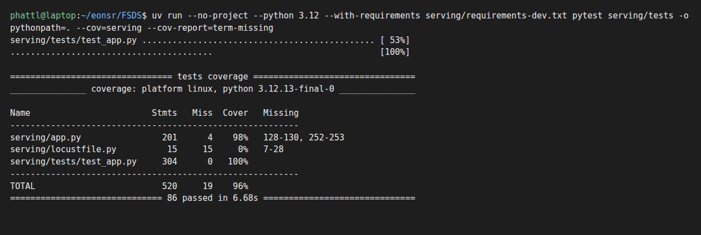

# ML Platform / LLM Platform — evidence

Các ghi nhận trong bảng dưới thuộc môi trường local (`kind` + Docker Compose), chủ yếu ngày 2026-10-21 và 2026-10-22. Cột giới hạn phân biệt kết quả chạy, artifact cấu hình và việc chưa kiểm chứng. Bằng chứng AWS mới hơn nằm trong các mục "Trên AWS" / "Trên EKS" của tài liệu thành phần và [kiểm kê rubric × cloud cập nhật 2026-10-31](rubric-cloud-audit.md), gồm [CI/CD](ml-llm-platform-cicd.md#trên-aws-2026-10-31), [agent eval](llm-platform-agent-eval.md#trên-aws-2026-10-31) và [drift](ml-platform-drift.md#trên-aws-pipeline-a--2026-10-31).

Receipt, log và ảnh gốc giữ nguyên định danh của môi trường đã chạy. Cấu hình hiện hành dùng tiền tố `platform`; các kết quả lịch sử chưa được chạy lại sau đổi tên.

| Thành phần | Ghi nhận local | Evidence / artifact | Giới hạn |
|---|---|---|---|
| LLM inference platform + benchmark | Một phần | llama.cpp (thay llm-d) — [agents](llm-platform-agents.md) | llm-d cần GPU trên AWS/EKS; ngoài mốc 1 |
| Custom LLM model | Một phần | Qwen2.5 GGUF tự host — [agents](llm-platform-agents.md) | Dùng GGUF có sẵn; chưa có bằng chứng fine-tuning riêng |
| agentgateway + security/policy | Đã ghi nhận | API key, rate limit, mcpAuthorization — [agents](llm-platform-agents.md) | Theo phạm vi tài liệu được dẫn |
| Benchmark + tối ưu model server | Đã ghi nhận | config B: req/s 0,475→0,578, p95 9,56→7,0 s — [evidence](evidence/llm-benchmark-20261021.jsonl) | Theo phạm vi tài liệu được dẫn |
| Global ModelConfig qua gateway | Đã ghi nhận | `default-model-config` → agentgateway `/v1` — [agents](llm-platform-agents.md) | Theo phạm vi tài liệu được dẫn |
| Agent registry | Đã ghi nhận | agentregistry 0.4.0 + route `registry.` — [gateway](llm-platform-gateway.md) | ảnh UI |
| RAG pipeline Airflow → Feast | Đã ghi nhận | DAG `ml_rag_ingest` chạy thật — [rag](llm-platform-rag.md) | ảnh Airflow |
| Data governance RAG (lineage) | Chưa kiểm chứng | bước publish DataHub có sẵn trong DAG | cần publish lineage RAG trong runtime ML Platform / LLM Platform AWS/EKS; ngoài mốc 1 (DataHub Data Platform không thay proof RAG) |
| Materialize offline → online (Airflow) | Đã ghi nhận | DAG `ml_feature_materialize`, tăng dần 2 lần — [feature-store](ml-platform-feature-store.md) | ảnh Airflow |
| Stream feature → offline + online | Đã ghi nhận | Flink → Kafka → feast-pusher, 72/72 khớp oracle — [stream-feature](ml-platform-stream-feature.md) | ảnh Flink UI |
| Training Pipeline Kubeflow gồm các bước | Đã ghi nhận | 5 bước SUCCEEDED — [training](ml-platform-training.md) | ảnh KFP |
| MLflow version model + data, tag | Đã ghi nhận | v3 `production`, tag `latest`, sha256 data — [training](ml-platform-training.md) | ảnh MLflow |
| KServe model-inside-image | Đã ghi nhận | `return-risk` READY, predict OK — [serving](ml-platform-serving.md) | ảnh pod + curl |
| FastAPI + pydantic + healthcheck | Đã ghi nhận | [web-api](ml-llm-platform-web-api.md) | Theo phạm vi tài liệu được dẫn |
| Async concurrent | Đã ghi nhận | `asyncio.gather` theo view — [web-api](ml-llm-platform-web-api.md) | Theo phạm vi tài liệu được dẫn |
| MCP tool helm + rolling + fallback | Đã ghi nhận | helm `--atomic` — [web-api](ml-llm-platform-web-api.md) | Theo phạm vi tài liệu được dẫn |
| Agent multi-replica + KEDA | Đã ghi nhận | data-agent 2→3→2 — [evidence](evidence/keda-data-agent-20261021.txt) | Theo phạm vi tài liệu được dẫn |
| Agent trong Sandbox | Chưa kiểm chứng | kagent 0.10 chạy Agent trong sandbox qua Agent Substrate (gVisor, valkey ×6, rustfs) — quá nặng cho kind 14 GB; hiện có: Agent không gọi được LLM/tool/Agent khác nếu không qua agentgateway có API key + `mcpAuthorization` — [agents](llm-platform-agents.md) | AWS/EKS: substrate + `SandboxAgent`; ngoài mốc 1 |
| Publish agent lên registry | Đã ghi nhận | `publish_agentregistry.sh` — [agents](llm-platform-agents.md) | Theo phạm vi tài liệu được dẫn |
| Agent 2: online feature + predict + RAG | Đã ghi nhận | model-agent gọi KServe `return-risk` + RAG — [agents](llm-platform-agents.md), [serving](ml-platform-serving.md) | ảnh chat |
| MCP gateway + policy | Đã ghi nhận | agentgateway `/mcp` — [agents](llm-platform-agents.md) | Theo phạm vi tài liệu được dẫn |
| A2A gateway + policy | Đã ghi nhận | route theo `x-kagent-host` — [agents](llm-platform-agents.md) | Theo phạm vi tài liệu được dẫn |
| Coordinator multi-replica + scale | Đã ghi nhận | KEDA min 2 / max 3 theo request A2A ở gateway: 2→3→2 pod — [evidence](evidence/keda-coordinator-20261021.txt), [`coordinator-keda.yaml`](../infra/k8s/agents/coordinator-keda.yaml) | ảnh kagent UI chat |
| Publish coordinator lên registry | Đã ghi nhận | [agents](llm-platform-agents.md) | Theo phạm vi tài liệu được dẫn |
| Warm Up / Agent Fleet (substrate) | Chưa kiểm chứng | Agent Substrate (kagent `controller.substrate`, WorkerPool gVisor, snapshot/rehydrate agent rảnh) cần ate-system ~2–3 GB RAM — không chạy được cạnh KFP/LLM trên máy 14 GB; local thay bằng scale-to-0 có kiểm soát (KEDA pause, scale qwen 0) | AWS/EKS: cài substrate, ảnh nhiều agent / ít worker; ngoài mốc 1 |
| Unit test coverage | Đã ghi nhận | 85 test, `serving/app.py` 98% (fixture + MagicMock/AsyncMock + httpx MockTransport) — [evidence](evidence/serving-coverage-20261021.txt), [ảnh 2026-10-31: 86 test, `app.py` 98%, tổng 96%](evidence/serving-coverage-20261031.png), [`test_app.py`](../serving/tests/test_app.py) | Coverage theo snapshot của báo cáo 2026-10-21 |
| Equivalence partitioning / BVA | Đã ghi nhận | parametrize biên — `tests/unit/test_serve.py`, `test_agent_eval.py`, [web-api](ml-llm-platform-web-api.md) | Theo phạm vi tài liệu được dẫn |
| Mutation testing | Đã ghi nhận | mutmut — [web-api](ml-llm-platform-web-api.md) | Theo phạm vi tài liệu được dẫn |
| Property-based (hypothesis) | Đã ghi nhận | model: [`tests/unit/test_model_properties.py`](../tests/unit/test_model_properties.py) (dự đoán idempotent, train lại cùng seed ra cùng model, split không lọt tương lai; hypothesis tìm ra ca test một-lớp) + Web API: `test_idempotent` (Hypothesis) — gọi lại cùng request và gửi lặp SKU ra cùng kết quả, [`serving/tests/test_app.py`](../serving/tests/test_app.py) | Theo phạm vi tài liệu được dẫn |
| Load test locust (HTML) | Đã ghi nhận | [web-api](ml-llm-platform-web-api.md) | Theo phạm vi tài liệu được dẫn |
| CI/CD RAG pipeline | Một phần | `ci/jenkins/rag-pipeline.Jenkinsfile`: test → build → **push registry** → deploy → chạy DAG. Image đi qua **registry local** `localhost:5001` (Jenkins push → k8s pull; đã kiểm pod Feature API kéo `localhost:5001/platform-feature-api:<sha>` ngày 2026-10-22) — [cicd](ml-llm-platform-cicd.md). | Chưa có Stage View cho toàn chuỗi pipeline từ revision hiện hành |
| CI/CD MCP + agent (+ Langfuse prompt) | Một phần | `feature-api-agents.Jenkinsfile`: test → build → **push registry** → helm `--atomic` → **sync prompt từ Langfuse** → deploy Agent → smoke 4 tool → **Eval agent** (dưới ngưỡng 0,95 ⇒ build đỏ). Langfuse v2 giữ 3 prompt (label production); Agent đọc qua `systemMessageFrom` ConfigMap; đổi prompt v2 trên Langfuse ⇒ Agent nhận sau sync (đã kiểm) — [agents](llm-platform-agents.md#system-prompt-từ-langfuse) | Chưa có Stage View cho toàn chuỗi pipeline từ revision hiện hành |
| CI/CD coordinator | Một phần | `coordinator.Jenkinsfile`: validate → sync prompt Langfuse → deploy → smoke A2A qua gateway → **Eval agent** | Chưa có Stage View cho toàn chuỗi pipeline từ revision hiện hành |
| CI/CD stream feature jobs | Một phần | `stream-features.Jenkinsfile`: test → build → **push registry** → deploy feast-pusher theo SHA — [stream-feature](ml-platform-stream-feature.md) | Chưa có Stage View cho toàn chuỗi pipeline từ revision hiện hành |
| Metric UI sau gateway | Đã ghi nhận | `metrics.` + `grafana.` — [gateway](llm-platform-gateway.md) | Theo phạm vi tài liệu được dẫn |
| Log UI sau gateway | Đã ghi nhận | Loki qua Grafana Explore — [observability](ml-llm-platform-observability.md) | Theo phạm vi tài liệu được dẫn |
| Trace UI sau gateway | Đã ghi nhận | `traces.` (Jaeger) — [gateway](llm-platform-gateway.md) | Theo phạm vi tài liệu được dẫn |
| UI test agent | Đã ghi nhận | `agent.` (kagent UI) | Theo phạm vi tài liệu được dẫn |
| UI agent registry | Đã ghi nhận | `registry.` | Theo phạm vi tài liệu được dẫn |
| Basic auth + rate limit | Đã ghi nhận | 401/200/429 — [gateway](llm-platform-gateway.md) | Theo phạm vi tài liệu được dẫn |
| Domain + HTTPS Web API | Một phần | sslip.io + CA nội bộ; Let's Encrypt DNS-01 qua DuckDNS đã chuẩn bị, mặc định tắt (`scripts/setup/setup_letsencrypt.sh`) — [gateway](llm-platform-gateway.md) | domain thật + ACME trên AWS/EKS; ngoài mốc 1 |
| Terraform cloud services | Chưa kiểm chứng | [Terraform AWS](../infra/aws/terraform/README.md): EC2/VPC/S3/IAM; [IaC](IaC.md) | Chưa apply theo [runbook](aws-deploy.md#terraform), thu proof cloud services; chưa có EKS |
| Ansible deploy VM | Chưa kiểm chứng | [Ansible AWS](../infra/aws/ansible/README.md), [IaC](IaC.md) (phần Data Platform) | chạy playbook trên EC2 và chụp PLAY RECAP theo [runbook](aws-deploy.md#ansible) |
| Web API metrics | Đã ghi nhận | feature-api `/metrics`; KServe `return_risk_*` — [serving](ml-platform-serving.md) | Theo phạm vi tài liệu được dẫn |
| CPU/RAM/disk/network | Đã ghi nhận | Prometheus + Grafana — [observability](ml-llm-platform-observability.md) | Theo phạm vi tài liệu được dẫn |
| Logs | Đã ghi nhận | Loki + Fluent Bit — [observability](ml-llm-platform-observability.md) | Theo phạm vi tài liệu được dẫn |
| Traces | Đã ghi nhận | agentgateway/kagent OTLP → Jaeger | Theo phạm vi tài liệu được dẫn |
| LLM telemetry (token, TTFT, PII) | Đã ghi nhận | token in/out/tổng mỗi request, thời gian 1 lượt, **TTFT** (`gen_ai_server_time_to_first_token`), **PII**: guardrail agentgateway chặn email/thẻ/SSN (403), `guardrail_checks_total{action}` — dashboard "Data & AI Platform — Agents, LLM, MCP", [observability](ml-llm-platform-observability.md) | Chưa kèm ảnh dashboard trong báo cáo |
| Agent telemetry (call agent/tool, lỗi) | Đã ghi nhận | lượt gọi mỗi Agent (`agentgateway_requests_total{route=a2a-*}`), mỗi tool (`agentgateway_mcp_requests_total`), **lỗi mỗi tool** (`mcp_tool_calls_total{tool,outcome}` trong Feature API) — dashboard "Data & AI Platform — Agents, LLM, MCP" | Chưa kèm ảnh dashboard trong báo cáo |
| A/B agent khác model config | Đã ghi nhận | data-agent vs data-agent-b — [ab-test](llm-platform-ab-test.md) | Theo phạm vi tài liệu được dẫn |
| A/B hai bản LLM | Đã ghi nhận | `platform-chat` 1:1 — [ab-test](llm-platform-ab-test.md) | Theo phạm vi tài liệu được dẫn |
| Vault | Đã ghi nhận | [vault](ml-llm-platform-vault.md) | Theo phạm vi tài liệu được dẫn |
| eval harness agent | Đã ghi nhận | A 100% vs B 91,7%; cổng chạy trong Jenkins (stage `Eval agent`, `scripts/run/eval_agent_ci.sh`) — [agent-eval](llm-platform-agent-eval.md) | ảnh Stage View có stage Eval |
| drift monitoring | Đã ghi nhận | Evidently, Sale event alert — [drift](ml-platform-drift.md) | Theo phạm vi tài liệu được dẫn |

Các dòng “Đã ghi nhận” trỏ tới báo cáo hoặc receipt tại thời điểm chạy, không xác nhận service đang hoạt động. Tài liệu thành phần có lệnh tái lập và phần thiếu ảnh/log; không dùng trạng thái bảng này thay kết quả chạy mới.

## Unit test coverage Web API

`pytest serving/tests --cov=serving`: 86 test pass, `serving/app.py` 98% (4 dòng chưa phủ: `load_store` nạp Feast thật,
và nhánh lỗi HTTP của tool `get_policy_chunks`), tổng 96% > 90%. `locustfile.py` 0% vì là kịch bản load test, không phải code
ứng dụng. Test dùng fixture + `MagicMock`/`AsyncMock` thay Feast, `httpx.MockTransport` thay KServe:
[`serving/tests/test_app.py`](../serving/tests/test_app.py).

## Tái lập và bổ sung evidence

- Chạy lại CI/CD từ revision cần kiểm chứng, lưu Stage View, image digest và kết quả smoke/eval.
- Thu receipt Airflow cho materialization/RAG và lineage RAG tương ứng trong DataHub.
- Sandbox và Warm Up đã có ảnh EKS ngày 31/10: [SandboxAgent gọi tool](evidence/aws/substrate-sandbox-agent-ui-20261031.png), [6 Agent / 1 worker](evidence/aws/substrate-warmup-6-agents-1-worker-20261031.png). LLM đang dùng Qwen 1,5B trên CPU; không suy thành proof GPU.
- [AWS EC2 + S3](aws-deploy.md) phục vụ Data Platform; ML/LLM chạy trên EKS `platform-apps`. Trạng thái AWS hiện tại xem [kiểm kê](rubric-cloud-audit.md); bảng local phía trên giữ nguyên phạm vi lịch sử.

[Mục lục tài liệu](README.md)
