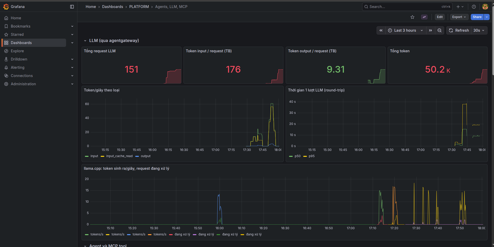
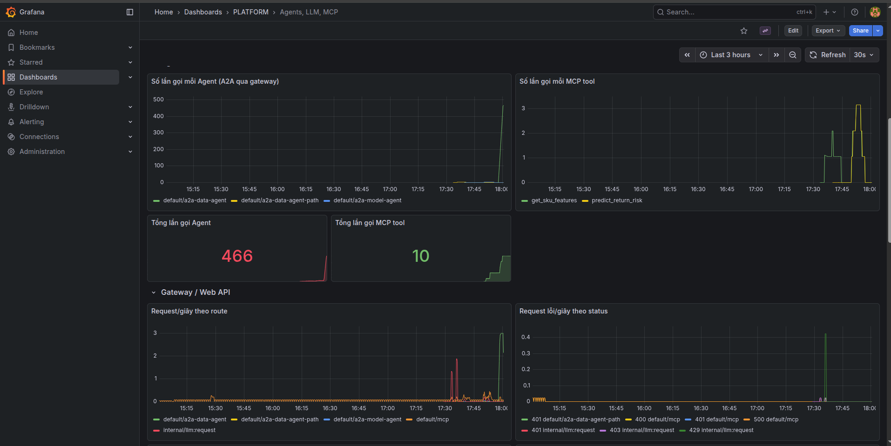
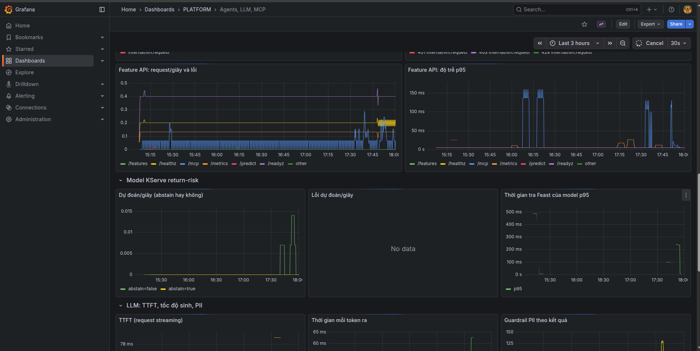
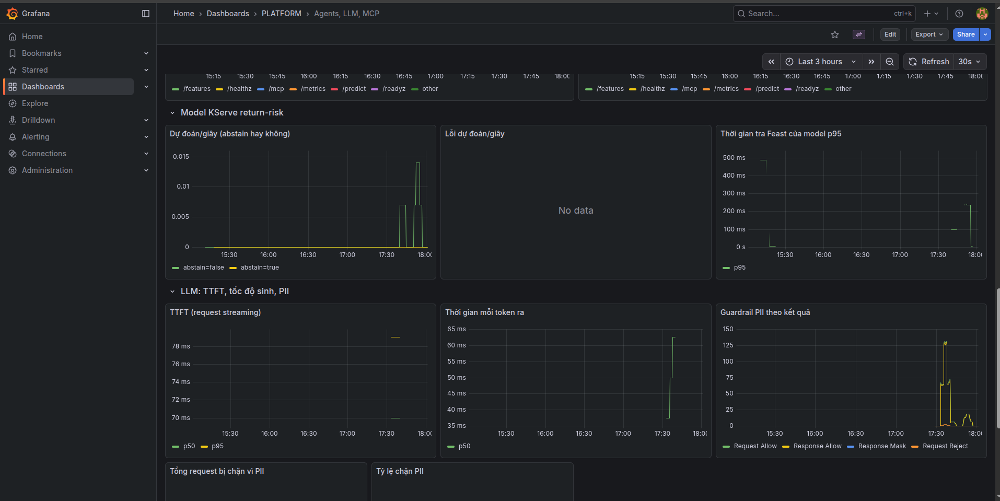
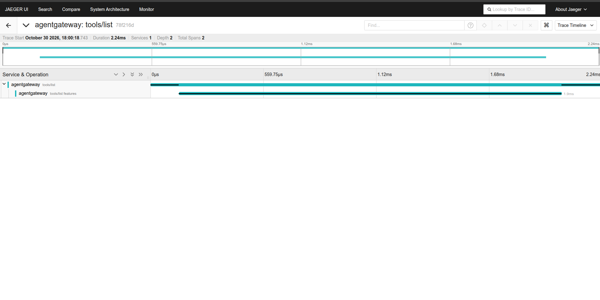
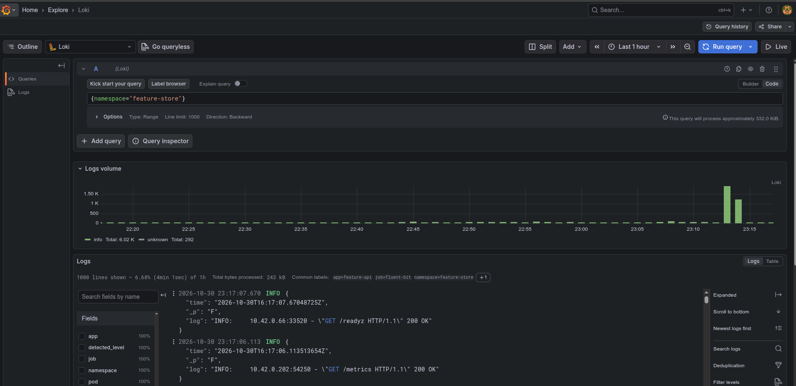
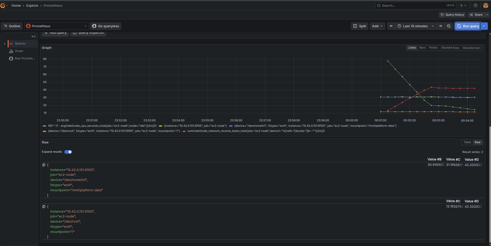

<!-- Mục đích: bộ quan sát (metrics, logs, traces, LLM/agent telemetry) trong kind, -->
# Observability — ML Platform / LLM Platform

Dựng: `bash scripts/setup/deploy_kind_observability.sh` (ns `observability`). Xem qua HTTPS + basic auth
(ingress của [`docs/ml-llm-platform-cicd.md`](ml-llm-platform-cicd.md)): `grafana.`, `traces.`, `metrics.` trên `172-25-0-2.sslip.io:30443`.

| Thành phần | Chart / bản | Vai trò | File |
|---|---|---|---|
| Prometheus | prometheus-community/prometheus 29.36.2 | số đo, giữ 6 giờ; lấy pod có annotation `prometheus.io/scrape` | [`prometheus-values.yaml`](../infra/k8s/observability/prometheus-values.yaml) |
| Loki | grafana/loki 7.3.0 (SingleBinary) | log, PVC 1 Gi, giữ 24 giờ | [`loki-values.yaml`](../infra/k8s/observability/loki-values.yaml) |
| Fluent Bit | fluent/fluent-bit 0.58.3 | đọc log container trên node, gắn nhãn namespace/pod/app, đẩy Loki | [`fluent-bit-values.yaml`](../infra/k8s/observability/fluent-bit-values.yaml) |
| Jaeger | jaegertracing/jaeger 4.16.1, image **2.10.0** | trace (OTLP :4317), lưu RAM | [`jaeger-values.yaml`](../infra/k8s/observability/jaeger-values.yaml) |
| Grafana | grafana/grafana 10.5.15 | xem cả ba; dashboard Data & AI Platform | [`grafana-values.yaml`](../infra/k8s/observability/grafana-values.yaml), [`dashboards/`](../infra/k8s/observability/dashboards/platform-agents.json) |

Nguồn dữ liệu:
- **Web API** (Feature API, từ v7): `/metrics` với `http_requests_total{method,handler,status}` và
  `http_request_duration_seconds{handler}` (prometheus_client, middleware trong [`serving/app.py`](../serving/app.py));
  request MCP gom về `handler="/mcp"`.
- **agentgateway**: `agentgateway_requests_total{route,status}`, `agentgateway_mcp_requests_total{method,resource}`
  (số lần gọi từng tool), `agentgateway_gen_ai_client_token_usage{gen_ai_token_type=input|output}` (token mỗi request),
  `agentgateway_gen_ai_server_request_duration` (thời gian 1 lượt LLM); trace OTLP gửi Jaeger.
- **TTFT và PII (agentgateway)**: `agentgateway_gen_ai_server_time_to_first_token` (chỉ request streaming),
  `agentgateway_gen_ai_server_time_per_output_token`; guardrail regex trên cả 2 model chặn request chứa email / thẻ
  tín dụng / SSN (HTTP 403 `pii_detected`) và che email/điện thoại/thẻ trong câu trả lời, đếm ở
  `agentgateway_guardrail_checks_total{phase,action}`. Không chặn số điện thoại ở request (số lượng, giá, mã SKU dễ
  bị nhận nhầm).
- **Lỗi mỗi MCP tool** (Feature API v8): `mcp_tool_calls_total{tool,outcome=ok|error}` — lỗi MCP trả HTTP 200 kèm
  `isError` nên không thấy được qua `http_requests_total`.
- **llama.cpp**: `llamacpp:predicted_tokens_seconds`, `llamacpp:requests_processing`.
- **kagent**: trace controller + Agent (Helm `otel.tracing`).
- **Log**: mọi pod qua Fluent Bit → Loki; xem ở Grafana Explore (Loki không có UI riêng).

## Dashboard "Data & AI Platform — Agents, LLM, MCP"

| Nhóm | Panel |
|---|---|
| LLM | tổng request; token input / output trung bình mỗi request; tổng token; token/giây theo loại; thời gian 1 lượt p50/p95; llama.cpp token/giây |
| Agent & MCP | số lần gọi mỗi Agent (A2A qua gateway); số lần gọi mỗi MCP tool; tổng lần gọi Agent / tool |
| LLM: TTFT, PII | TTFT p50/p95; thời gian mỗi token ra; guardrail theo phase/action; tổng request bị chặn PII; tỷ lệ chặn |
| MCP tool | lượt gọi theo tool + kết quả; tổng lỗi mỗi tool |
| Gateway / Web API | request/giây theo route; request lỗi theo status; Feature API request/giây + 5xx; độ trễ p95 theo handler |

## Kiểm 2026-10-21

- Prometheus: sau 60 request thử, `http_requests_total` của Feature API ghi `/features 200 = 30`, `/features 422 = 30`.
- Loki: `count_over_time({job="fluent-bit"}[10m])` có log của mọi namespace (agentgateway, feature-store, kagent…).
- Jaeger: `/api/services` có `agentgateway` sau khi bật tracing.
- Grafana: datasource Prometheus/Loki/Jaeger đều `OK`; vào qua ingress: basic auth `ops` → form đăng nhập Grafana →
  dashboard.

Lỗi đã gặp:
- Jaeger 2.22 (mặc định của chart) chỉ trả API v3 ở `/api/v3/...`, Grafana gọi `/api/services` (404) ⇒ ghim 2.10.0.
- Ingress có basic auth ⇒ header `Authorization: Basic` tới Grafana, Grafana coi là tài khoản của nó và trả 401 ⇒
  `grafana.ini: auth.basic.enabled=false`.
- Panel "pod data-agent" cần kube-state-metrics (đã tắt cho nhẹ) ⇒ bỏ.

Kiểm PII/TTFT 2026-10-21 (gọi `/v1/chat/completions` qua gateway): "Email the refund to jane.doe@example.com" → 403
`pii_detected`; "My card is 4111 1111 1111 1111" → 403; "Return risk of 2 units of sku-00003 for 4500 cents?" → 200;
request `stream: true` → có `time_to_first_token`. `guardrail_checks_total`: Request/Allow 2, Request/Reject 2,
Response/Allow 1. Tool: gọi `get_sku_features` qua gateway khi MinIO đang tắt → `mcp_tool_calls_total{outcome="error"}`
tăng đúng số lượt lỗi.

## Trên EKS, 2026-10-30

Grafana `https://grafana.<ip>.sslip.io` (basic auth `ops` rồi tài khoản admin Grafana), dashboard
"Agents, LLM, MCP", 3 giờ gồm benchmark Qwen, [`gateway_smoke`](evidence/aws/gateway-smoke-20261030.json) (17/17),
chat Coordinator và đợt tải KEDA.

Panel guardrail có "Response Mask": chính lần gateway che nhầm tỉ lệ Return thành `<PHONE_NUMBER>`
(xem [LLM và agent](llm-platform-agents.md#trên-eks-2026-10-30)).

Jaeger nhận trace OTLP của agentgateway; một trace MCP `tools/list` có span con tới backend `features`:

Log: Fluent Bit (DaemonSet, 1 pod/node) đọc log container, gắn nhãn `namespace`, `pod`, `app`, đẩy vào Loki
([`fluent-bit-values.yaml`](../infra/k8s/observability/fluent-bit-values.yaml)). Grafana Explore → Loki,
`{namespace="feature-store"}`, 1 giờ:

Hai cột ~1,5k và ~1k dòng khớp đợt [load test trên EKS](ml-llm-platform-web-api.md#load-test-trên-eks)
(3.004 request trong 60 s).

Computing telemetry của EC2 (node-exporter `:9100`, Prometheus EKS scrape qua IP riêng). Grafana Explore, 4 truy vấn:
CPU % (`node_cpu_seconds_total` idle), RAM % (`MemAvailable/MemTotal`), disk % cho `/` và `/mnt/platform-data` (EBS dữ
liệu), network nhận byte/giây (bỏ `lo`, veth, docker, bridge).

Khung 15 phút, đồ thị chỉ có từ 00:01: trước đó Prometheus vẫn scrape IP EC2 **cũ** (`10.42.0.12`, máy bị thay hôm 30/10) dù
ConfigMap đã trỏ `10.42.0.151`, vì sidecar nạp lại config bị tắt và pod chạy 13 giờ không khởi động lại.
Sửa: [`prometheus-values.yaml`](../infra/k8s/observability/prometheus-values.yaml) bật `configmapReload`, test
`test_prometheus_reloads_config_when_targets_change`.
