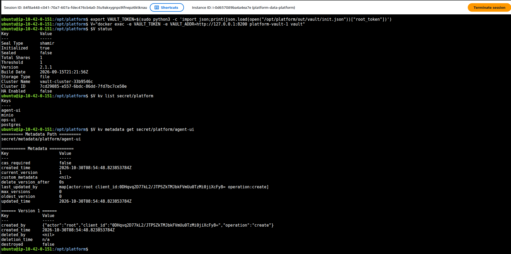

<!-- Mục đích: quản lý secret tập trung bằng HashiCorp Vault -->
# Secret tập trung — HashiCorp Vault

Secret nằm ở **một chỗ** (Vault) để cả tổ chức dùng chung, không rải trong code.

## Thiết kế

```
.env + Secret k8s agentgateway ──setup_vault.sh──► Vault KV v2  secret/platform/{minio,postgres,agentgateway}
                                      (setup_jenkins.sh / setup_ingress.sh thêm jenkins, agent-ui)
                                                    │  policy platform-read (chỉ đọc)
                                                    ▼
                               token CI chỉ-đọc ──► Jenkins (credential duy nhất: vault-ci-token)
                                                    ▼
                         scripts/setup/vault_env.sh ──► run_sku_return_feature.sh, feast-pusher, …
```

| Thành phần | File |
|---|---|
| Service Vault 2.1.1, chế độ server, lưu file trong volume `vault-data` | `vault` trong [`docker-compose.yml`](../docker-compose.yml) (profile `security`) |
| Init 1 lần + unseal + bật KV v2 + nạp secret + policy + token CI | [`scripts/setup/setup_vault.sh`](../scripts/setup/setup_vault.sh) |
| Đọc secret thành biến môi trường | [`scripts/setup/vault_env.sh`](../scripts/setup/vault_env.sh) |
| Consumer: submit job Flink, Jenkinsfile stream | [`run_sku_return_feature.sh`](../scripts/run/run_sku_return_feature.sh), [`stream-features.Jenkinsfile`](../ci/jenkins/stream-features.Jenkinsfile) |

## Quyết định

- **Server mode, không dev mode**: dev mode giữ secret trong RAM, restart là mất. Server mode lưu
  file; restart thì Vault **sealed** (khoá), `setup_vault.sh` unseal lại.
- **Khoá unseal + root token** nằm ở `out/vault/init.json` (gitignored, quyền 600) — chỉ chấp nhận ở
  local. Trên GKE: auto-unseal bằng Cloud KMS, root token thu hồi sau khi setup.
- **Least privilege**: CI dùng token policy `platform-read` chỉ đọc `secret/data/platform/*`, period 768h.
- Thứ tự lấy credential trong script: biến môi trường → Vault (nếu có `VAULT_TOKEN`) → `.env`.

## Sau khi máy restart

`scripts/setup/up_ml_base.sh` dựng lại phần nền dùng chung một lệnh: MinIO + PostgreSQL + Lakekeeper,
unseal Vault, Jenkins, và materialize lại Redis nếu trống (Redis trong kind không lưu đĩa). Không bật
LLM/agent. Dừng service Compose thì **luôn ghi tên service** — `docker compose --profile X stop` không
tên sẽ dừng cả MinIO/PostgreSQL mà Feast, MLflow, Vault phụ thuộc.

## Bằng chứng (2026-10-21)

```text
eval "$(scripts/setup/vault_env.sh postgres)"  → POSTGRES_USER=platform POSTGRES_DB=sources (password 18 ký tự)
POST secret/data/platform/postgres bằng token CI     → HTTP 403 (chỉ đọc)
vault_env.sh agentgateway                        → AGW_AGENT_KEY 36 ký tự, khớp Secret k8s
restart container vault                          → sealed=true; setup_vault.sh → sealed=false
```

<!-- Ảnh UI Vault (http://localhost:8200, secret/platform/*): người vận hành chụp rồi gắn vào đây. -->

## Trên AWS (2026-10-31)

Vault 2.1.1 chạy trên EC2 (Docker Compose, dữ liệu trên EBS `/mnt/platform-data/vault`, chỉ nghe loopback 8200, vào
qua SSM). Khởi tạo lại 30/10 sau sự cố thay EC2 ([`setup_vault.sh`](../scripts/setup/setup_vault.sh)). KV v2
`secret/platform/*` là nơi duy nhất giữ secret dùng chung:

| Secret | Ai đọc |
|---|---|
| `agent-ui`, `ops-ui` | [`setup_ingress.sh`](../scripts/setup/setup_ingress.sh) sinh một lần rồi đọc để tạo htpasswd basic auth cho NGINX |
| `postgres` | [`vault_env.sh`](../scripts/setup/vault_env.sh) cho job/CI (Flink, Jenkins), không ghi vào repo |
| `minio` | bản local (trên AWS dùng IAM role, không có MinIO) |

Ảnh dưới chỉ in trạng thái, tên secret và metadata phiên bản, **không in giá trị**: `Sealed false`, 4 key dưới
`secret/platform`, `agent-ui` version 1 tạo 2026-10-30 08:54 UTC — đúng lúc `setup_ingress.sh` chạy lần đầu sau khi
khởi tạo lại Vault.


