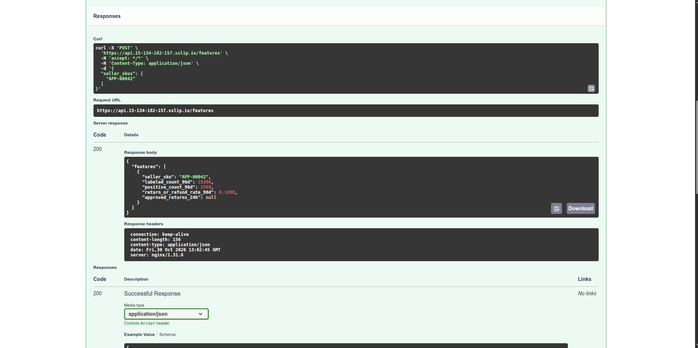
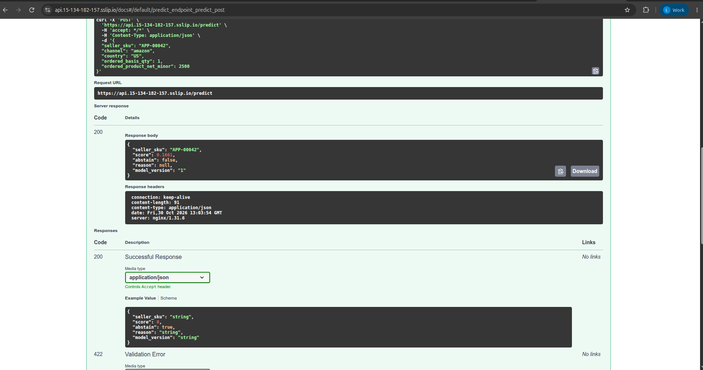

<!-- Mục đích: Web API kéo feature SKU từ kho ONLINE, -->
# Web API kéo feature — ML Platform / LLM Platform

FastAPI + pydantic + healthcheck cho k8s, dùng async.

```
Agent / client ──POST /features {"seller_skus": [...]}──► serving/app.py
                                                            │ await get_online_features_async
                                                            ▼
                                             Feast registry (MinIO) + Redis (kind platform)
```

| Endpoint | Việc |
|---|---|
| `GET /healthz` | liveness: process còn sống |
| `GET /readyz` | readiness: đã nạp Feast registry, chưa nạp → 503 |
| `POST /features` | 1–100 SKU (`^[A-Za-z0-9_.-]{1,64}$`), trả 4 feature mỗi SKU |

Mỗi feature view được tra riêng và song song (`asyncio.gather`). SKU chưa có trong Redis,
hoặc một view lỗi/chưa đăng ký → feature của view đó là `null`. Chỉ khi **mọi** view lỗi mới trả 503.

Feature trả về: `labeled_count_90d`, `positive_count_90d`, `return_or_refund_rate_90d`
(view `sku_return_daily`), `approved_returns_24h` (view `sku_return_24h`).
SKU trùng trong request chỉ tra một lần, kết quả giữ thứ tự lần xuất hiện đầu.

`POST /chunks` `{"query": "...", "top_k": 3}` (query 3–500 ký tự, top_k 1–10) tìm đoạn chính sách trả hàng
trong Feast RAG (pgvector); chỉ bật khi pod có `FEAST_RAG_REGISTRY`, nếu không trả 503. Pipeline nạp chunk:
[`docs/llm-platform-rag.md`](llm-platform-rag.md).

Code: [`serving/app.py`](../serving/app.py). Test: [`serving/tests/test_app.py`](../serving/tests/test_app.py).

## Test

```bash
uv run --no-project --python 3.12 --with-requirements serving/requirements-dev.txt \
  pytest serving/tests -o pythonpath=. --cov=serving --cov-report=term-missing
```

Kết quả 2026-10-21: 84 pass, coverage `serving/app.py` 98% (chỉ thiếu `load_store`, phần nạp Feast thật).

| Kỹ thuật | Ở đâu |
|---|---|
| fixture + mock | `store` (MagicMock + AsyncMock giả `get_online_features_async`), `client` |
| Equivalence partitioning + boundary value | `test_sku_count_boundaries` (0 / 1 / 50 / 100 / 101 SKU), `test_sku_format` (độ dài 0 / 1 / 64 / 65, ký tự lạ) |
| Property-based (idempotency) | `test_idempotent` (Hypothesis): gọi 2 lần và gửi lặp SKU ra cùng kết quả |

## Mutation testing (mutmut)

Cấu hình `[tool.mutmut]` trong `pyproject.toml`.

```bash
uv run --no-project --python 3.12 --with-requirements serving/requirements-dev.txt mutmut run
uv run --no-project --python 3.12 --with-requirements serving/requirements-dev.txt mutmut results
```

Kết quả 2026-10-21 trên `serving/app.py` (bản cuối: feature, chunk, dự đoán KServe, MCP, metrics), 177 bản đột biến:

| Loại | Số | Ghi chú |
|---|---:|---|
| killed | 142 | test bắt được |
| timeout → killed | 21 | mutmut báo timeout vì chạy song song bằng fork làm treo `TestClient`; chạy lại từng bản tuần tự (`MUTANT_UNDER_TEST=<tên> pytest -x serving/tests` trong `mutants/`) thì cả 21 đều fail |
| survived | 5 | 3 bản đổi `zip(strict=True)` (tương đương: số view luôn bằng số kết quả); 2 bản đổi `host=` của MCP app (chỉ đổi danh sách Host chống DNS rebinding; test gọi bằng Host `testserver` nên không phân biệt) |
| no tests | 9 | `load_store` — chỉ chạy khi có Feast thật |

**Mutation score: 163/168 = 97,0%**. Cấu hình `[tool.mutmut]` trong `pyproject.toml`
(`also_copy` gồm `rag` vì test `load_rag` import nó); chạy `mutmut run --max-children 2` cho đỡ RAM.

## Load test (locust)

Chạy API thật (uvicorn, 1 worker) nối Feast registry trên MinIO + Redis trong kind, trong image `platform-feast:0.66.0`;
20 user, 60 s, tỷ lệ 4 : 1 : 1 = một SKU / lô 10 SKU / `healthz`. File: [`serving/locustfile.py`](../serving/locustfile.py).

| Request | Số | Lỗi | p50 | p95 | p99 | req/s |
|---|---:|---:|---:|---:|---:|---:|
| `POST /features` | 5.811 | 0 | 6 ms | 19 ms | 34 ms | 97,6 |
| `POST /features [batch]` | 1.495 | 0 | 7 ms | 20 ms | 32 ms | 25,1 |
| `GET /healthz` | 1.402 | 0 | 3 ms | 10 ms | 16 ms | 23,6 |
| **Tổng** | **8.708** | **0** | 6 ms | 18 ms | 31 ms | **146,3** |

Báo cáo HTML: [`evidence/load-test-feature-api-20261021.html`](evidence/load-test-feature-api-20261021.html).
Giới hạn: locust chạy cùng container với API (cùng máy 14 GB), lúc đó view `sku_return_24h` chưa đăng ký
nên mỗi request chỉ thật sự đọc Redis một lần; số này là mức sàn local, chưa phải GKE.

## MCP tool

Cùng app phơi thêm MCP server (thư viện `mcp` 2.3.0) tại `/mcp/`, một tool `get_sku_features(seller_skus)`
dùng chung `fetch_features` với REST. Chế độ **stateless + JSON**: request MCP nào tới replica nào cũng được,
không cần sticky session, nên scale nhiều replica như API thường. Input sai hoặc Redis lỗi → `isError: true`
kèm lời nhắn rõ (`ToolError`) để LLM tự sửa lại lời gọi. Test: `test_mcp_*` trong
[`serving/tests/test_app.py`](../serving/tests/test_app.py).

```bash
curl -s -X POST http://platform-control-plane:30800/mcp/ -H 'Content-Type: application/json' \
  -H 'Accept: application/json, text/event-stream' \
  -d '{"jsonrpc":"2.0","id":1,"method":"tools/call","params":{"name":"get_sku_features","arguments":{"seller_skus":["sku-A"]}}}'
```

## Chạy trong k8s bằng helm (kind `platform`)

```bash
bash scripts/setup/deploy_kind_feature_api.sh [tag]
```

| Phần | File |
|---|---|
| Image (dựng trên `platform-feast:0.66.0`, 1,02 GB, phần lớn là layer Feast dùng chung) | [`docker/Dockerfile.serving`](../docker/Dockerfile.serving) |
| Helm chart: Deployment 2 replica + Service NodePort 30800 | [`infra/helm/feature-api/`](../infra/helm/feature-api/Chart.yaml) |
| Build → `kind load` → Secret từ `.env` → `helm upgrade --install --atomic` | [`scripts/setup/deploy_kind_feature_api.sh`](../scripts/setup/deploy_kind_feature_api.sh) |

- **Rolling update**: `maxUnavailable: 0, maxSurge: 1` — thêm 1 pod mới, chỉ bỏ pod cũ khi pod mới Ready.
  `preStop: sleep 5s` để kube-proxy gỡ pod cũ khỏi Service trước khi nó tắt (thiếu cái này, lần đo đầu rớt
  1/366 request đúng lúc pod cũ tắt).
- **Auto fallback**: `helm upgrade --atomic --timeout`: pod mới không Ready trong hạn ⇒ helm tự rollback về
  revision trước.
- Probe: `startupProbe` + `livenessProbe` gọi `/healthz`, `readinessProbe` gọi `/readyz`.
- Secret `feature-api-env` (khóa MinIO, registry, Redis) tạo lúc chạy script từ `.env`, không nằm trong Git.
- Pod phân giải được `minio` (172.23.0.3) vì node kind nối vào mạng `platform_default` (kiểm 2026-10-21).
  Redis gọi qua Service trong cụm `redis.feature-store.svc.cluster.local:6379`.
- Request: 50m CPU / 128Mi RAM, limit 384Mi.

### Kiểm 2026-10-21

Một container gửi `POST /features` mỗi 0,2 s suốt lúc chạy: 3 lần rolling update (v1 → v2 → v1 → v2), rồi một
bản cố tình hỏng (`envSecret=does-not-exist` ⇒ pod mới không khởi động được, `--timeout 45s`).

| Kết quả | |
|---|---|
| Request | **583 / 583 trả 200**, 0 lỗi |
| Bản hỏng | revision 12 `failed` → helm tự tạo revision 13 `Rollback to 11`; 2 pod cũ phục vụ suốt |

Log: [`evidence/feature-api-helm-rollout-20261021.txt`](evidence/feature-api-helm-rollout-20261021.txt).
Giá trị feature lúc đó là `null` vì Redis vừa khởi động lại, chưa materialize.

### Bản v3 (2026-10-21): thêm tìm chunk RAG

Image v3 có thêm `feast[postgres]`, `fastembed` và model `BAAI/bge-small-en-v1.5` nằm sẵn trong image
(`RAG_MODEL_CACHE=/opt/models`); Secret thêm `FEAST_RAG_REGISTRY`, `RAG_PG_*`. Helm revision 14, 1 replica
(`REPLICAS=1`, máy local chật RAM; rolling update/rollback đã chứng minh ở trên với 2 replica).

| Thử | Kết quả |
|---|---|
| `POST /chunks` "How long does a Walmart buyer have to return?" | `walmart-returns / Return window` đứng đầu, distance 0,127 |
| MCP qua agentgateway `tools/call search_policy_chunks` "Can a TikTok buyer get a refund without returning the item?" | `tiktok-shop-returns / Refund only` |

Agent dùng tool: [`docs/llm-platform-agents.md`](llm-platform-agents.md).

### Trên EKS, 2026-10-30

Feature API (helm, 2 replica) sau ingress HTTPS `https://api.<ip>.sslip.io` (cert Let's Encrypt). `helm upgrade` lên
image `813627b-pii1` (làm tròn số, xem [LLM và agent](llm-platform-agents.md#trên-eks-2026-10-30)) là revision 2,
rolling không gián đoạn.





`approved_returns_24h` còn `null`: feature stream chưa chạy trên AWS.
