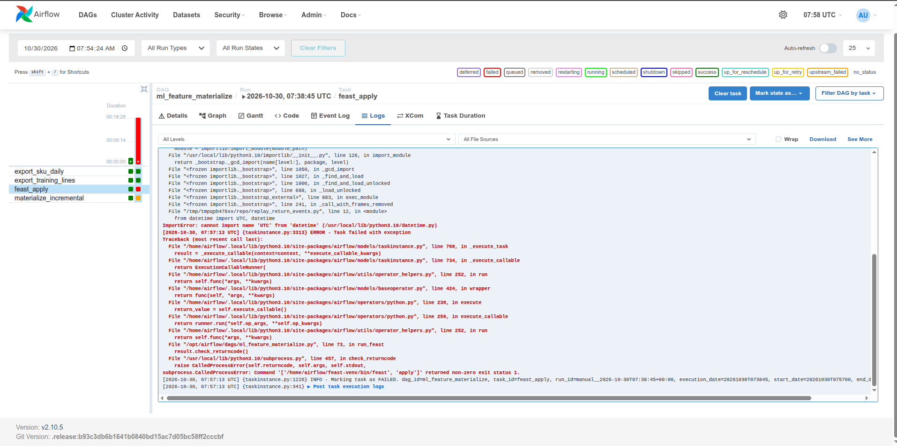
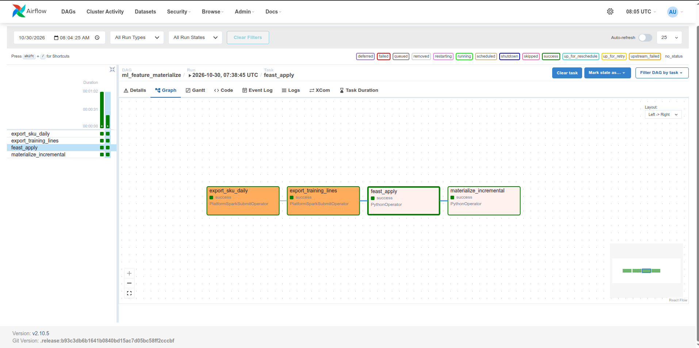
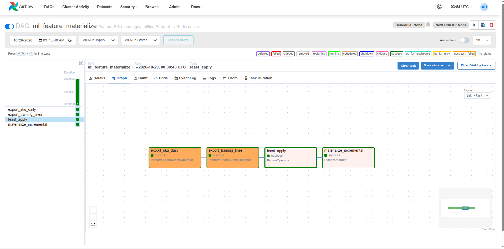
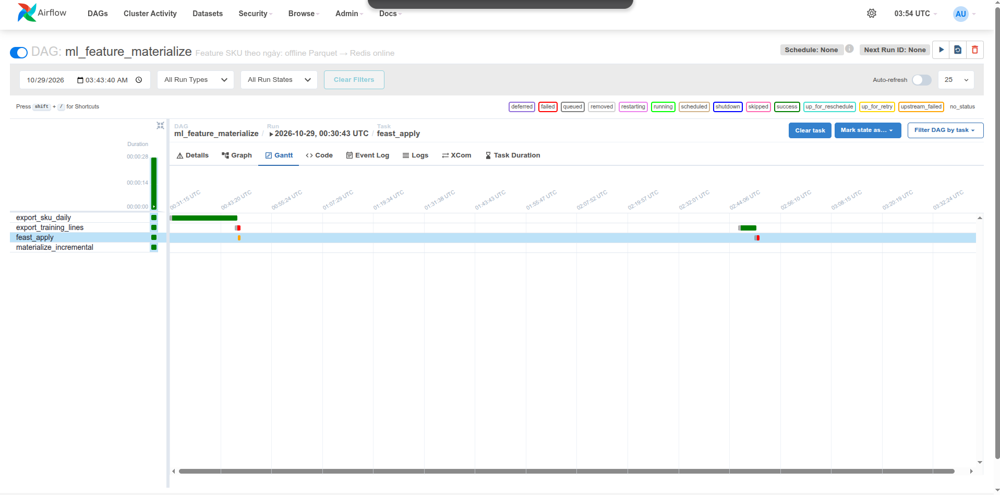
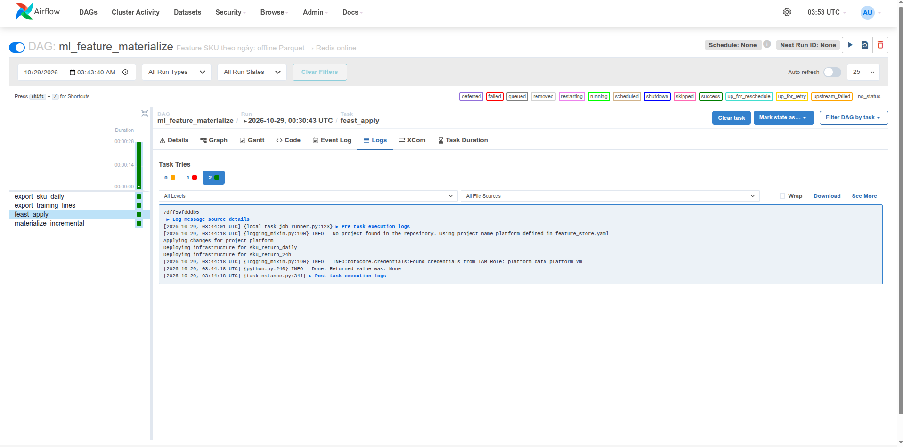

<!-- Mục đích: cách dựng và chạy kho feature (Feast) cho phần ML Platform, -->
# Kho feature (Feast) — ML Platform bước 2

pipeline Airflow **materialize tăng dần** feature mới nhất từ kho
OFFLINE sang kho ONLINE.

## Đường đi của dữ liệu

```
Iceberg Gold (lifecycle_fact_order_lines + lifecycle_label_segments)
   │ ① Spark: export_sku_daily_features.py — ảnh chụp mỗi SKU lúc 00:00 UTC mỗi ngày
   ▼
Parquet  s3://platform/feature-store/sku_daily/          ← kho OFFLINE (MinIO; GCP: gs://)
   │ ② feast apply — ghi định nghĩa vào registry s3://platform/feature-store/registry.db
   │ ③ feast materialize-incremental <end> — chỉ nạp ảnh chụp trong (lần trước, end]
   ▼
Redis trong cụm kind platform, NodePort 30379          ← kho ONLINE
```

DAG: [`dags/ml_feature_materialize.py`](../dags/ml_feature_materialize.py) = ① → xuất tập train
(`export_training_lines.py`, đầu vào của KFP) → ② → ③.

| Thành phần | File |
|---|---|
| Định nghĩa feature (entity `sku`, view `sku_return_daily`) | [`feature_repo/features.py`](../feature_repo/features.py) |
| Cấu hình Feast (đọc biến môi trường) | [`feature_repo/feature_store.yaml`](../feature_repo/feature_store.yaml) |
| Hàm tính ảnh chụp theo ngày | `sku_daily_features` trong [`spark_jobs/lib/order_lifecycle_gold.py`](../spark_jobs/lib/order_lifecycle_gold.py) |
| Job Spark xuất Parquet | [`spark_jobs/gold/export_sku_daily_features.py`](../spark_jobs/gold/export_sku_daily_features.py) |
| Cụm kind + Redis | [`infra/k8s/kind-config.yaml`](../infra/k8s/kind-config.yaml), [`infra/k8s/feature-store/redis.yaml`](../infra/k8s/feature-store/redis.yaml) |
| Kiểm tra | [`tests/spark/check_sku_daily_features.py`](../tests/spark/check_sku_daily_features.py) |

## Vì sao chụp theo ngày, khoá theo SKU

Feature cũ `feat_sku_return_rate_90d` tính **cho từng Order Line** lúc đặt. Đơn mới đến thì
không có dòng nào sẵn. Ảnh chụp theo ngày dùng **cùng** cửa sổ và cùng phép quét (`_sweep`)
với feature cũ, nên:

- Train: Feast PIT join lấy ảnh chụp gần nhất **trước** giờ đặt đơn.
- Serve: Redis giữ ảnh chụp mới nhất.

Kiểm tra chứng minh hai điều: khớp phép đếm Python thuần, và line đặt đúng 00:00 nhận đúng
số của ảnh chụp ngày đó (train và serve cùng định nghĩa). Trễ tối đa 1 ngày; nhãn vốn chờ
30 ngày nên không đáng kể.

## Chạy local

RAM: chỉ bật phần cần. Không chạy cùng DataHub.

```bash
# 1. Cần Gold order_lifecycle trong catalog. Chưa có thì chạy pipeline Data Platform (~5 phút với fixture):
bash scripts/run/run_order_lifecycle_live.sh --phase source
bash scripts/run/run_order_lifecycle_live.sh --phase airflow     # chạy xong tự dừng stack

# 2. Cụm kind + Redis, nối vào mạng Compose
scripts/setup/setup_kind_feature_store.sh

# 3. Bật lại stack, nạp Variable (gồm platform_feast_root / platform_feast_redis)
docker compose --profile airflow --profile spark up -d minio-init
docker compose --profile airflow --profile spark up -d --wait airflow spark-master spark-worker-1 spark-worker-2
scripts/setup/setup_airflow.sh

# 4. Chạy DAG hai lần với mốc giả lập khác nhau (hoặc UI http://localhost:8081 → Trigger w/ config)
docker compose --profile airflow exec airflow airflow dags trigger ml_feature_materialize \
  --conf '{"end": "2026-05-01T00:00:00Z"}'
docker compose --profile airflow exec airflow airflow dags trigger ml_feature_materialize \
  --conf '{"end": "2026-06-01T00:00:00Z"}'

# 5. Redis có dữ liệu (số key = số SKU)
kubectl --context kind-platform -n feature-store exec deploy/redis -- redis-cli dbsize
```

Log task `materialize_incremental` lần hai bắt đầu từ mốc lần một, không nạp lại từ đầu:
đó là bằng chứng "tăng dần".

Feast nhớ mốc đã nạp trong registry. Muốn chụp lại bằng chứng từ đầu thì xoá registry
trước bước 4 (Redis cũng nên xoá bằng `kind delete cluster` rồi chạy lại bước 2):

```bash
docker compose run --rm --entrypoint sh minio-init -c \
  'mc alias set local http://minio:9000 $MINIO_ROOT_USER $MINIO_ROOT_PASSWORD && mc rm local/platform/feature-store/registry.db'
```

`end` là thời gian **giả lập**. Lần đầu Feast chỉ quét từ 1 năm trước giờ thật (ttl = 0), nên
dữ liệu giả lập phải nằm trong khoảng đó.

## Tắt

```bash
kind delete cluster --name platform        # Redis không giữ dữ liệu; materialize lại là có
docker compose --profile spark --profile airflow down
```

## Bằng chứng

Lần chạy local 2026-10-21 (fixture 15 đơn / 2 SKU, cutoff 2026-06-01):

| Run | `end` | Log `materialize_incremental` | Kết quả |
|---|---|---|---|
| mat_4 | 2026-05-01 | `sku_return_daily from 2025-10-22 … to 2026-05-01` | success |
| mat_5 | 2026-06-01 | `sku_return_daily from 2026-05-01 … to 2026-06-01` | success |

- `export_sku_daily`: `wrote 304 rows` (2 SKU × 152 ngày).
- Redis `dbsize` = 2; `get_online_features` trả đúng ảnh chụp 2026-06-01 của Parquet.
- Feature = 0 ở fixture này là đúng: chưa line nào có nhãn đủ 30 ngày trong 90 ngày trước cutoff.
  Dữ liệu cỡ lớn (bước train) mới có số > 0.

<!-- Ảnh Grid DAG xanh + log hai lần materialize: người vận hành chụp rồi gắn vào đây. -->

### Trên AWS, 2026-10-30

DAG `ml_feature_materialize` trên Airflow EC2 hỏng ở `feast_apply`: `feast apply` import mọi `.py` trong
`feature_repo/`, kể cả `replay_return_events.py` (dùng `datetime.UTC`, chỉ có từ Python 3.11) trong venv Feast
Python 3.10 của Airflow.



Sửa: [`feature_repo/.feastignore`](../feature_repo/.feastignore) loại hai script không phải định nghĩa feature,
test `test_feast_apply_skips_helper_scripts`. Chạy lại: bốn task xanh, Redis `DBSIZE` 2000.



## Trên AWS (2026-10-29)

Airflow/Spark chạy Compose EC2, offline Parquet và registry ở S3; online Redis ở EKS qua NodePort 30379.
Run `manual__2026-10-29T00:30:43+00:00` của [DAG ml_feature_materialize](../dags/ml_feature_materialize.py)
hoàn tất 4/4 task theo [receipt](evidence/aws/data-platform-aws-20261027.json) (`airflow_ml_feature_materialize`).

`export_sku_daily` gọi [export feature SKU](../spark_jobs/gold/export_sku_daily_features.py);
`export_training_lines` gọi [export tập train](../spark_jobs/gold/export_training_lines.py), chỉ giữ nhãn có trước cutoff 2026-06-30.
`feast_apply` đăng ký [feature repo](../feature_repo/feature_store.yaml); `materialize_incremental` nạp phần thời gian mới
của `sku_return_daily` vào Redis. Log apply thấy credentials lấy từ IAM role EC2.







Receipt ghi hai lỗi đã sửa: cột run_id trùng khi export training lines, thiếu mount feature_repo khi feast_apply.
Gantt còn dấu attempt lỗi; Graph ghi trạng thái cuối success. Tại mốc này `sku_return_24h` offline rỗng;
apply thành công không chứng minh stream pusher đã ghi dữ liệu. Lần chạy ngày 30 ở mục trên có proof riêng.
