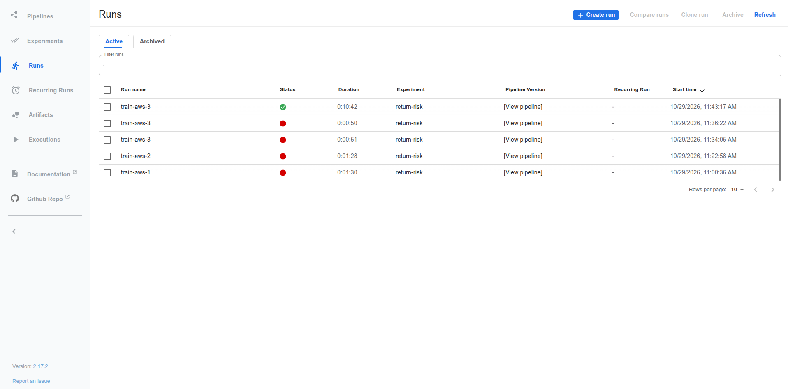
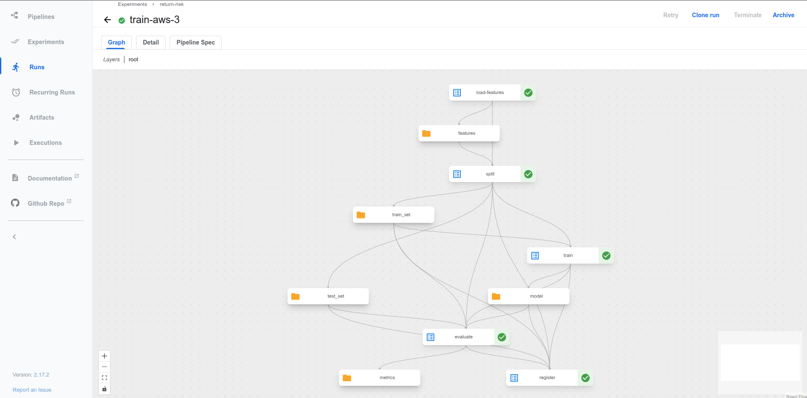
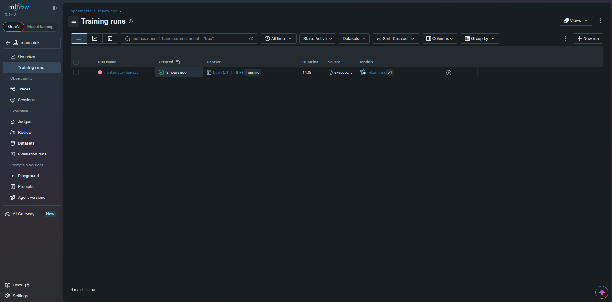
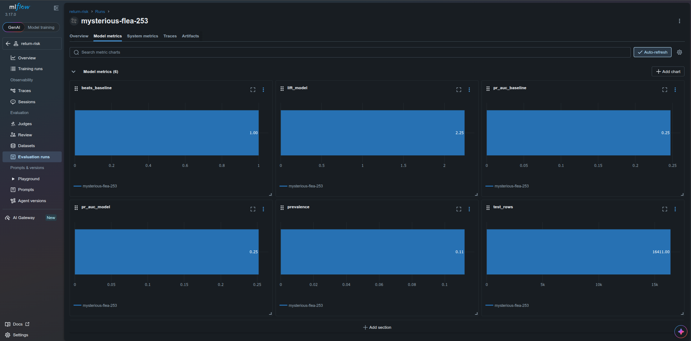
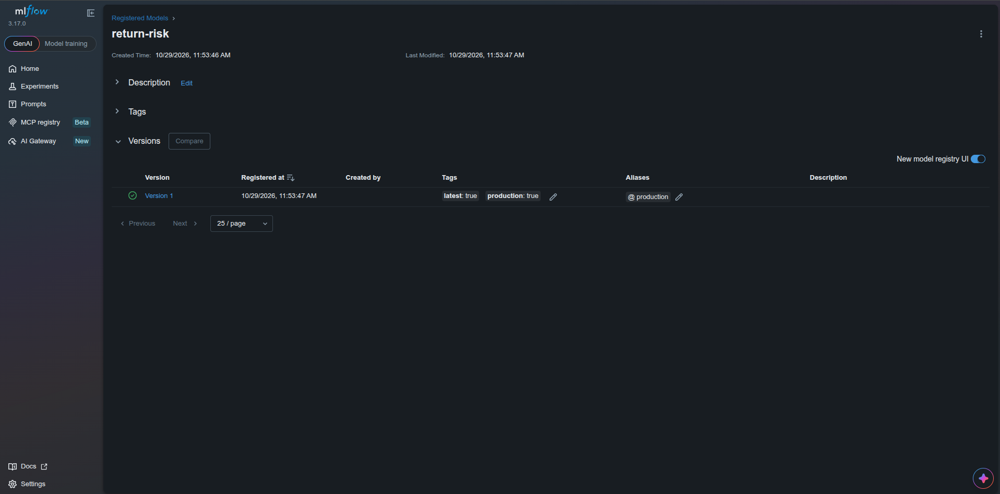

<!-- Mục đích: pipeline train model return-risk trên Kubeflow + version ở MLflow -->
# Train model return-risk — Kubeflow Pipelines + MLflow

Pipeline Kubeflow gồm các bước (load từ offline feature store, split, train, evaluate).
Lưu model + dữ liệu + metadata mỗi run lên MLflow, tự gắn tag `latest` / `production`.

## Đường đi

```
s3://platform/feature-store/training_lines   (Spark export_training_lines.py: line có nhãn + thuộc tính lúc đặt)
   │ ① load_features: Feast get_historical_features — PIT join sku_return_daily + sku_return_24h
   ▼ ② split: test = `test_days` ngày đặt đơn cuối (không chia ngẫu nhiên)
   ▼ ③ train: LightGBM, seed cố định
   ▼ ④ evaluate: PR-AUC model vs baseline (tỷ lệ trả 90 ngày của SKU) trên CÙNG tập test
   ▼ ⑤ register: MLflow run (param, metric, model, file train/test + sha256, dataset_version)
        → model "return-risk" version mới: tag latest=true; alias + tag production CHỈ khi thắng baseline
```

| Thành phần | File |
|---|---|
| Logic thuần (test được không cần KFP) | [`ml/train_lib.py`](../ml/train_lib.py), test [`tests/unit/test_train_lib.py`](../tests/unit/test_train_lib.py) |
| Pipeline KFP 5 bước | [`ml/training_pipeline.py`](../ml/training_pipeline.py) |
| Image các bước | [`docker/Dockerfile.train`](../docker/Dockerfile.train) (dựng trên `platform-feast`) |
| Xuất tập train | [`spark_jobs/gold/export_training_lines.py`](../spark_jobs/gold/export_training_lines.py), task `export_training_lines` của DAG `ml_feature_materialize` |
| MLflow server | service `mlflow` (profile `ml`), [`docker/Dockerfile.mlflow`](../docker/Dockerfile.mlflow) |
| Submit | [`scripts/run/run_training_pipeline.sh`](../scripts/run/run_training_pipeline.sh) |

## Quyết định

- **Feature lúc đặt đơn** từ `fact_order_lines` (kênh, account, số lượng, tiền, đơn giá) + feature SKU
  từ Feast. Bỏ mọi cột biết sau khi đặt (giao, hủy, trả, hoàn) — leakage.
- **Gate production**: phải thắng baseline PR-AUC. Thua thì version vẫn được lưu (tag `latest`) nhưng
  không deploy. MLflow cấm alias tên `latest` (`models:/return-risk/latest` đã có sẵn nghĩa đó) nên
  `latest` là **tag**; `production` vừa là alias (để deploy) vừa là tag.
- **MLflow tắt job execution** (`MLFLOW_SERVER_ENABLE_JOB_EXECUTION=false`): 7 tiến trình huey ăn ~1 GB
  và từng làm container bị OOM-kill; tracking + registry không cần.

## Phát hiện: dữ liệu v2 mặc định không có tín hiệu

Run đầu (bộ `small`, 3.325 line, test 757 line): PR-AUC model **0,287**, baseline **0,291**, prevalence
**0,291** — cả hai ngang đoán mò. Nguyên nhân: `generator/generate_order_lifecycle.py` rút kịch bản
trả/hoàn **độc lập** với SKU, kênh, giá (mọi line cùng giá, cùng số lượng). Gate chặn đúng.

Sửa: tuỳ chọn `--sku-return-skew S` (mặc định 0 = như cũ, nội dung dữ liệu không đổi — đã đối chiếu
3.631/3.631 line). S > 0: mỗi SKU có hệ số `exp(S·z)`, `z ~ N(0,1)` cố định theo SKU, nhân thêm hệ số
kênh; test `test_sku_return_skew_creates_learnable_signal`. Bộ small với S = 1,0: tỷ lệ trả theo SKU
từ 7% đến 54%, tổng vẫn ~29%.

## Chạy local

```bash
docker compose --profile ml up -d mlflow                     # UI http://localhost:5050
kubectl --context kind-platform apply -k "github.com/kubeflow/pipelines/manifests/kustomize/cluster-scoped-resources?ref=2.17.2"
kubectl --context kind-platform apply -k "github.com/kubeflow/pipelines/manifests/kustomize/env/platform-agnostic?ref=2.17.2"
# Script submit tự build/push platform-train:<git-SHA> rồi biên dịch KFP với cùng image.
scripts/setup/setup_kind_registry.sh
scripts/run/run_training_pipeline.sh train-N                 # UI KFP: kubectl port-forward svc/ml-pipeline-ui 8888:80
```

## Bằng chứng

Run `train-3` (KFP 2.17.2 trong kind, 2026-10-21): **SUCCEEDED** cả 5 bước.

| Mục | Giá trị |
|---|---|
| Tập train / test | 2.568 / 757 line (test = 10 ngày cuối), prevalence test 0,291 |
| PR-AUC model / baseline | 0,287 / 0,291 → `beats_baseline = false` |
| MLflow | model `return-risk` **v2**: tag `latest=true`, `production=false`, không alias production |
| Version dữ liệu (tag run) | `data.dataset_version`, `data.generation_id`, `data.train_sha256`, `data.test_sha256`, `data.entity_path`; artifact `data/train`, `data/test`; dataset input `train` |

Đây là dữ liệu **không tín hiệu** (mục trên) ⇒ gate từ chối đúng. Chạy lại trên bộ có
`--sku-return-skew` để có version `production` cho KServe.

## Trên AWS (2026-10-29)

KFP 2.17.2 chạy EKS; MLflow 3.17.0 chạy EC2, artifacts ở S3.
Run KFP `train-aws-3`, ID `0485ebd9-d74f-4db9-9b70-aaac07e5cb24`, SUCCEEDED 5 bước trong 10:42;
[receipt AWS](evidence/aws/data-platform-aws-20261027.json) (`ml_eks`) ghi image và mẫu 2‰, 359.457 dòng.
[Pipeline code](../ml/training_pipeline.py), [train logic](../ml/train_lib.py), [Dockerfile](../docker/Dockerfile.train).

| Bước trong graph | Công việc |
|---|---|
| `load-features` | Đọc training_lines từ S3 offline store, gọi Feast historical features theo event time; Pod Identity `kubeflow/pipeline-runner` cho quyền S3 |
| `split` | Tách train/test theo ngày đặt Order; xuất train_set và test_set |
| `train` | LightGBM trên train_set, xuất model |
| `evaluate` | So PR-AUC model với baseline trên cùng test_set |
| `register` | Ghi model, metrics, metadata và dataset vào MLflow; chỉ đặt production nếu thắng baseline |





MLflow run `mysterious-flea-253` liên kết model `return-risk` v1 và dataset `train (a1f3e3b9)`.
Metric hiển thị PR-AUC model/baseline cùng làm tròn 0,25, `beats_baseline=1`, lift 2,25, prevalence 0,11,
16.411 dòng test. Không suy khoảng cách chính xác giữa hai PR-AUC từ chart đã làm tròn.
Registry có tags `latest=true`, `production=true` và alias `production` cho v1.







Version dữ liệu trong code `register`: tags `data.dataset_version`, `data.generation_id`,
`data.train_sha256`, `data.test_sha256`, `data.entity_path`; artifacts `data/train`, `data/test` và dataset input train.
Ảnh AWS hiện tại chỉ thấy liên kết dataset train, chưa mở các tag/hash và hai artifact của cùng run.
MLE14 còn cần capture đó; graph KFP có train_set/test_set không thay proof chúng đã được lưu ở MLflow.
Receipt ghi các lần chạy lỗi trước do OOM/đọc file store và port-forward; cache KFP tắt ở lần này.
