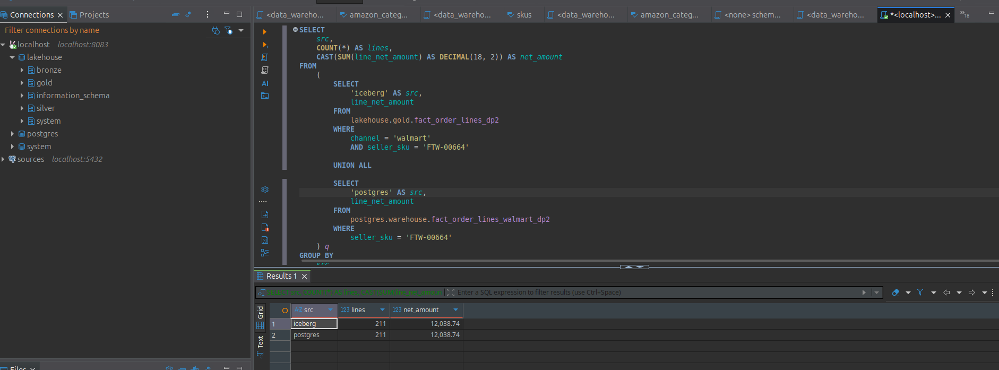

# Novel ideas: protocol đo lường và kết quả

Rubric cho hai ý Novel yêu cầu mô tả ý tưởng và bằng chứng chạy được. Không điền
số ước lượng; mỗi kết luận phải gắn với lần chạy, phạm vi dữ liệu, câu lệnh và
kết quả đã quan sát. Phạm vi hai ý tưởng và phép đối chiếu đã thực hiện được ghi ngay bên dưới;
cấu hình triển khai nằm trong [kiến trúc DE](architecture-decisions.md),
[Trino](trino.md) và [CDC](cdc.md).

## 1. Trino federation — đã chạy đối chiếu Gold/warehouse

**Ý tưởng:** dùng một phiên SQL để đọc Iceberg trên MinIO và PostgreSQL
warehouse. Xem [cấu hình và SQL đã chạy](trino.md).

**Câu hỏi so sánh đã chạy:** cùng SKU Walmart `FTW-00664` có bao nhiêu Order
Line và tổng tiền net là bao nhiêu ở Gold Iceberg và lát warehouse PostgreSQL?

| Cách | Thao tác | Số bước | Thời gian | Kết quả |
|---|---|---:|---:|---|
| Trino CLI, hai truy vấn riêng | Một lần trên Gold và một lần trên warehouse, phải ghép hai kết quả | 2 | 1,66 + 1,01 = 2,67 giây | Mỗi bên 211 dòng, net 12.038,74 |
| Trino CLI, một truy vấn liên nguồn | `UNION ALL` hai catalog, nhóm theo nguồn trong một SQL | 1 | 2,16 giây | Hai dòng kết quả, mỗi bên 211 dòng và net 12.038,74 |

Warehouse là lát sáu cột của Gold Walmart cùng lần ghi; vì vậy hai phía dùng
cùng tập Order Line, bộ lọc SKU và phép tính. Số giây là một lượt chạy trên
cache hiện có, đo cả CLI và kết nối; không kết luận Trino liên nguồn luôn nhanh
hơn. Bằng chứng chính là **một câu SQL đọc đồng thời hai hệ thống** và đối
chiếu dữ liệu bằng nhau. Phạm vi hiện là Walmart SKU, chưa phải so sánh doanh
thu đa Channel theo tháng như kế hoạch ban đầu.

## 2. Debezium CDC — đã có bằng chứng đến Bronze

Đo từ lúc `UPDATE` commit trên PostgreSQL đến lúc bản ghi đọc được ở Bronze, và
số bản ghi phải đọc để tìm ba thay đổi. So với batch polling phải quét toàn bảng;
chu kỳ 24 giờ là chính sách so sánh đã chọn, không phải giới hạn kỹ thuật của
batch.

| Cách | Thay đổi cần phát hiện | Dòng phải đọc | Commit → Bronze |
|---|---:|---:|---:|
| Batch snapshot | 3 | 1.293.525 dòng nguồn ở lần đếm hiện tại | Theo lịch 24 giờ: chờ 0–24 giờ trước lần đọc tiếp; chưa đo runtime của một lượt quét |
| Debezium CDC | 3 | 3 sự kiện mới ở offset 3–5; Bronze tăng từ 3 lên 6, không thiếu/trùng | Đến Kafka: 466,6–623,3 ms; đến Bronze: tối đa 31,261–44,380 giây, gồm kích hoạt DAG bằng tay |

Phép đo Bronze và ảnh Airflow ở [`cdc.md`](cdc.md). Batch đối chứng được cấu
hình đọc bảng nguồn mỗi 24 giờ: thay đổi đến sau một lần đọc phải chờ gần 24
giờ, thay đổi rải đều chờ trung bình khoảng 12 giờ. Đây là **hệ quả của lịch
chạy đã chọn**, không phải tốc độ tối đa của Batch. Muốn giảm thời gian chờ của
Batch phải chạy quét lại bảng nguồn thường xuyên hơn; CDC đọc chính thay đổi đã
commit. Số **1.293.525** lấy từ `SELECT count(*) FROM walmart.orders` sau khi
probe thứ hai kết thúc; các dòng mẫu đã được xóa. Số đó là lượng bản ghi một
lượt snapshot toàn bảng phải xét để tìm ba thay đổi, không phải byte I/O đo từ
PostgreSQL.

DE-N1: [Data contract + schema registry và cổng cách ly đầu Silver v2](novel-de-n1-data-contracts.md).

DE-N2: [Bảo trì Iceberg tự động theo chính sách](novel-de-n2-iceberg-maintenance.md).
