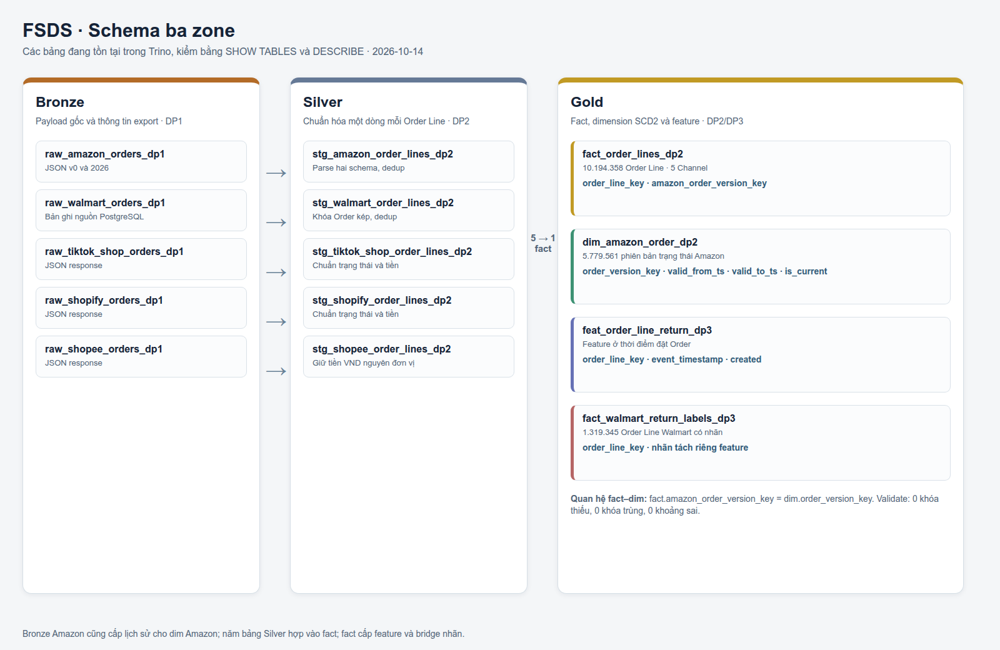
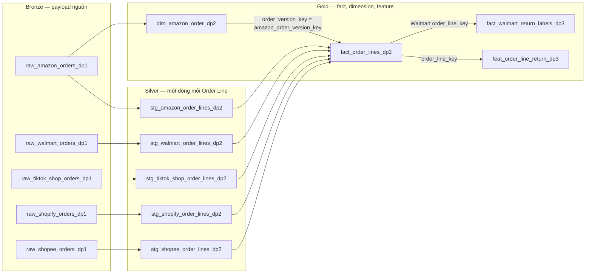
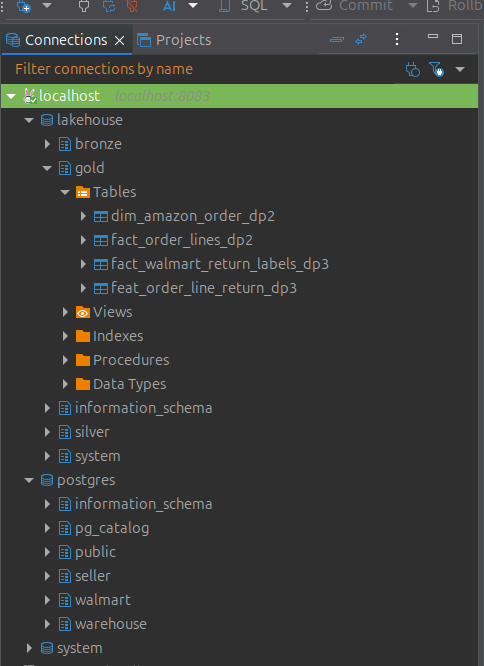
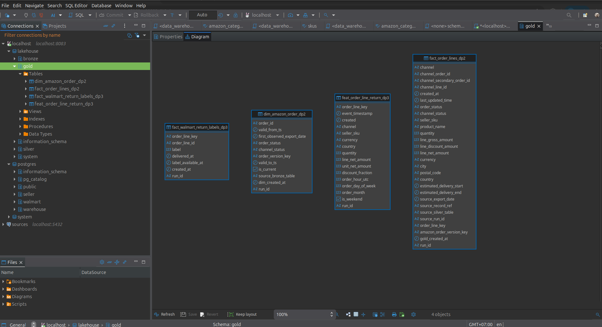
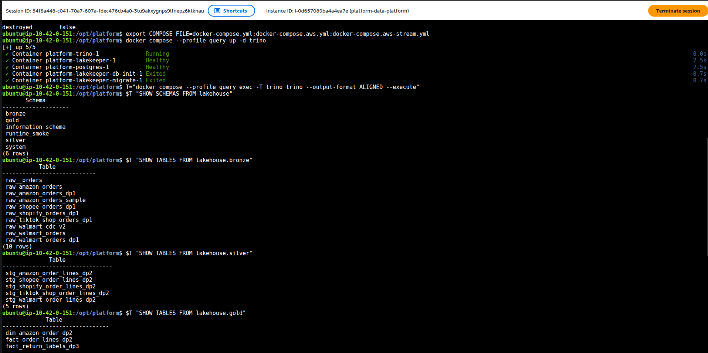
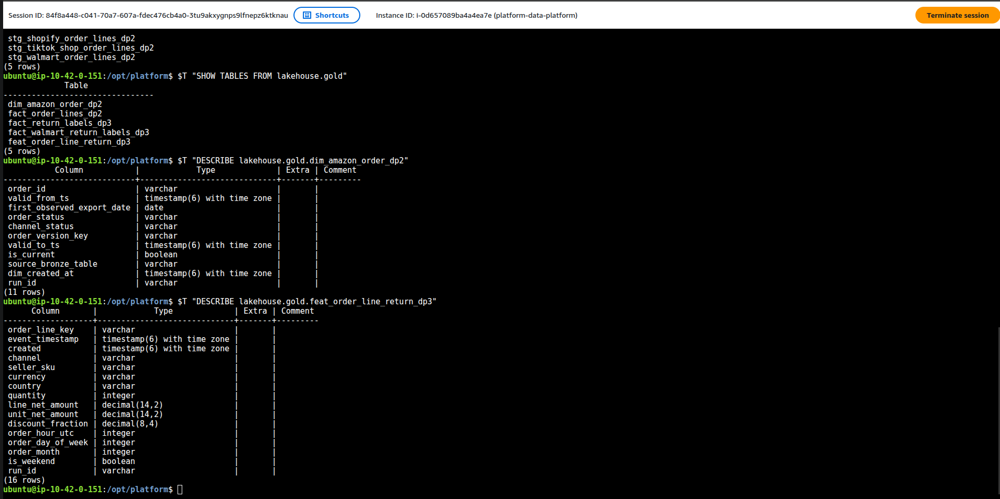

# Schema ba zone và quan hệ Gold

Kiểm tra trực tiếp bằng Trino `SHOW TABLES` và `DESCRIBE` ngày 2026-10-14. Sơ
đồ dưới đây chỉ vẽ các bảng thuộc run DP1/DP2/DP3 của năm Channel; Bronze còn
có bảng thử/smoke và `raw_walmart_cdc` cho pipeline CDC riêng.

Sơ đồ trên vẽ từ [bản HTML tự chứa](diagrams/schema-zones.html), dựa trên metadata
đã đọc qua Trino. Ảnh giao diện DBeaver nối Trino cùng các bảng nằm ở mục dưới.

| Zone | Bảng | Độ hạt và nhiệm vụ |
|---|---|---|
| Bronze | Năm bảng `raw_*_dp1` | Payload hoặc bản ghi nguồn chưa chuẩn hóa; giữ export và provenance |
| Silver | Năm bảng `stg_*_order_lines_dp2` | Một dòng sản phẩm/Order, chuẩn schema và dedup riêng Channel |
| Gold | `fact_order_lines_dp2` | Một Order Line xuyên năm Channel; khóa `order_line_key` |
| Gold | `dim_amazon_order_dp2` | Một phiên bản trạng thái/Order Amazon đã thấy ở Bronze; khóa `spark_jobs.lib.order_version_key` |
| Gold | `feat_order_line_return_dp3` | Feature lúc đặt Order; khóa `order_line_key`, có `event_timestamp` và `created` |
| Gold | `fact_walmart_return_labels_dp3` | Nhãn Walmart riêng, nối theo Order Line sau khi đủ thời gian có đáp án |

## Ảnh DBeaver nối Trino (runtime)

Ảnh thứ nhất là Database Navigator của DBeaver nối Trino (`localhost:8083`), thấy
đủ ba zone `bronze`, `silver`, `gold` của catalog `lakehouse` cùng các schema
`warehouse`, `seller`, `walmart` của catalog `postgres`. Ảnh thứ hai là ER
Diagram giữa `fact_order_lines_dp2` và `dim_amazon_order_dp2`.

## Quan hệ fact và SCD2

Trino `DESCRIBE` xác nhận fact có `amazon_order_version_key` kiểu `varchar`,
dimension có `spark_jobs.lib.order_version_key` kiểu `varchar` cùng `valid_from_ts`,
`valid_to_ts`, `is_current`. Job SCD2 tạo khóa từ cặp `(order_id,
valid_from_ts)`; fact Amazon tạo cùng khóa từ `channel_order_id` và
`last_updated_time`. Bốn Channel khác có khóa này bằng `NULL`. Validate runtime
đã kiểm **5.779.561** phiên bản, không có khóa trùng, khoảng hiệu lực sai hoặc
fact Amazon trỏ tới phiên bản không tồn tại. Xem [Gold](gold.md) và
[quyết định SCD2](gold-design.md).

Đây là quan hệ logic trong Iceberg. Iceberg không khai báo foreign key cưỡng
chế như PostgreSQL; `validate_amazon_order_dim` kiểm khóa trong mỗi run DP2.
`feat_order_line_return_dp3` có hai cột thời gian thiết kế sử dụng, được xác nhận
bằng `DESCRIBE` sau lần chạy DP3.

## Quy ước đặt tên

| Tầng/vai trò | Tiền tố | Ví dụ đã chạy |
|---|---|---|
| Bronze, giữ bản gốc và provenance | `raw_` | `raw_amazon_orders_dp1` |
| Silver, chuẩn hóa và dedup | `stg_` | `stg_amazon_order_lines_dp2` |
| Gold, phiên bản chiều | `dim_` | `dim_amazon_order_dp2` |
| Gold, sự kiện hoặc nhãn | `fact_` | `fact_order_lines_dp2`, `fact_walmart_return_labels_dp3` |
| Gold, feature offline | `feat_` | `feat_order_line_return_dp3` |

`obt_` được dành cho bảng phẳng phục vụ một mục đích; hiện chưa có bảng loại
này trong các run được ghi nhận. Hậu tố `_dp1`, `_dp2`, `_dp3` phân biệt bảng bằng
chứng Airflow với các bảng benchmark/smoke. Catalog là `lakehouse`, namespace
là `bronze`, `silver`, `gold`; các khái niệm nghiệp vụ nằm ở
[thuật ngữ](terminology.md).

## Trên AWS (2026-10-28)

DP1/DP2/DP3 chạy Compose EC2, các bảng Iceberg nằm ở S3. [DataHub AWS](datahub.md#trên-aws-2026-10-28-đến-2026-10-29)
nhúng lineage raw → stg → fact/dim → feat; [Gold AWS](gold.md#trên-aws-2026-10-28) nhúng log validator.
[Manifest](evidence/aws/datahub-validation-aws-20261029.json) giữ tên bảng và run_id.

Các bảng `raw_` giữ payload nguồn, `stg_` chuẩn hóa/dedup, `fact_` giữ Order Line hoặc nhãn,
`dim_` giữ phiên bản SCD2, `feat_` giữ feature lúc đặt Order. Bảng nhãn năm Channel AWS là
`gold.fact_return_labels_dp3`, khác bridge Walmart trong sơ đồ local trên.
Code quan hệ: [SCD2](../spark_jobs/gold/build_amazon_order_status_scd2.py),
[fact](../spark_jobs/gold/build_order_snapshot_lines.py), [feature](../spark_jobs/gold/build_order_snapshot_return_features.py).

Bảng thật trên AWS, đọc qua Trino EC2 (catalog `lakehouse` = Iceberg S3 qua Lakekeeper), 2026-10-31:

- **Bronze** `raw_<channel>_orders_dp1` (5 Channel) giữ payload nguồn + cột provenance; `raw_walmart_cdc_v2` là đích
  CDC Debezium ([cdc](cdc.md)). `raw_amazon_orders`, `raw_walmart_orders`, `raw_amazon_orders_sample` là bảng chạy tay
  giữ làm bằng chứng đo Spark; `raw__orders` là bảng hỏng còn sót (gap #10, chưa xoá).
- **Silver** `stg_<channel>_order_lines_dp2`: một dòng một Order Line, đã chuẩn hoá schema và bỏ trùng.
- **Gold** `dim_amazon_order_dp2` (SCD2 trạng thái đơn), `fact_order_lines_dp2` (Order Line năm Channel),
  `fact_return_labels_dp3` + `fact_walmart_return_labels_dp3` (nhãn Return), `feat_order_line_return_dp3` (feature).
- Schema `runtime_smoke` là bảng thử của Ansible khi kiểm Lakekeeper ghi được, không thuộc pipeline.

SCD2: `valid_from_ts` / `valid_to_ts` / `is_current` cho từng phiên bản trạng thái của một `order_id`, khoá phiên
bản `order_version_key` là khoá fact dùng để nối (quan hệ dim–fact vẽ ở ảnh DBeaver ERD phía trên, cùng code Spark).
Feature: `event_timestamp` (thời điểm đặt Order — mốc point-in-time) và `created` (lúc job ghi), đúng hai cột
Feast cần.
