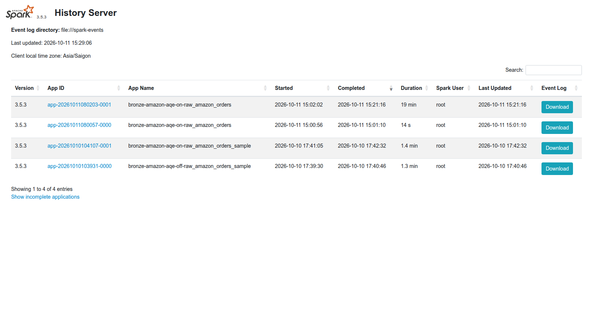
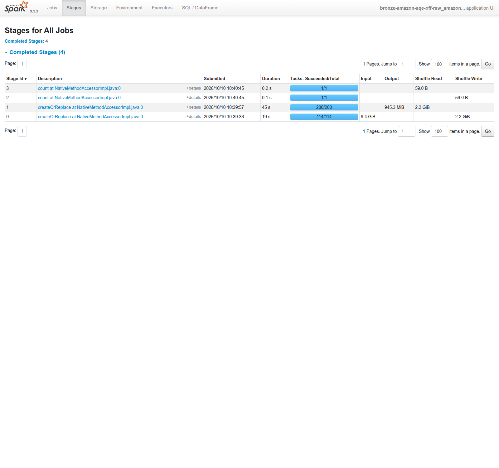
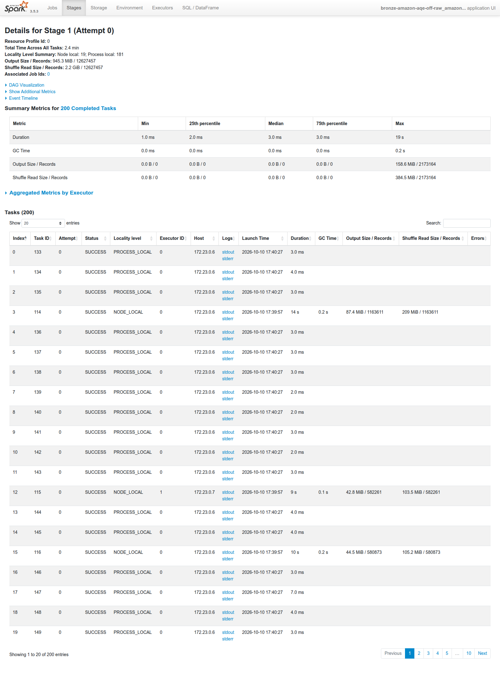
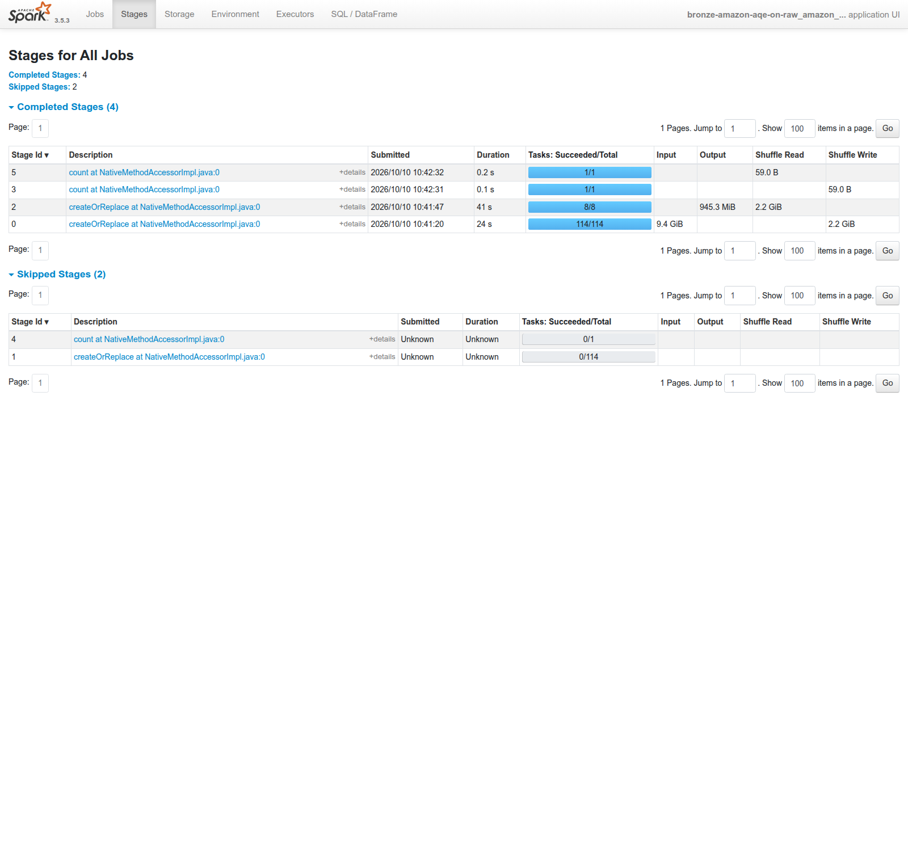
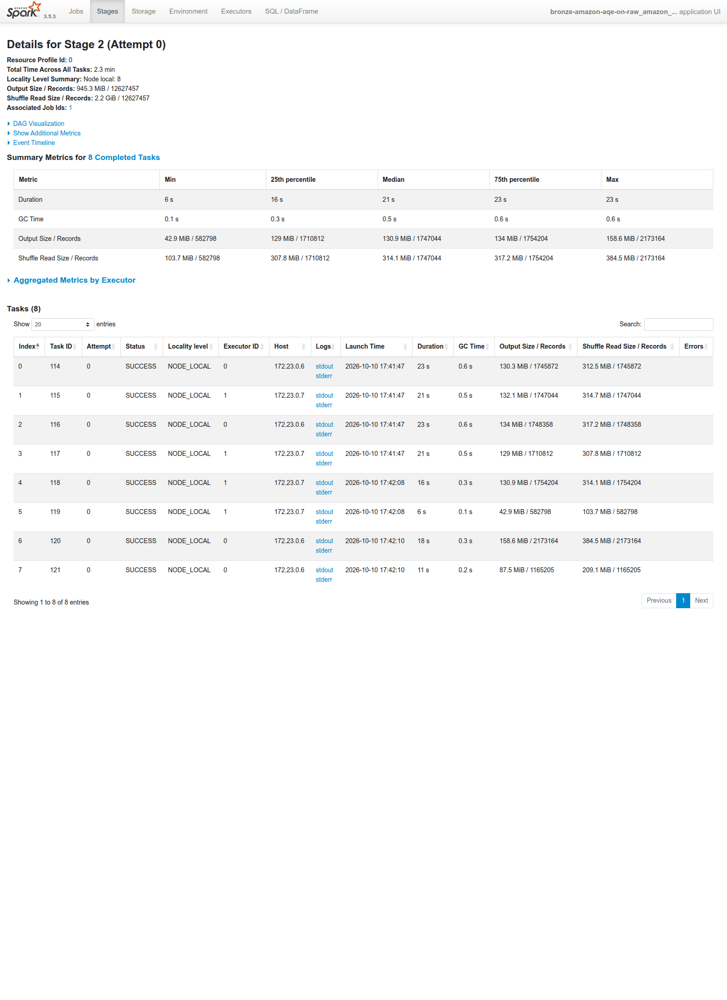
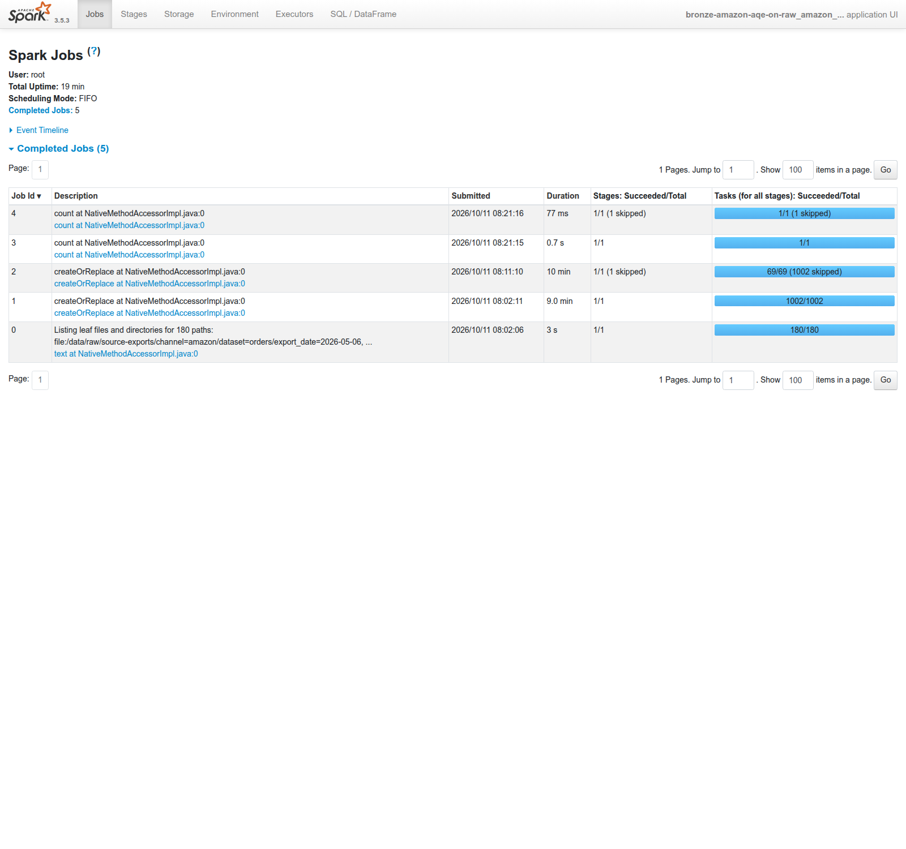
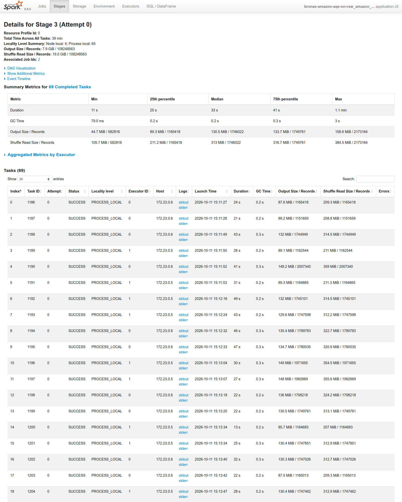
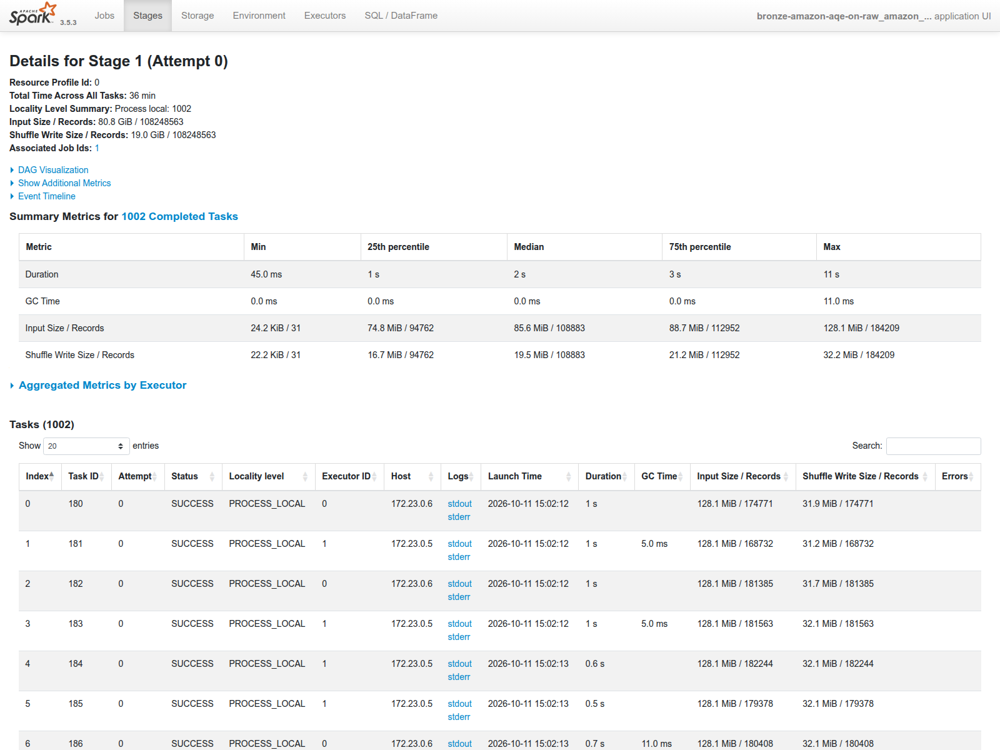
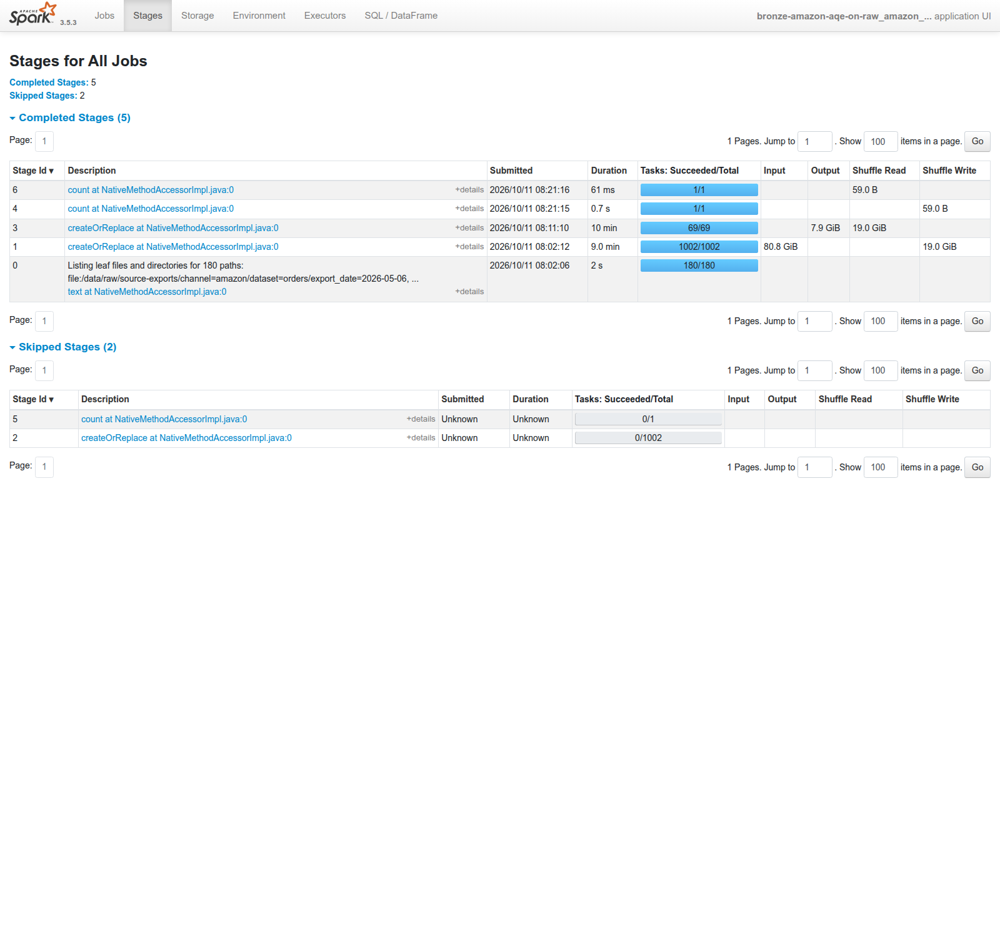

# Tối ưu Spark — giai đoạn Bronze

Tài liệu này ghi lại **cách tối ưu job Spark đầu tiên của lakehouse**: từ baseline cố tình
xấu, qua một giả định bị số đo bác bỏ, tới nguyên nhân thật và kết quả ở quy mô đầy đủ.
Cập nhật **2026-10-11**.

Mọi số ở đây lấy từ `HANDOFF.bronze.md` mục 4 và `docs/evidence/spark-ui/README.md` —
không đo lại, không suy đoán. Chỗ nào chưa có số thì ghi rõ "chưa đo".

---

## 1. Mục tiêu và phạm vi

**Bronze là gì** (theo `CONTEXT.md`): bản sao trung thực của dữ liệu Channel giao cho
Seller. Nó chỉ đổi file sang định dạng cột và thêm cột kỹ thuật (Export Date, tên file
nguồn, thời điểm nạp). Nó **không** sửa tên cột, **không** gộp schema, **không** bỏ bản
trùng. Bronze có **một bảng mỗi KÊNH**, không phải một bảng mỗi dạng schema: hai dạng schema của
Amazon (v0 và 2026-01-01) nằm chung một bảng vì Bronze **giữ nguyên chuỗi JSON**, không parse —
không parse thì không phải chọn bộ tên cột nào. Việc quy tên khoá về một dạng thuộc **Silver**
(xem `docs/silver.md`). Bảng tầng này mang tiền tố `raw_`.

**Job này làm gì:** `spark_jobs/01_bronze_baseline.py` đọc các file JSONL export của
Amazon nằm ở `/data/raw` (mount read-only vào container Spark), rồi ghi thành bảng Iceberg
`lakehouse.bronze.raw_amazon_orders` qua REST catalog Lakekeeper, dữ liệu bảng nằm trên MinIO.
Job **không parse JSON và không làm sạch gì** — đúng vai trò "chép nguyên bản" của Bronze.

**Phạm vi tài liệu:** baseline, chuỗi tối ưu hiệu năng, và bằng chứng Spark UI. Phần Silver,
Gold và tích hợp Airflow thuộc giai đoạn sau (mục 9 để trống, điền ở GĐ 4).

---

## 2. Hình dạng bảng và vì sao

Bốn quyết định thiết kế đã chốt (`HANDOFF.bronze.md` mục 1). Điểm quan trọng không phải
chọn gì, mà **vì sao**:

| # | Quyết định | Lý do |
|---|---|---|
| Q1 | Bronze **giữ nguyên chuỗi JSON** ở cột `payload`; Silver mới parse | Tên khoá Amazon đổi giữa kỳ (`AmazonOrderId` tháng 1 → `orderId` tháng 5). Nếu parse ở Bronze thì phải giải schema evolution ngay tại Bronze — trái vai trò "chép nguyên bản" |
| Q2 | **Hai bảng riêng** `raw_amazon_orders` + `raw_walmart_orders` | Commit Iceberg là atomic: tách bảng thì một nguồn hỏng vẫn chạy lại riêng được nguồn kia |
| Q3 | Provenance **phương án A**: mỗi bảng một tên cột nguồn riêng | Amazon dùng `source_file` (đọc từ đĩa nên có tên file); Walmart dùng `source_table` (đọc qua JDBC, `input_file_name()` trả chuỗi rỗng). Cả hai có `ingested_at`, `run_id`; Walmart giữ thêm `fetched_at` **của nguồn**, không gộp với `ingested_at` |
| Q4 | `raw_amazon_orders` PARTITIONED BY (`export_date`); `raw_walmart_orders` PARTITIONED BY (`days(fetched_at)`) | Partition khớp đúng cách file nằm trên đĩa. `days()` an toàn kể cả khi nguồn đổi nhịp kéo |

**Hệ quả đã chấp nhận: bảng Amazon KHÔNG có cột mã đơn hàng.** Cột của nó chỉ là
`payload, source_file, export_date, ingested_at, run_id`. Đây là cái giá của Q1: muốn tra
một đơn thì tra ở Silver. Bronze tồn tại để **chạy lại khi Silver lỗi**, không phải để tra cứu.

**Hệ quả nữa:** mục rubric *schema evolution* nằm ở `02_silver_*.py`, **KHÔNG** ở Bronze.
Tài liệu phải trỏ đúng chỗ đó.

---

## 3. Dữ liệu nguồn

Đường dẫn nguồn:
`/data/raw/source-exports/channel=amazon/dataset=orders/export_date=YYYY-MM-DD/part-*.jsonl`

| Số đo | Giá trị |
|---|---|
| Số ngày | 180 ngày (2026-01-01 → 2026-06-29) |
| Số file | 3.316 file |
| Số dòng | 108.248.563 dòng |
| Dung lượng | 80,77 GiB |

**Chỉ có HAI nguồn batch.** TikTok **không** có trong batch — nó chỉ đi Kafka/stream. Walmart
nằm ở `/data/raw/pg-load/walmart.orders/export_date=*/` (JSONL chờ nạp vào PostgreSQL), ba
trường `purchase_order_id`, `raw_payload`, `fetched_at`; `fetched_at` = `...T23:59:59Z` cho cả
ngày nên có 180 giá trị phân biệt.

Vì sao nguồn của Walmart là PostgreSQL (không phải file JSONL), và vì sao cột `raw_payload` khai `JSONB` nên thứ tự key bị xếp lại mà vẫn không phải lỗi: xem `docs/channel-sources.md`, mục **Ranh giới tin cậy: nguồn của Walmart là PostgreSQL, không phải file JSONL**.

**Skew là có thật, không phải giả định.** Dung lượng mỗi ngày Amazon:
- nhỏ nhất 2026-01-01 = **7,3 MB**
- giữa 2026-03-22 = **495 MB**
- lớn nhất 2026-06-29 = **1,64 GB**

Ngày lớn nhất lệch **224 lần** ngày nhỏ nhất theo **dung lượng file nguồn**. Đây chính là dòng
rubric *skew*.

**Đọc con số 224 cho đúng.** Nó đo dung lượng file JSONL nguồn, không đo tải của một task. Đo
trên chính bảng Iceberg đã ghi (metadata `raw_amazon_orders.partitions`, 180 ngày,
108.248.563 dòng, 187 file, 8.525.005.070 byte) thì hình dạng nhẹ hơn hẳn:

| Thước đo | Số |
|---|---|
| dòng/ngày nhỏ nhất (2026-01-01) | 8.530 |
| dòng/ngày trung vị | 582.228 |
| dòng/ngày lớn nhất (2026-06-29) | 2.173.164 |
| **max / trung vị** | **3,73 lần** |
| max / min | 254,8 lần |
| ngày nặng nhất chiếm | **2,01%** tổng dòng |
| 5 ngày nặng nhất chiếm | 7,18% tổng dòng |
| byte/ngày max / trung vị | 3,56 lần (khớp thước đo dòng) |

Số làm một task chậm là **3,73**, không phải 224. Trên 180 ngày, skew là **nhẹ-vừa**. Nó lộ rõ ở
**mẫu 20 ngày rải đều** vì mẫu đó kéo giãn đúng dải 8.530..2.173.164. Tải cũng **tăng dần theo
thời gian** (10 ngày đầu 8.530..400.384; 5 ngày cuối 999.062..2.173.164).

**Small-file là vấn đề phía ĐỌC.** 1.064 / 3.316 file nhỏ hơn 1 MB. Vì vậy đuôi file tí hon
là chi phí lúc **đọc**, không phải lúc ghi — điều này quyết định lựa chọn ở mục 5e.

---

## 4. Baseline và vì sao tắt AQE

Baseline **cố tình tắt tối ưu**:
- `spark.sql.adaptive.enabled=false` (AQE tắt)
- `spark.sql.shuffle.partitions=200`

**Vì sao tắt AQE:** rubric cho điểm khi **chứng minh tìm ra và sửa được vấn đề hiệu năng**.
Nếu bật AQE ngay từ đầu thì Spark tự sửa, không còn ảnh "trước" để so. AQE phải là **một
phương án được đo**, không phải thứ bị giấu.

**Nguyên tắc:** baseline phải **thật sự chậm, nhưng không được giả tạo chậm**. Tắt AQE là
một cấu hình hợp lệ (nhiều cluster thật vẫn chạy vậy), không phải cài thêm độ trễ nhân tạo.
Nhờ vậy khi bật lại AQE mà **không nhanh hơn**, ta mới dám tin con số.

---

## 5. Chuỗi tối ưu — đúng theo thứ tự thật đã xảy ra

Phần này giữ nguyên thứ tự thật, kể cả bước thất bại. Bước (b) là phần giá trị nhất: một
giả định bị số đo bác bỏ, và ta không giấu nó như một thất bại.

### a. Giả định ban đầu
"Skew do thiếu tối ưu → **bật AQE sẽ chữa skew**." Đây là kỳ vọng thông thường vì AQE được
quảng cáo là chữa skew.

### b. Đo — GIẢ ĐỊNH BỊ BÁC BỎ
Chạy **cùng 20 ngày rải đều** (có cả ngày bé lẫn ngày to), chỉ đổi cờ AQE:

| Lần | AQE | Thời gian | Stage ghi | Số task | Task lâu nhất |
|---|---|---|---|---|---|
| 1 | off | **72,3s** | stage 1 | 200 (chỉ ~20 có việc, 180 rỗng 0,01s) | **18,7s** |
| 2 | on | **81,7s** | stage 2 | **8** (AQE gộp lại) | **23,6s** |

Kết quả **ngược kỳ vọng**: bật AQE **chậm hơn** (72,3s → 81,7s) và task chậm nhất **tệ hơn**
(18,7s → 23,6s). Giả định ban đầu bị số đo bác bỏ.

> **Hạ giọng phần so sánh THỜI GIAN TỔNG (đo 2026-10-12).** Chạy **đúng một cấu hình ba lần**
> trong cùng môi trường cho 55,9 / 63,2 / 64,8s — tức **nhiễu 8,9s trên nền 61,3s = 14,5%**
> (n=3, chỉ là cỡ độ lớn, không phải khoảng tin cậy). Cặp 72,3 / 81,7 chênh 9,4s = **13%**, với
> **n=1 mỗi bên**. Chênh nhỏ hơn nhiễu, nên bảng trên **không đủ** để kết luận "AQE làm chậm hơn"
> ở mức thời gian tổng. Muốn kết luận đó thì phải chạy lại mỗi bên nhiều lần — **chưa làm**.
>
> **Phần KHÔNG bị nhiễu ảnh hưởng và vẫn đứng vững**, vì là số đếm và phân bố chứ không phải bấm
> giờ: AQE gộp **200 task → 8 task**; chỉ **19/200 task có dữ liệu** (181 task rỗng); task nặng
> nhất ôm đúng **2.173.164 dòng** và **384,5 MiB** shuffle read — ba số này giống hệt nhau qua cả
> lần `lan1` và cả ba lần chạy đối chứng. Kết luận ở mục (c) dưới đây dựa trên các số này, nên nó
> không bị lung lay.

### c. Vì sao AQE không chữa được skew của job này
AQE giỏi hai việc: (a) gộp nhiều task bé, và (b) **cắt skew trong JOIN**. Job này **không có
JOIN**. Chỗ nghẽn là một task phải ghi trọn một partition 1,64 GB — AQE **không chia việc ghi
một partition cho nhiều task**. Tệ hơn, AQE còn gộp 2-3 ngày vào một task nên task chậm nhất
nặng thêm (đúng như cột "số task" cho thấy: 200 → 8).

### d. Nguyên nhân thật — `write.distribution-mode`
Đòn thật không nằm ở AQE mà ở cách Iceberg phân phối việc ghi:

| Giá trị | Cách làm | Đánh đổi |
|---|---|---|
| `hash` (mặc định Iceberg 1.5 cho bảng có partition — **đang dùng**) | dồn mọi dòng cùng `export_date` về **một** task | 1 file/partition, gọn; nhưng ngày to = 1 task ôm hết → nghẽn |
| `none` | không shuffle, 114 task đọc gì ghi nấy | ghi song song, hết nghẽn; nhưng **nhiều file nhỏ** hơn — liên quan trực tiếp tới kết luận "small-file là vấn đề phía đọc" |

### e. Quyết định: GIỮ `hash` (chốt 2026-10-11)
Đây là câu hỏi treo ở `HANDOFF.bronze.md` mục 5, đã chốt: **giữ `hash`, không chạy lại**.

**`hash` là mặc định NGẦM, không phải giá trị ghi trong bảng (đo 2026-10-12).**
`SHOW TBLPROPERTIES lakehouse.bronze.raw_amazon_orders` **không có** dòng
`write.distribution-mode` (chỉ có `write.parquet.compression-codec=zstd`). Nên "giữ `hash`" nghĩa
là **giữ nguyên mặc định của Iceberg cho bảng có partition** — trong repo không có dòng cấu hình
nào để chỉ vào. Bảng thử nghiệm đặt qua `spark.sql.catalog.lakehouse.table-default.write.distribution-mode`
thì thuộc tính **có xuất hiện** trong `SHOW TBLPROPERTIES`, nên cách đặt đó áp được.

Lý do: ở quy mô 180 ngày, skew **vẫn còn** (ảnh `06`: median 33s, max 1,1 phút ≈ gấp 2 lần
median) **nhưng không chặn được việc** — job vẫn xong và ghi đủ dòng. Đổi sang `none` sẽ
đổi một cái nghẽn có kiểm soát lấy **nhiều file nhỏ hơn**, mà small-file vốn đã là vấn đề
phía đọc (1.064/3.316 file < 1 MB, mục 3). Giữ `hash` giữ đúng 1 file/partition, đổi lại
chấp nhận ngày to ghi trong một task. Đây là đánh đổi có lý do, không phải bỏ qua skew.

### f. Ba phương pháp đã thử, và bảng trước/sau (đo 2026-10-12)

Phần (e) chốt giữ `hash` bằng **lập luận**. Phần này đo bằng **số**: ba phương pháp, mỗi phương
pháp một lần chạy riêng, cùng 20 ngày mẫu (`pick_sample_days` tất định nên cùng dữ liệu), AQE tắt,
ghi vào bảng thử rồi xoá. Không bảng thật nào bị ghi vào, không đổi mặc định của job.

**Baseline phải đo lại, vì môi trường đã khác.** Baseline cũ 72,3s chạy driver trên `spark-master`;
ba phương pháp chạy driver trên `worker-1` (`--driver-memory 600m`, vì `spark-master` 512 MB bị
OOM kill). Nên đã chạy **đối chứng**: đúng cấu hình baseline trong môi trường mới, **ba lần**.

| Lần chạy | "XONG sau" |
|---|---|
| đối chứng 1 | 55,9s |
| đối chứng 2 | 63,2s |
| đối chứng 3 | 64,8s |
| **trung bình = baseline mới** | **61,3s** |
| dao động giữa ba lần giống hệt nhau | **8,9s = 14,5%** |

Mọi so sánh dưới đây dùng **61,3s**. Hàng 72,3s vẫn giữ ở mục (b) nhưng phải đọc kèm nhãn "môi
trường cũ, driver ở `spark-master`".

**Bảng trước/sau.** Với mỗi phương pháp, `SHOW TBLPROPERTIES` của bảng thử đã được kiểm **trước
khi đọc số**, để chắc cấu hình thật sự áp vào bảng — không kiểm thì mọi số đều có thể là số của
`hash`.

| | Thời gian | So baseline 61,3s | Dòng ở task nặng nhất | Task lâu nhất | Số file | Chữa skew? |
|---|---|---|---|---|---|---|
| **đối chứng** (`hash`, shuffle 200) | 61,3s | — | 2.173.164 | 11,0-12,8s | 20 | — |
| **(a)** `shuffle.partitions` 200 → 24 | 70,9s | +9,6s, **sát nhiễu → chưa chắc** | **2.173.164** | 22,3s | 20 | **KHÔNG** |
| **(b)** `distribution-mode=none` | **48,4s** (44,6 / 52,2) | **−12,9s = −21%, KHÁC THẬT** | **181.050** | 6,1s | **309** | **CÓ**, ở mức task |
| **(c)** `distribution-mode=range` | 79,4s | **+18,1s = +30%, KHÁC THẬT** | **2.173.164** | 10,7s | 20 | **KHÔNG** |

"KHÁC THẬT" nghĩa là hai dải số **không chồng nhau**: lần (b) chậm nhất (52,2s) vẫn nhanh hơn lần
đối chứng nhanh nhất (55,9s). Đó là cách đọc đúng khi n nhỏ, chắc hơn so trung bình với trung bình.

**Vì sao từng phương pháp ra như vậy:**
- **(a)** chỉ đổi số task sau shuffle. Khoá phân phối vẫn là `export_date`, nên task nặng nhất vẫn
  ôm **đúng** 2.173.164 dòng — không đổi một dòng nào. Nó chỉ bớt task rỗng (200 → 24, trong đó 16
  có dữ liệu), nên trung vị task tăng từ 0,01s lên 4,18s mà đỉnh không giảm. Giả định nêu **trước**
  khi chạy là "không chữa được", và số đo xác nhận.
- **(b)** bỏ shuffle hẳn: còn **một** stage đọc-và-ghi, 114 task, **cả 114 đều có dữ liệu**,
  shuffle read = 0. Vì không ai gom một ngày về một task nữa, dòng ở task nặng nhất rơi từ
  2.173.164 xuống 181.050 (**12 lần**).
- **(c)** không chữa được, và lý do đáng nhớ: `range` chẻ theo **ranh giới dải** của khoá, nhưng
  khoá ở đây là `export_date` và **một ngày là một giá trị** — không chẻ nhỏ hơn được. Nên nó trả
  thêm chi phí hai stage lấy mẫu (13,6s + 24,7s) mà dòng/task max vẫn đúng 2.173.164.

**Giá của (b), và phần đã đo được của giá đó.** (b) ra **309 file** thay vì 20 (**15,5 lần**),
file trung vị 1,45 MiB thay vì 44,5 MiB, số file mỗi partition lệch 1..23. Tức skew không mất đi
mà **chuyển dạng**: từ "một task ôm hết" sang "số file mỗi partition lệch". Mục 3 đã chốt
small-file là chi phí phía **đọc**, nên đã đo luôn chi phí đó:

`SELECT count(*), sum(length(payload)), count(distinct export_date)` — một truy vấn cho cả ba
bảng, chạy **hai lần** mỗi bảng trong cùng phiên Spark. Cả ba trả kết quả y hệt (12.627.457 dòng /
10.058.940.405 ký tự / 20 ngày), nên ba bảng chứa đúng cùng dữ liệu.

| Bảng | Số file | Lần 1 | Lần 2 |
|---|---|---|---|
| đối chứng (`hash`) | 20 | 25,34s | 18,40s |
| (c) `range` | 20 | 24,02s | 15,90s |
| (b) `none` | **309** | 27,86s | 19,10s |

Hai bảng **cùng 20 file** đã lệch nhau 1,3-2,5s, và lần 1 luôn chậm hơn lần 2 khoảng 7-8s ở cả ba
bảng (hiệu ứng cache). Bảng 309 file chậm hơn +2,5..3,8s (lần 1) và +0,7..3,2s (lần 2) —
**nằm trong nhiễu của chính phép đo**. Kết luận trung thực: ở 20 ngày / 12,6 triệu dòng, chi phí
đọc thêm của 15,5 lần nhiều file **chưa tách được khỏi nhiễu**; hướng chênh là chậm hơn một chút,
không đủ để khẳng định. **Không** kết luận "309 file không tốn gì".

**Ba giới hạn của phép đo đọc, ghi ra để không ai đọc quá:** (1) truy vấn quét **toàn bảng**,
không lọc partition; (2) **chưa đo** truy vấn có lọc, là dạng truy vấn mà small-file thường đau
nhất; (3) **chưa đo** ở 180 ngày, nơi số file sẽ lớn hơn khoảng 9 lần.

**Quyết định (e) giữ `hash` vẫn chưa đổi**, nhưng lý do của nó đã yếu đi một phần: (e) dựa vào
"đổi sang `none` sẽ đổi lấy nhiều file nhỏ, mà small-file là vấn đề phía đọc", và chi phí đọc đó
đo ở 20 ngày thì chưa tách được khỏi nhiễu. Chưa đo ở 180 ngày nên chưa có cơ sở đổi quyết định.
Số nằm đây để lần sau xem lại không phải đo lại từ đầu.

**Giới hạn đã biết, không liên quan tới số đo.** `DROP TABLE ... PURGE` in lỗi Lakekeeper
`BadRequestException: Table does not exist or user does not have permission to view it at
location ...metadata.json` **sau khi** xoá, lặp cả 7 lần drop. Mỗi lần bảng vẫn mất thật (biến
khỏi `SHOW TABLES` và khỏi MinIO), và `raw_amazon_orders` vẫn đúng 187 file / 8.525.005.070 byte
qua toàn bộ loạt thí nghiệm. Purge chạy **nền**: MinIO sạch sau khoảng 20-25s. Chưa rõ nguyên nhân,
chưa điều tra.

---

## 6. Kết quả ở quy mô đầy đủ — lần 3

`--aqe on --table raw_amazon_orders`, cả 180 ngày,
`run_id=e02f0e9f-3635-499e-a47d-aabc7ff55df9` (2026-10-11 08:02 → 08:21).

| Số đo | Giá trị |
|---|---|
| Thời gian | **1.150,7s** (19 phút 11 giây) |
| Số dòng ghi | **108.248.563** — khớp đúng tổng nguồn, không mất dòng |
| Task stage ghi | **1.002** (trước khi AQE gộp; AQE gộp còn **69 task**, xem ảnh 06) |
| Dung lượng bảng trên MinIO | `/data/fsds/lakehouse` = **10 GB** (ước ban đầu 17 GB) |
| Nén | **zstd ~10 lần** (từ ~80,77 GiB JSONL xuống bảng 10 GB) |
| Đĩa `/` sau khi chạy | còn **25 GB** (trước 33 GB → bảng ăn ~8 GB) |
| Event log | `out/spark-events/app-20261011080203-0001` (5,7 MB, đã hoàn tất) |

Số mới lấy từ ảnh lần 3: stage ghi = **stage 3**, output **7,9 GiB / 108.248.563 dòng**,
Duration min 11s / median 33s / **max 1,1 phút**. Stage đọc (stage 1) median **2s** — đọc
không phải chỗ nghẽn, đúng như ở quy mô 20 ngày.

---

## 7. Ảnh Spark UI

Chín ảnh dưới đây chụp từ **Spark History Server** (không phải UI cổng 4040 — UI đó chết
cùng job nên không canh được job chạy 19 phút). Nguồn: ba event log trong `out/spark-events/`.
Mỗi ảnh kèm lời giải thích **chỉ vào con số cần đọc**.

### 7.1. Danh sách ba lần chạy



Ảnh này để **định danh ba app bằng chứng** trong danh sách. Hai app còn lại trong danh sách
không phải bằng chứng (một lần chết giữa đường, một lần gãy vì thiếu MinIO) — xem mục 8.

### 7.2. Lần 1 — AQE off (20 ngày)



Danh sách stage của lần 1: **stage 1 là stage ghi**. Đây là stage cần soi để thấy skew.



**Ảnh skew rõ nhất.** Stage 1 có **200 task**, Duration min **1,0ms** / median **3,0ms** /
max **19s**. 180/200 task rỗng còn vài task ôm hết việc — đúng hình dạng skew.

### 7.3. Lần 2 — AQE on (20 ngày)



Danh sách stage lần 2: **stage 2 là stage ghi** (AQE chèn thêm stage so với lần 1).



**Ảnh AQE gộp task.** Stage 2 còn **8 task**, Duration min **6s** / median **21s** / max
**23s**. Task đều hơn, nhưng task chậm nhất **tệ hơn** lần 1 (19s → 23s) — bằng chứng AQE
không chữa được skew của job này.

### 7.4. Lần 3 — 180 ngày (AQE on)



Danh sách job lần 3: dùng để đọc **tổng thời gian job** ở quy mô đầy đủ.



Stage 3 = stage **ghi** của lần 3, **69 task** (AQE gộp từ 1.002). Output **7,9 GiB /
108.248.563 dòng**. Duration min **11s** / median **33s** / max **1,1 phút** — skew còn
nhưng không chặn được việc.



Stage 1 = stage **đọc** của lần 3, 1.002 task, Input **80,8 GiB / 108.248.563 dòng**.
Duration median **2s**, max **11s** → **đọc KHÔNG phải chỗ nghẽn**.



Toàn bộ stage lần 3: thấy **stage 2 bị SKIPPED** vì AQE thay bằng stage 3 — đúng cơ chế AQE
thay thế kế hoạch cũ.

---

## 8. Cách chạy lại

**BẮT BUỘC bật MinIO trước.** `spark-master` không `depends_on` MinIO, nên bật mỗi 3 service
Spark thì MinIO vẫn tắt, job đọc file và tính xong rồi **gãy đúng lúc ghi** với
`BadRequestException: Malformed request: IO error at s3://fsds/lakehouse/...`. Gặp lỗi này
thì `docker ps` xem MinIO có chạy không, **đừng** đi sửa Lakekeeper hay quyền S3.

```bash
cd /home/phattl/eonsr/FSDS
docker compose up -d minio minio-init                                        # BẮT BUỘC
docker compose --profile spark up -d spark-master spark-worker-1 spark-worker-2
bash scripts/setup_lakekeeper.sh                                             # chạy lại được, đã có thì bỏ qua
```

**Chạy job** (script chạy cả ba lần hoặc từng lần):
```bash
bash scripts/run_bronze_evidence.sh lan3   # 180 ngày, AQE on  → bảng thật
bash scripts/run_bronze_evidence.sh lan1   # 20 ngày, AQE off  → ảnh skew
bash scripts/run_bronze_evidence.sh lan2   # 20 ngày, AQE on   → ảnh so sánh
```

**Chạy lại loạt thí nghiệm skew của mục 5f** (mỗi lần ghi một bảng thử, đo xong thì `DROP TABLE
... PURGE`; đừng để hai bảng thử cùng tồn tại, mỗi bảng ~945 MiB):
```bash
bash scripts/run_bronze_evidence.sh skew_0   # đối chứng: cấu hình baseline, môi trường mới
bash scripts/run_bronze_evidence.sh skew_a   # shuffle.partitions 24
bash scripts/run_bronze_evidence.sh skew_b   # distribution-mode=none
bash scripts/run_bronze_evidence.sh skew_c   # distribution-mode=range
```
Bốn đích này **không** nằm trong `tatca`, và **không** ghi vào hai bảng thật. Mỗi lần
`spark-submit` để lại ~108 MB jar trong `/opt/spark/work` của **mỗi** worker — chạy nhiều thì
thư mục đó phình, xoá được vì chỉ chứa jar tải lại được cộng `stderr`/`stdout`
(**đừng** chạm `out/spark-events`, đó mới là bằng chứng).

> **ĐỪNG chạy `docker compose --profile spark up -d` trần.** Nó khởi động luôn service
> default-profile `generator-batch` và bắt đầu sinh lại 100 GB vào MinIO trên `/`. Luôn nêu
> đúng tên 3 service Spark.

**Xem lại bằng History Server** (Spark UI cổng 4040 chết cùng job):
```bash
docker run -d --rm --name fsds-spark-history -p 18080:18080 --user root \
  -v "$PWD/out/spark-events:/spark-events:ro" \
  -e SPARK_HISTORY_OPTS="-Dspark.history.fs.logDirectory=file:///spark-events" \
  apache/spark:3.5.3-java17 /opt/spark/bin/spark-class \
  org.apache.spark.deploy.history.HistoryServer
# mở http://localhost:18080 ; xong thì: docker stop fsds-spark-history
```

Ba event log dùng được cho History Server là `app-20261010103931-0000` (lần 1),
`app-20261010104107-0001` (lần 2), `app-20261011080203-0001` (lần 3). Hai file
`app-20261010104633-0002.inprogress` (chết giữa đường) và `app-20261011080057-0000` (gãy vì
thiếu MinIO) **không phải bằng chứng** và đã được xoá.

---

## 9. Tích hợp vào Airflow pipeline

**Điền ở GĐ 4.**
