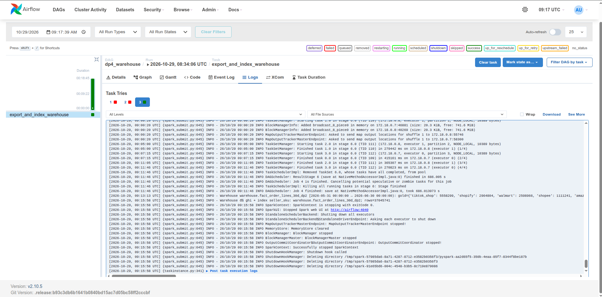
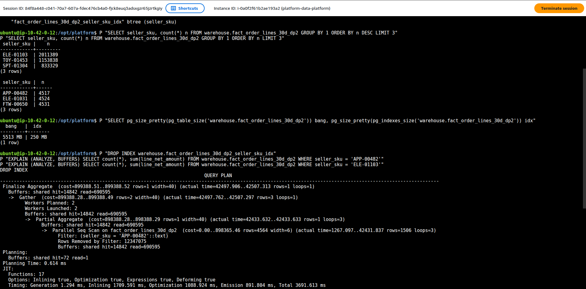
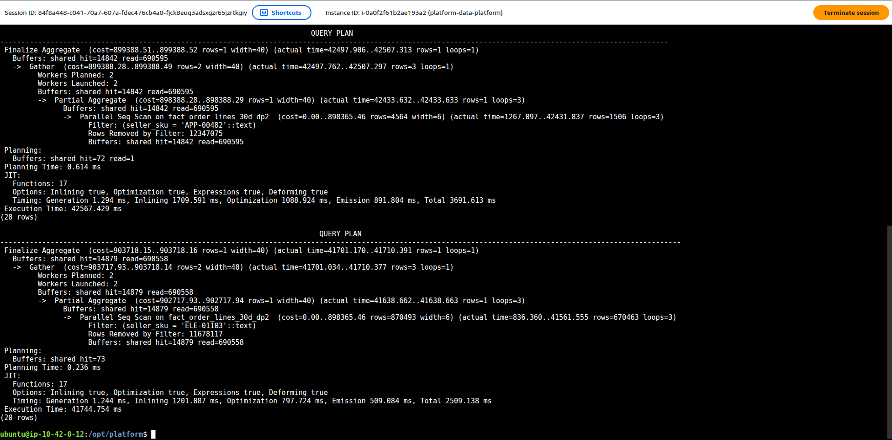
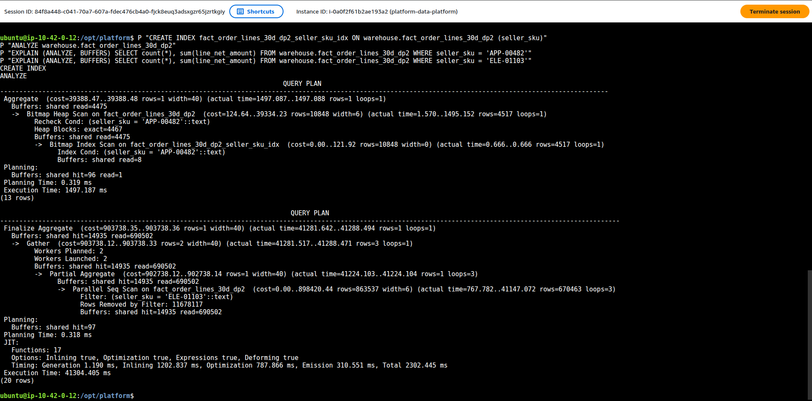

# Data Storage — compaction Iceberg

Cập nhật 2026-10-14. Phần này ghi bằng chứng thực chạy cho `rewrite_data_files`
trên bảng Amazon Bronze toàn kỳ. Code đo và chạy: `spark_jobs/maintenance/inspect_iceberg_storage.py`
và `spark_jobs/maintenance/compact_amazon_order_snapshots.py`. Tài liệu API tương ứng là
[Apache Iceberg 1.11 Spark procedures](https://iceberg.apache.org/docs/1.11.0/spark-procedures/)
và [metadata table `.files`](https://iceberg.apache.org/docs/1.11.0/spark-queries/).

## Chọn bảng bằng metadata, không suy từ số file raw

`/data/raw` có 5.774 JSONL, nhưng sau khi Spark ghi Bronze/Silver, các bảng
DP1/DP2 đang có **một file trên mỗi partition**. Vì vậy chỉ đếm file nhỏ rồi
chạy compaction sẽ không giảm số file: Iceberg giữ nguyên ranh giới partition.

| Bảng | File | Partition | Partition có nhiều file |
|---|---:|---:|---:|
| `bronze.raw_amazon_orders_dp1` | 10 | 10 | 0 |
| `bronze.raw_walmart_orders_dp1` | 20 | 20 | 0 |
| `silver.stg_amazon_order_lines_dp2` | 28 | 28 | 0 |
| `silver.stg_walmart_order_lines_dp2` | 180 | 180 | 0 |
| `bronze.raw_amazon_orders` toàn kỳ, trước compaction | 187 | 180 | 7 |

Bảy ngày Amazon có hai file là 2026-02-23, 05-07, 05-16, 05-18, 06-11,
06-23 và 06-28. Truy vấn đo chỉ quét bảy ngày này:

```sql
SELECT count(*) AS rows, sum(length(payload)) AS payload_chars
FROM lakehouse.bronze.raw_amazon_orders
WHERE export_date IN (
  DATE '2026-02-23', DATE '2026-05-07', DATE '2026-05-16',
  DATE '2026-05-18', DATE '2026-06-11', DATE '2026-06-23',
  DATE '2026-06-28'
);
```

`sum(length(payload))` buộc Spark đọc cột dữ liệu, thay vì trả `count(*)`
từ metadata. Mỗi phía có một lượt làm nóng rồi ba lượt đo cùng câu SQL.

## Kết quả thực chạy

Lệnh `CALL lakehouse.system.rewrite_data_files` dùng bin-pack,
`target-file-size-bytes=134217728`, `min-input-files=2`, và chỉ một nhóm
rewrite đồng thời để vừa RAM laptop. Lệnh báo **12 file được viết lại thành 6
file**, 311.825.996 byte đầu vào, 0 file thất bại, mất 16,088 giây.

| Chỉ số | Trước | Sau |
|---|---:|---:|
| File hiện hành toàn bảng | 187 | 181 |
| Dòng toàn bảng | 108.248.563 | 108.248.563 |
| Byte file hiện hành toàn bảng | 8.525.005.070 | 8.524.986.535 |
| Dòng của truy vấn bảy ngày | 5.757.639 | 5.757.639 |
| Tổng ký tự payload của truy vấn | 4.381.958.279 | 4.381.958.279 |
| Ba lượt quét, giây | 10,511 / 10,348 / 9,451 | 9,641 / 9,405 / 9,066 |
| Trung vị, giây | **10,348** | **9,405** |

Trung vị giảm 0,943 giây, khoảng **9,1%** trên máy này. Số dòng và tổng ký tự
payload trùng khớp trước/sau. Lượt đo sau phải chạy trong Spark session mới vì
phiên đầu bị ngắt sau khi Iceberg đã commit compaction; do đó số giây là quan
sát thực nghiệm, không tách riêng được tác động của cache, tải máy và startup.
Một partition (`2026-06-28`) vẫn có hai file, nên hiện có 181 file thay vì 180.

## PostgreSQL warehouse và index

`spark_jobs/warehouse/export_order_snapshot_lines.py` đã sao chép lát Walmart của
`lakehouse.gold.fact_order_lines_dp2` sang
`sources.warehouse.fact_order_lines_walmart_dp2`. Bảng có **1.875.607** dòng,
khoảng `created_at` từ 2026-01-01 đến 2026-06-29; trước index chiếm **253 MB**.
Chỉ giữ sáu cột cần cho truy vấn để vừa đĩa máy dev. Đây là bản sao của Gold,
không phải một fact đầy đủ năm Channel trong PostgreSQL.

Cùng truy vấn, SKU `FTW-00664` có 211 dòng và tổng tiền net 12.038,74 theo
đồng tiền nguồn:

```sql
SELECT count(*), sum(line_net_amount)
FROM warehouse.fact_order_lines_walmart_dp2
WHERE seller_sku = 'FTW-00664';
```

DDL tạo index dùng cho phép đo dưới đây:

```sql
CREATE INDEX idx_fact_order_lines_walmart_sku
  ON warehouse.fact_order_lines_walmart_dp2 (seller_sku);
```

| `EXPLAIN (ANALYZE, BUFFERS)` | Trước index | Sau index |
|---|---|---|
| Kế hoạch | `Parallel Seq Scan` | `Bitmap Index Scan` → `Bitmap Heap Scan` |
| Dòng lọc / đọc | 211 / 1.875.607 | 211 / 211 khóa index |
| Buffer | hit 15.704, read 16.635 | read 213 |
| `Execution Time` | **51,611 ms** | **1,134 ms** |

Index `idx_fact_order_lines_walmart_sku` trên `(seller_sku)` chiếm **13 MB**;
bảng cùng index là **266 MB**. Đây là hai lần `EXPLAIN ANALYZE` trên cùng máy,
không phải benchmark nhiều lượt; cache có thể khác nhau giữa hai lần. Bằng chứng
mạnh nhất là kế hoạch đã đổi từ quét toàn bảng sang dùng index, và số buffer
đọc giảm rõ rệt.

## Lakehouse trên AWS: gộp file nhỏ bằng partition evolution (2026-10-29)

`maintenance_iceberg` trên `bronze.raw_shopee_orders_dp1` ra **no-op**: bảng chia theo ngày, mỗi ngày đúng
1 file ~2,4 MB, nên `rewrite_data_files` (gộp trong từng partition) không có gì để gộp. Nguyên nhân là
skew kích thước kênh: shopee nhỏ nhất nhưng vẫn chia theo ngày như amazon (gap #16).

[`repartition_small_channel.py`](../spark_jobs/maintenance/repartition_small_channel.py) đổi spec tại chỗ
(`ALTER TABLE … REPLACE PARTITION FIELD export_date WITH months(export_date)`) rồi
`rewrite_data_files(options => map('rewrite-all','true'))`, đo trước/sau, chặn nếu fingerprint đổi:

| | Trước (ngày) | Sau (tháng) |
|---|---|---|
| Số file dữ liệu | 180 | **6** |
| Cỡ trung bình | 2,44 MB | **73,13 MB** |
| Spec đang dùng | 1 | 1 (mọi file đã sang spec mới) |
| `count(*)` cả bảng (trung vị 3 lần) | 1,040 s | **0,286 s** (3,6×) |
| Lọc 30 ngày cuối (trung vị 3 lần) | 7,943 s | **0,968 s** (8,2×) |
| Dòng / fingerprint | 4.689.957 / -2551885948954549477803 | **giống hệt** |

Lọc 30 ngày nhanh 8× vì trước phải mở ~30 file nhỏ (mỗi file một lần đọc footer + request S3), sau chỉ
1–2 file tháng. Đổi lại, lọc đúng một ngày nay phải đọc cả file tháng chứa ngày đó.
Giới hạn: job Bronze `dp1` ghi `createOrReplace … partitionedBy("export_date")`, chạy lại dp1 sẽ trả bảng
về chia theo ngày; đóng hẳn gap #16 cần cho ingest chọn spec theo kênh. Lùi về spec cũ:
`CALL lakehouse.system.rollback_to_snapshot(...)` với `snapshot_before` trong biên lai.

## Warehouse trên AWS: 30 ngày, năm Channel (2026-10-29)

DAG [`dp4_warehouse`](../dags/dp4_warehouse.py) chép 30 ngày trước cutoff (2026-05-31 → 2026-06-30) của
`lakehouse.gold.fact_order_lines_dp2` sang `warehouse.fact_order_lines_30d_dp2` trên PostgreSQL EC2
([job](../spark_jobs/warehouse/export_order_snapshot_lines.py)): **37.045.741 dòng**, bảng **5.513 MB**,
index `(seller_sku)` **250 MB**. Job đối soát số dòng theo Channel với Gold trước khi tạo index.

SKU bị skew mạnh: nhiều nhất `ELE-01103` 2.011.389 dòng (5,4%), ít nhất `APP-00482` 4.517 dòng (0,012%).
Đo bằng `EXPLAIN (ANALYZE, BUFFERS) SELECT count(*), sum(line_net_amount) … WHERE seller_sku = …`,
`DROP INDEX` rồi `CREATE INDEX` + `ANALYZE` trên cùng bảng:

| SKU | Index | Kế hoạch | Buffer đọc | `Execution Time` |
|---|---|---|---|---|
| `APP-00482` (0,012%) | không | `Parallel Seq Scan`, lọc bỏ ~37 tr dòng | 690.595 | **42.567 ms** |
| `APP-00482` | có | `Bitmap Index Scan` → `Bitmap Heap Scan` | **4.475** | **1.497 ms** (28×) |
| `ELE-01103` (5,4%) | không | `Parallel Seq Scan` | 690.558 | 41.745 ms |
| `ELE-01103` | có | **vẫn `Parallel Seq Scan`** — planner bỏ index | 690.502 | 41.304 ms |

- Index chỉ có lợi khi điều kiện **chọn lọc**: SKU hiếm đọc ít hơn ~150 lần trang đĩa.
- SKU phổ biến (5,4%) rải trên gần mọi trang ⇒ đi qua index vẫn phải mở hầu hết trang theo thứ tự
  ngẫu nhiên, nên planner chọn quét tuần tự: đúng hành vi mong đợi, không phải lỗi.
- Sau index `APP-00482` vẫn 1,5 s vì 4.517 dòng nằm trên 4.467 trang (bảng không xếp theo SKU, cache
  lạnh trên EBS). Muốn nhanh hơn: `CLUSTER … USING` index, hoặc index bao (`INCLUDE (line_net_amount)`)
  để chỉ đọc index.

Ảnh EXPLAIN và log được nhúng ở [mục AWS](#trên-aws-2026-10-29).

## Phạm vi phép đo

Tài liệu này ghi compaction Iceberg và chỉ mục PostgreSQL. Phép đối chiếu cùng
câu hỏi giữa Iceberg và warehouse bằng Trino được ghi riêng tại
[trino.md](trino.md); z-order chưa được đo trong bộ bằng chứng hiện có.

## Trên AWS (2026-10-29)

Spark/Iceberg và PostgreSQL chạy Compose trên EC2, dữ liệu lakehouse ở S3.
[Receipt AWS](evidence/aws/data-platform-aws-20261027.json) có `lakehouse_repartition_shopee` và `airflow_dp4_warehouse`;
chi tiết phép đo ở [Lakehouse](#lakehouse-trên-aws-gộp-file-nhỏ-bằng-partition-evolution-2026-10-29)
và [Warehouse](#warehouse-trên-aws-30-ngày-năm-channel-2026-10-29).

Với Shopee, [job partition evolution](../spark_jobs/maintenance/repartition_small_channel.py) đổi ngày → tháng,
rewrite-all: 180 → 6 file; 4.689.957 dòng và fingerprint `-2551885948954549477803` giữ nguyên.
Trung vị ba lần `count(*)` 1,040 → 0,286 s; lọc 30 ngày 7,943 → 0,968 s. Đây là số trong receipt;
chưa có ảnh AWS chụp riêng trước/sau compaction. Maintenance trước đó no-op vì mỗi partition ngày chỉ một file.

DAG [dp4_warehouse](../dags/dp4_warehouse.py), run `manual__2026-10-29T08:34:06.602356+00:00`,
gọi [export và index](../spark_jobs/warehouse/export_order_snapshot_lines.py). Job chép 30 ngày năm Channel,
so count từng Channel với Gold rồi tạo B-tree `(seller_sku)` và `ANALYZE`.
Ảnh dưới cho thấy vấn đề của baseline: lọc SKU hiếm vẫn phải quét cả bảng.









`APP-00482` có 4.517/37.045.741 dòng: trước index Parallel Seq Scan 42.567,429 ms, đọc 690.595 buffer;
sau index Bitmap Index Scan → Bitmap Heap Scan 1.497,187 ms, đọc 4.475 buffer.
Với SKU phổ biến `ELE-01103` (2.011.389 dòng), planner vẫn chọn Seq Scan: index không có lợi khi phải đọc
phần lớn trang. Đây là các lượt EXPLAIN quan sát trên EBS, chưa tách ảnh hưởng cache thành benchmark ổn định.
