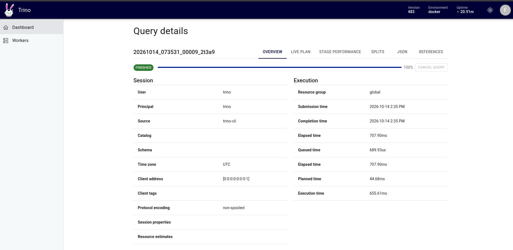

# Trino: truy vấn Iceberg và PostgreSQL trong một phiên SQL

Trino chạy trong profile `query` để tách mức RAM khỏi Spark, Flink và Airflow. JDBC
endpoint mặc định là `localhost:8083`; DBeaver dùng driver Trino, user `platform`,
không bật authentication cho môi trường học cục bộ.

## Hai catalog

- `lakehouse`: Iceberg REST qua Lakekeeper (`http://lakekeeper:8181/catalog`), dữ
  liệu Parquet trên MinIO. Trino dùng native S3 client với path-style access.
- `postgres`: PostgreSQL database `sources`, nguồn của Walmart. Mật khẩu và
  MinIO access key lấy từ environment của Compose; catalog files không giữ bí mật.

## Khởi động và kiểm tra

```bash
docker compose --env-file .env.example --profile query up -d trino
docker compose --env-file .env.example --profile query exec -T trino trino --execute 'SHOW CATALOGS'
docker compose --env-file .env.example --profile query exec -T trino trino --execute 'SHOW SCHEMAS FROM lakehouse'
docker compose --env-file .env.example --profile query exec -T trino trino --execute 'SHOW SCHEMAS FROM postgres'
```

Lần chạy 2026-10-14: Trino 483 ở trạng thái `ACTIVE`. Trino nhìn thấy
`lakehouse.bronze`, `lakehouse.silver`, `postgres.seller` và `postgres.walmart`.
Truy vấn sau đọc **đồng thời** bảng Iceberg và bảng PostgreSQL:

```sql
SELECT s.sku, p.category
FROM lakehouse.silver.stg_walmart_order_lines_dp2 AS s
JOIN postgres.seller.skus AS p ON p.sku = s.sku
LIMIT 5;
```

Kết quả quan sát được:

| SKU | Nhóm hàng |
|---|---|
| `HOM-01833` | `home` |
| `BEA-01612` | `beauty` |
| `ELE-01033` | `electronics` |
| `ACC-00827` | `accessories` |
| `FTW-00571` | `footwear` |

Đây là bằng chứng Trino truy vấn được hai hệ thống trong một câu SQL. Bằng chứng
Novel #1 còn cần phép so sánh thời gian trên cùng câu hỏi và cùng dữ liệu Gold.

## Đối chiếu Gold với warehouse trên cùng Order Line

Ngày 2026-10-14, sau khi Gold năm Channel và lát warehouse Walmart đã được
ghi, một câu SQL Trino đọc **cả hai catalog** cho cùng SKU:

```sql
SELECT src, count(*) AS lines,
       CAST(sum(line_net_amount) AS DECIMAL(18,2)) AS net_amount
FROM (
  SELECT 'iceberg' AS src, line_net_amount
  FROM lakehouse.gold.fact_order_lines_dp2
  WHERE channel = 'walmart' AND seller_sku = 'FTW-00664'
  UNION ALL
  SELECT 'postgres' AS src, line_net_amount
  FROM postgres.warehouse.fact_order_lines_walmart_dp2
  WHERE seller_sku = 'FTW-00664'
) q
GROUP BY src ORDER BY src;
```

| Nguồn | Order Line | Net amount (tiền gốc nguồn) |
|---|---:|---:|
| Iceberg Gold | 211 | 12.038,74 |
| PostgreSQL warehouse | 211 | 12.038,74 |

CLI Trino trả đúng hai dòng trên. Một lượt đo đầu-cuối bằng `/usr/bin/time`
cho câu SQL liên nguồn là **2,16 giây**. Hai câu SQL tương ứng chạy riêng qua
Trino CLI lần lượt là **1,66** và **1,01 giây** (tổng 2,67 giây); đây là một
lượt chạy trên cache hiện tại, không suy ra cải thiện hiệu năng tổng quát.
Điểm khác biệt được chứng minh là một câu SQL/truy vấn thay cho hai câu SQL
và bước ghép kết quả thủ công. Phép đo Novel #1 ở
[`data-integration.md`](data-integration.md).

Ảnh lần chạy 2026-10-14:




Ảnh Trino UI cho thấy một câu SQL `UNION ALL` chạy qua cả hai catalog và kết thúc
`FINISHED`. Ảnh DBeaver cho thấy chính câu SQL đó cùng bảng kết quả: `iceberg`
211 dòng / 12.038,74 và `postgres` 211 dòng / 12.038,74.

## Tài liệu cấu hình

Cấu hình theo tài liệu chính thức của
[Iceberg REST catalog](https://trino.io/docs/current/object-storage/metastores.html#rest-catalog),
[S3-compatible storage](https://trino.io/docs/current/object-storage/file-system-s3.html)
và [PostgreSQL connector](https://trino.io/docs/current/connector/postgresql.html).
